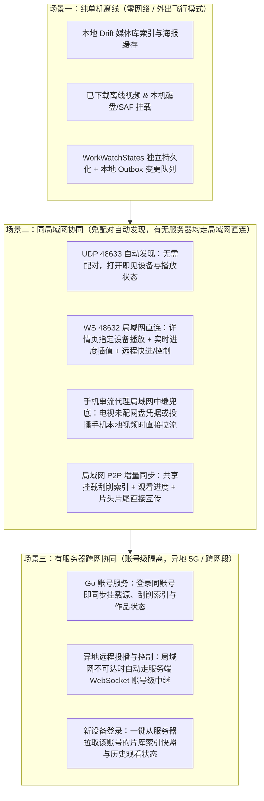
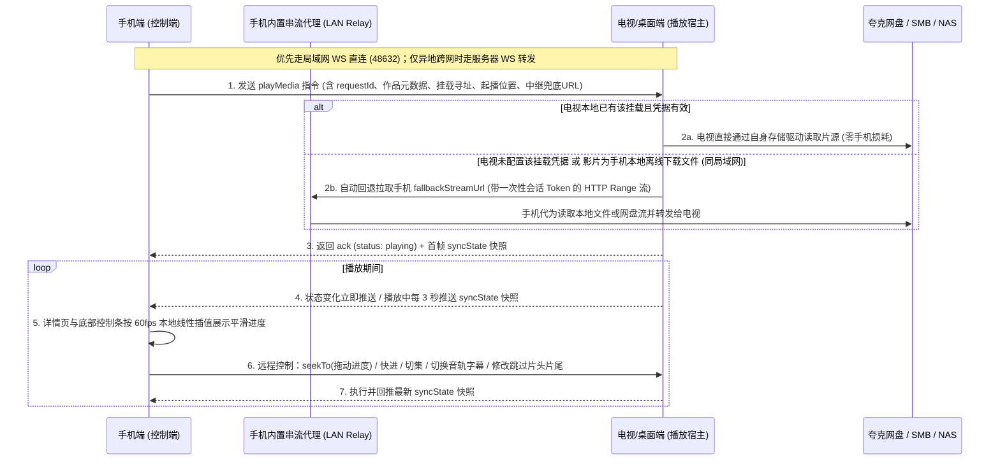
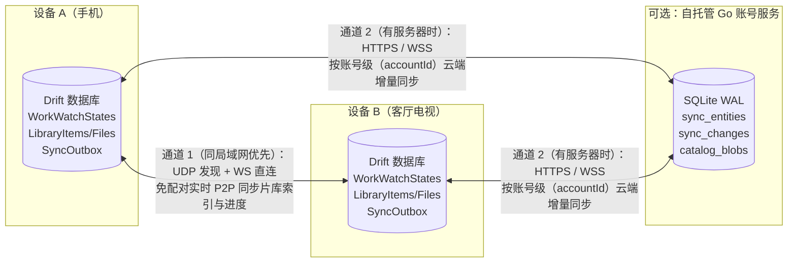

# 多端同步、离线协同与远程投播控制架构计划

> 状态：评审修订稿（尚未实施）。
> 更新日期：2026-11-14（确立「局域网免配对自动发现直连 + 有服务器时按账号级别管理且局域网优先直连」、分层媒体库刮削同步、详情页指定设备播放、局域网串流中继兜底及实时进度控制设计）。
> 基线：[本地媒体库改造计划](fork-plan.md)、[媒体 ID 与作品状态方案](media-identity-and-skip-settings-design.md)、[多端冲突分析与增量架构图](sync-and-cast-conflict-analysis.md)。首版面向自用与自托管，客户端覆盖 Windows、macOS、Linux 和 Android（手机、平板、TV），后续扩展 iOS / iPadOS / tvOS。

---

## 1. 核心目标与连接协同模型

系统坚持**「离线可用、局域网零配置直连、有服务器按账号级协同」**的设计原则：

1. **局域网免配对（Zero-Pairing LAN）**：在局域网内无需任何 PIN 码、扫码配对或繁琐授权。只要设备在同一局域网（同 Wi-Fi 或手机热点），通过 UDP 自动发现即可直接看到目标设备、实时查看其播放进度、在媒体详情页一键指定设备播放、远程快进/拖动进度，并直接通过局域网点对点（P2P）同步已刮削片库与观看状态。
2. **有服务器靠账号级（Account-Level）**：当部署并登录自托管服务器后，以**账号（`accountId`）**作为唯一的信任与数据隔离边界（无需额外的设备配对或跨设备密钥移交）。登录同一账号即可在任意网络下同步片库索引、观看进度并发现同账号设备。
3. **同局域网始终优先直连（LAN-Direct First）**：即便两端都登录了服务器，只要探测到目标设备在当前局域网内可达，投播、进度同步、远程控制、串流中继和片库索引传输**全部直接走局域网连接**，不绕道服务器；仅在异地（如手机在外用 5G）或跨网段广播不通时，才通过服务器通道中转。



### 1.1 发现、控制与同步的路由优先级梳理

| 当前所处环境 | 设备如何发现？ | 控制指令与实时进度怎么走？ | 媒体库索引与观看状态怎么同步？ |
| --- | --- | --- | --- |
| **1. 未登录服务器 + 同一局域网** | UDP `48633` 局域网广播自动发现所有开启接收的设备，**免配对直接使用**。 | 手机与电视通过局域网 WebSocket（`48632`）**直接建连通信**。 | 两端通过局域网 WebSocket **P2P 直接增量同步**。 |
| **2. 已登录服务器 + 同一局域网** | UDP `48633` 广播（携带 `accountId`）与服务器在线列表合并去重（按 `deviceId` 识别同一台设备）。 | **优先走局域网 WebSocket 直连**（毫秒级响应、支持手机局域网串流中继、外网断网不受影响）。 | 增量变更既可通过局域网 P2P 毫秒级直传，也会异步提交到服务器保持云端最新。 |
| **3. 已登录服务器 + 异地/跨网（如在外用 5G）** | 通过服务器 `/api/v1/devices` 与 WSS 获取同账号下的在线设备列表及播放状态。 | 局域网不可达，自动通过**服务器 WSS 通道按账号级路由转发**。 | 通过**服务器 HTTPS / WSS** 按账号游标增量拉取与推送。 |

### 1.2 历史评审问题与修订结论

| 早期计划的问题 | 修订决定与代码依据 |
| --- | --- |
| 局域网遥控要求先登录 `PlexHome` 或繁琐的 PIN/扫码配对 | 彻底移除 [companion_remote_host_controller.dart](../lib/services/companion_remote/companion_remote_host_controller.dart) 对 `PlexHome` 的依赖，且**不做局域网配对拦截**。局域网 UDP 发现即可直接通过 WS 连接控制；有服务器时直接按登录账号（`accountId`）鉴权。 |
| 各端完全独立扫描与刮削共享网盘/NAS | 改为**按存储类型分层同步**（见第 2 节）。夸克/SMB/WebDAV 等共享挂载采用「一端刮削、多端同步索引」，避免多端重复列目录触发夸克风控、解决电视端刮削慢或连不上 TMDB 的痛点，并同步手动匹配锁定结果。 |
| 目标设备未配网盘凭据或投播手机离线视频时无法播放 | 手机指定设备播放时，除发送挂载路径外，支持由手机内置串流代理生成带一次性会话 Token 的**局域网 HTTP Range 中继流**作为兜底，目标设备零配置即可起播。 |
| 遥控仅支持模拟按键，无法查看进度或精准拖动 | 扩展 [RemoteCommand](../lib/models/companion_remote/remote_command.dart) 与 `syncState` 协议，支持语义化指令（`playMedia`、`seekTo`、`setAudioTrack` 等）与「状态快照 + 客户端平滑插值」进度同步。 |
| 把现有 Go 服务直接当作账号服务骨架 | 现有服务承担 Watch Together 房间中继与第三方 OAuth 代理（见 [server/main.go](../server/main.go#L2644)）。复用 Go 与容器工程经验，独立建立轻量的账号与同步服务及 SQLite 存储。 |
| 复杂的跨设备密钥移交（HPKE）与恢复码信封 | 面向自用自托管场景，简化为**账号级权限与 HTTPS/TLS 传输保护**。登录同一账号即可直接读写该账号的同步数据与设备列表，消除新设备登录后还要找老设备扫码解锁密钥的门槛。 |
| 认为现有账号作用域能隔离整个本地库 | [MountRegistry](../lib/storage/mount_registry.dart#L26) 按数据库读取挂载，观看状态以本机 `itemId` 为投影主键（见 [library_tables.dart](../lib/database/library_tables.dart#L158)）。采用独立本地工作区隔离不同账号的数据库、偏好、缓存、下载任务和后台扫描。 |

---

## 2. 媒体库同步模式分析与分层设计（各自刮削 vs 刮削一次多端同步）

### 2.1 为什么不能只靠“各端独立扫描刮削”？

1. **网盘风控与耗时**：夸克网盘、WebDAV 列目录有严格的频控限制。若手机、平板、电脑、电视 4 台设备各自全量扫描数千个文件并请求 TMDB / Bangumi，不仅耗时耗电，还极易触发网盘风控，或因电视端网络环境无法直连 TMDB 导致刮削全部失败。
2. **手动匹配与纠错成本**：用户在手机或电脑上将未匹配或识别错误的条目手动匹配并锁定（[LibraryItems.locked](../lib/database/library_tables.dart#L79)、[LibraryFiles.matchLocked](../lib/database/library_tables.dart#L123)）。若其他设备各自重扫重刮，手动修正无法复用，甚至会出现两端归类不一致。
3. **指定设备即点即播**：用户在手机详情页点击「在电视上播放」时，期望电视立刻起播，而不是等待电视先完成目录扫描和元数据刮削。

### 2.2 三种媒体库同步方案对比

| 评估维度 | 方案 A：各端完全独立扫描刮削 | 方案 B：全量数据库盲目镜像 | **方案 C（选定）：按存储类型分层的「一次刮削、多端复用」** |
| --- | --- | --- | --- |
| **核心机制** | 只同步挂载配置与观看进度；每台设备独立扫盘、独立请求 TMDB/Bangumi | 所有设备强同步整套 `LibraryItems` 与 `LibraryFiles` 表 | **共享网络挂载（Quark/SMB/WebDAV）同步刮削索引快照+增量**；**本机私有磁盘仅本机维护索引** |
| **网盘风控与建库速度** | 差（$N$ 台设备产生 $N$ 倍列目录与刮削请求） | 好（仅 1 台设备请求） | **极佳（主力设备扫一次，其余设备直接导入索引，0 网盘列目录、0 TMDB API 刮削请求，秒级建库；仅展示海报时按需加载图片）** |
| **手动匹配与锁定** | 无法复用（需额外同步匹配规则） | 自动一致 | **自动一致（连同 `locked`、`matchLocked` 与元数据修正一并同步）** |
| **路径有效性** | 高（各管各的） | 差（PC 的 `D:\Movies` 同步到手机/TV 上变成死链） | **高（按 `mountId` 类型隔离：网络源相对路径全端通用，本地路径留在单机）** |
| **传输体积** | 极小（仅几 KB 状态） | 大（若含图片二进制缓存可达数百 MB） | **小（仅同步结构化元数据 JSON + 海报远程 URL/相对路径，1 万部影片压缩后约 2~5 MB）** |

### 2.3 方案 C 的详细落地规则

#### （1）按挂载类型划分同步粒度与「挂载身份归一化」

| 挂载 / 来源类型 | 确定性源指纹 (`canonicalKey`) | 挂载描述与凭据同步 | 文件与刮削索引（Catalog Index）同步 | 作品状态（观看进度 / 片头片尾）同步 |
| --- | --- | --- | --- | --- |
| **Quark（夸克网盘）** | `quark:<uid>:<rootFolderId>` | 同步 `mountId`、名称、`rootFolderId`、勾选/排除目录；局域网/同账号支持一键加密下发登录态，各端独立维护 Cookie 刷新 | **同步**。一端扫描刮削后生成索引包（含 `quarkCheckpoint` 水位线），多端直接导入 | **同步**（按 `local-library` + `tmdb`/`imdb`/`bangumi` 外部 ID） |
| **SMB / WebDAV（NAS/共享）** | `smb://<host>/<share>/<rootPath>` 或 `webdav://<baseUrl>` | 同步 `mountId`、地址、根目录、勾选/排除目录；支持勾选随同账号/同局域网同步凭据 | **同步**。任意一端扫描刮削后生成索引包，多端直接导入映射到本机表 | **同步**（按 `local-library` + 作品外部 ID） |
| **Emby / Jellyfin（媒体服务器）** | `<backend>:<serverMachineId>` | 同步后端类型、名称、地址、`serverMachineId` | **不同步本地索引**（直接使用各服务器自身的媒体库与元数据） | **同步**（按 `emby/<machineId>` 或 `jellyfin/<machineId>` + 作品外部 ID） |
| **本地目录 / Android SAF** | `local:<deviceId>:<pathHash>` | 仅本机保留 | **不同步**（文件仅存于单机磁盘） | **同步**（已刮削作品的进度与片头片尾汇入 `local-library` 作用域） |

> **关键冲突消解——防止多端独立挂载产生重复 UUID**：
> 若用户在未同步前，先在手机上扫码挂载了夸克网盘（生成 `UUID_A`），又在电视上独立扫码挂载了同一个夸克账号的同一根目录（生成 `UUID_B`），两端相遇时通过比对 `canonicalKey`（如 `quark:<uid>:<rootFolderId>`）自动识别为同一物理挂载源，将 `UUID_B` 归并至较早创建的权威 `mountId`，保留电视本机已有的有效登录凭据，消除“同一文件出现两个重复版本”与“投播时无法识别本机已有挂载”的冲突。

#### （2）共享网络挂载的「刮削索引包（Mount Catalog）」结构与防回退法则

针对每个启用同步的共享网络挂载（`mountId`），维护独立的 `catalogVersion`（单调递增游标），同步记录分为两类：

1. **手动匹配锁定规则（`MatchOverrideRecord`，最高优先级）**：
   - 键：`mountId + normalizedPath`（或稳定 `remoteId`，亦支持按文件夹路径批量指定季集/分类）。
   - 值：手动指定的 `kind`、`libraryType`、`provider`（`tmdb` / `bangumi` / `imdb`）、`externalId`、`seasonNumber`、`episodeNumber`、自定义标题/别名及 `locked = true`。
   - 作用：用户在手机上对冷门/未匹配资源完成手动纠错后，瞬间同步至电视与 PC；即便某台设备在本地重新扫描，遇到已有 `MatchOverrideRecord` 的文件也直接套用锁定结果，绝不回退为未匹配。
2. **已刮削目录索引（`MountCatalogSnapshot` & `MountCatalogDelta`）**：
   - **扫描基线水位（解决多端增量衔接冲突）**：内嵌该挂载当前的 `quarkCheckpoint`（即 `rootFolderId:watermark` 服务端时间戳水位线）与完整扫描代际号。接收端（如电视）导入索引包时一并更新本机 `library_scan_states.quarkCheckpoint` 与文件 `seenInScan`，使电视端后续点“刷新”时可直接在此水位线上做 0.1 秒级增量扫描（无需因为本机未跑过全量扫描而重新遍历全盘）。
   - **文件层（对应 `LibraryFiles`）**：`path`、`remoteId`、`size`、`modifiedAt`、`role`（视频/字幕/同目录海报）、`parsed`、`versionLabel`、`language`、已探测的媒体编码信息（`durationMs`, `width`, `height`, `videoCodec`, `hdrFormat`, `streams`）及 `ownerPath`（外挂字幕关联的视频路径）。
   - **作品层（对应 `LibraryItems` + 关联流派/演职员）**：以作品身份或剧集层级组织的元数据（`kind`, `libraryType`, `title`, `sortTitle`, `originalTitle`, `aliases`, `year`, `releaseDate`, `summary`, `rating`, `runtimeMs`, `seasonNumber`, `episodeNumber`, `posterSource`, `backdropSource`, `logoSource`, `tmdbId`, `imdbId`, `bangumiId`, `metadataSource`, `locked`, `genres`, `credits`）。
   - **海报源跨端兼容（防裂图与图片加载兜底）**：
     - **需明确边界**：同步索引省掉的是**网盘列目录**与 **TMDB API 元数据刮削请求**（搜索、拉简介、季集信息）；**设备首次显示海报墙时，仍需请求对应的图片地址（如 `image.tmdb.org` 或镜像域名）下载图片并缓存到本地**。
     - 为防止“手机能看海报、电视直连 `image.tmdb.org` 却裂图”：
       1. 同步包中海报 URL 优先存**标准路径 + 同步源的 TMDB 图片镜像域名配置（`imageBase`）**；同目录本地图片（`mount:<mountId>:<path>`）仅在当前设备可达该 `mountId` 时优先使用，否则回退远程 URL。
       2. **局域网图片缓存兜底**：若电视直连海报 URL 失败且同局域网有手机/PC 在线，可向同伴设备请求已缓存或可代理拉取的海报缩略图并落盘缓存。
   - **本机落库映射与清理**：接收端收到索引包后，按 `mountId + path` upsert `LibraryFiles`，按外部 ID 合并或创建本机的 `LibraryItems`，随后触发 [WorkWatchStates](../lib/database/library_tables.dart#L177-L196) 向 [LibraryUserStates](../lib/database/library_tables.dart#L158-L173) 的投影恢复。当某挂载被移除或文件被删除时，`pruneEmptyTitles()` 级联清理底下已无任何 `LibraryFiles` 视频支撑的空 `episode`、`season` 与 `show/movie`（独立表中的 `WorkWatchStates` 持久保留）。

#### （3）主从协同、扫描租约与状态单调升级法则

- **状态单调升级法则（State Monotonicity Rule，防未配代理设备冲掉已刮削数据）**：
  - 在合并同一文件（`mountId + path/remoteId`）的刮削状态时，严格执行单向优先级：
    $$\text{手动锁定 (matchLocked = true)} > \text{自动已匹配 (matched)} > \text{未匹配 (unmatched)} > \text{待刮削 (pending)}$$
  - 任何情况下，未配置 TMDB Key 或网络不通导致刮削失败的设备（产出 `pending` / `unmatched`），**严禁覆盖**其他设备已经刮削成功的 `matched` 元数据。
- **主从角色与局域网扫描租约（防多端并发扫盘触发网盘风控）**：
  - **TV 端默认策略**：Android TV 等大屏受控端获取到共享挂载时，默认优先拉取局域网同伴或云端的 `MountCatalogSnapshot` 秒级建库，**不主动在后台跑全盘扫描**。
  - **局域网扫描互斥**：当某台设备正在对 `mountId` 执行扫描或刮削时，在局域网广播「正在扫描 `mountId`」状态；同局域网其他设备自动抑制对该挂载的后台定时扫描，直接等待接收扫描完成后的 `MountCatalogDelta`。
- **智能多源择优播放（参考网易爆米花 / Infuse）**：
  - 当同一部电影或同一集在多个挂载源（如家里 NAS 的 SMB 挂载 + 夸克网盘挂载 + 本机离线下载）都有文件版本时，点击「播放」按当前网络可达性自动择优：
    $$\text{本机已下载离线文件} > \text{当前可达的局域网 SMB/WebDAV} > \text{互联网网盘 (Quark)}$$
  - 若用户出门在外使用 5G 流量，家里無公网的 SMB 挂载探测不可达时，播放器自动跳过 SMB 版本、直接起播夸克网盘版本，无需报错中断。

---

## 3. 手机「指定设备播放」与「实时进度/远程控制」架构

### 3.1 局域网免配对发现与账号级融合路由

在现有 [LanDiscoveryService](../lib/services/companion_remote/lan_discovery_service.dart)（UDP `48633`）与 [CompanionRemotePeerService](../lib/services/companion_remote/companion_remote_peer_service.dart)（WebSocket `48632`）基础上，移除旧 `PlexHome` 身份绑定与配对门槛：

1. **设备唯一标识（`deviceId`）**：
   - 每台设备首次启动时生成持久化的 `deviceId`（UUID）和易读的设备名称（如“客厅电视”、“MacBook Pro”，可在设置中修改）。
2. **局域网 UDP 广播（免配对即发现）**：
   - 开启「允许被发现与远程播放」的设备（TV/桌面端默认开启）定期在 UDP `48633` 发送广播信标：
     ```json
     {
       "app": "plezy",
       "v": 2,
       "deviceId": "dev_8f9a...",
       "name": "客厅电视",
       "platform": "android_tv",
       "wsPort": 48632,
       "ips": ["192.168.1.50"],
       "accountKey": "sha256(serverUrl + accountId) 或 null(未登录)",
       "nowPlaying": {
         "state": "playing",
         "workKey": "local-library:show:tmdb:12345",
         "title": "三体",
         "subtitle": "S01E03 · 射手和农场主",
         "positionSec": 740,
         "durationSec": 2700
       }
     }
     ```
   - **可见性与作用域防污染规则（Same-Scope Zero-Pairing）**：
     - **控制与投播可见性**：若手机未登录服务器，展示局域网内发现的所有设备；若手机已登录服务器，优先展示相同 `accountKey` 的设备及局域网内未登录账号的公共设备（如客厅公共电视）。当目标设备**正在播放其他影片**而用户在手机上点播新影片时，弹出轻量确认（“客厅电视正在播放《xxx》，是否切换为《yyy》？”），防止误触打断家人观影。
     - **后台 P2P 数据同步隔离**：局域网后台自动合并片库索引（`mount_catalog`）与观看进度（`work_watch`）时，**严格限制在同作用域（双方均未登录服务器，或双方 `accountKey` 完全相同）**，防止同局域网不同账号（如室友/家人独立账号）之间互相污染观看记录。
3. **连接通道自动择优（LAN Direct 优先，Server Relay 兜底）**：
   - 手机上的设备列表合并「局域网 UDP 发现的设备」与「服务器同账号在线设备」（通过 `deviceId` 归并同一台物理设备）：
     - **当该设备存在局域网 IP 且局域网 WS（`ip:48632`）可达时**：**无条件使用局域网直连**。即使双方都登录了服务器，控制指令、实时进度同步、局域网串流中继和 P2P 数据同步也全部走局域网直连。
     - **当局域网不可达且双方登录了同一服务器账号时**：自动回退使用服务器的 WebSocket（`/api/v1/ws`）按 `(accountId, targetDeviceId)` 转发消息。
4. **挂载凭据一键下发（最大化目标端原生直连，减少手机中继依赖）**：
   - 在局域网发现电视或同步挂载配置时，支持手机端将已配置的 SMB / WebDAV / 夸克挂载凭据通过局域网直连一键下发至目标电视本机安全存储。
   - 电视拥有凭据后，99% 的网盘与 NAS 影片均由电视自身驱动直接读取，手机即使锁屏、关机或离家也不影响电视继续播放。
   - **手机串流中继保活与进度双写**：仅当投播「手机本地离线下载视频」或目标电视确实无凭据时，才启用 `lanRelayFallback`；此时手机自动开启前台保活服务（Foreground Service + WakeLock / Wi-Fi Lock）防止锁屏断流，且电视播放期间通过 `syncState` 将进度实时回写至手机与电视双端的 `WorkWatchStates`。

### 3.2 媒体详情页「指定设备播放（Play On Device）」全链路

当用户在手机上浏览任意电影或剧集详情页时，点击「在指定设备上播放」并选择目标设备（例如“客厅电视”），手机向目标设备发送 `playMedia` 命令。



#### （1）`playMedia` 四层载荷设计

为保证目标设备在**“已同步片库”、“尚未同步片库”、“甚至还没配网盘密码”**三种状态下都能立即起播，`playMedia` 载荷包含以下四层信息：

```json
{
  "requestId": "req_01J9Z8...",
  "work": {
    "sourceKey": "local-library",
    "kind": "episode",
    "provider": "tmdb",
    "externalId": "12345",
    "seasonNumber": 1,
    "episodeNumber": 3,
    "title": "三体",
    "episodeTitle": "第 3 集：射手和农场主",
    "year": 2023,
    "posterUrl": "https://image.tmdb.org/t/p/w500/...",
    "skipSettings": {
      "intro": {"enabled": true, "startMs": 40000, "endMs": 130000},
      "credits": {"enabled": true, "durationFromEndMs": 90000}
    }
  },
  "source": {
    "type": "mount",
    "mountId": "7c9e6679-7425-40de-944b-e07fc1f90ae7",
    "path": "/电视剧/三体 (2023)/Season 1/三体 - S01E03 - 2160p.mkv",
    "remoteId": "fid_987654321",
    "versionLabel": "4K HDR",
    "streamQuality": "original"
  },
  "lanRelayFallback": {
    "enabled": true,
    "videoStreamUrl": "http://192.168.1.25:48634/cast/tok_8f9a2b.../video.mkv",
    "externalSubtitles": [
      {
        "language": "zh-CN",
        "title": "简体中文字幕",
        "url": "http://192.168.1.25:48634/cast/tok_8f9a2b.../sub_0.ass"
      }
    ],
    "expiresAtMs": 1731619200000
  },
  "playback": {
    "startPositionMs": 740000,
    "autoPlay": true,
    "preferredAudioLanguage": "zh",
    "preferredSubtitleLanguage": "zh-CN"
  },
  "seriesQueue": [
    {
      "seasonNumber": 1,
      "episodeNumber": 4,
      "title": "第 4 集",
      "path": "/电视剧/三体 (2023)/Season 1/三体 - S01E04 - 2160p.mkv",
      "remoteId": "fid_987654322"
    }
  ]
}
```

#### （2）目标设备（Host）寻址与起播优先级

目标设备收到 `playMedia` 后，按以下顺序解析片源（使用 `requestId` 去重，防止网络抖动重复起播）：

1. **优先直连挂载源（Direct Mount Read）**：
   - 检查本机 `MountRegistry` 是否存在相同的 `mountId` 且凭据可用。
   - 若可用，直接通过本机存储驱动（Quark / SMB / WebDAV）与本机 `127.0.0.1` 串流代理打开 `path`（规范化路径校验，禁止 `..` 路径越界），**完全不消耗手机电量与无线带宽**。
2. **次选本机同作品已匹配文件（Local Work Lookup）**：
   - 若本机无此 `mountId`，但本机库中存在相同 `WorkIdentity`（同 `sourceKey + provider + externalId + season + episode`）的可播文件或离线下载，自动使用本机已有版本起播。
3. **局域网串流中继兜底（LAN Stream Relay Fallback，同局域网可用）**：
   - 若电视端尚未配置该网盘/SMB 凭据，或用户在手机上点播的是**手机本地下载的离线视频 / 手机本地目录视频**：
   - 电视端直接使用载荷中的 `lanRelayFallback.videoStreamUrl` 起播。
   - 手机端的串流代理为该次投播会话开辟受限路由 `/cast/<ephemeral_token>/...`，支持标准 HTTP `Range` 拖动、Quark 直链自动续期及外挂字幕流转发。宿主播放结束或断开后立即吊销该临时 Token。

### 3.3 实时进度感知与远程控制协议

#### （1）UDP 信标轻量状态广播（未建连即感知）

宿主设备在局域网广播的 UDP `48633` 信标中直接携带 `nowPlaying` 字段：
- 当宿主空闲时：`nowPlaying = null`。
- 当宿主正在播放或暂停时：携带 `{state: "playing" | "paused", workKey, title, subtitle, positionSec, durationSec}`。
- **效果**：用户一打开手机 App，无需任何手动连接操作，首页底栏和对应影片详情页就能在 **1~3 秒内** 自动显示“正在客厅电视上播放”。

#### （2）WebSocket 双向状态同步（`syncState` 快照 + 客户端插值）

一旦手机与宿主建立 WebSocket 会话（用户进入正在播放的影片详情页、点开底部遥控条或发起投播时自动静默建连），宿主通过 `RemoteCommandType.syncState` 推送权威状态快照 `RemotePlaybackState`：

| 字段 | 类型 | 说明 |
| --- | --- | --- |
| `sessionId` | `String` | 当前播放会话 ID |
| `playerState` | `String` | `idle` \| `loading` \| `playing` \| `paused` \| `buffering` \| `completed` \| `error` |
| `workIdentity` | `Object?` | 当前播放作品的 `sourceKey`, `kind`, `provider`, `externalId`, `seasonNumber`, `episodeNumber` |
| `title` / `subtitle` / `posterUrl` | `String?` | 当前播放主标题、副标题（如 `S01E03 · 射手和农场主`）、封面地址 |
| `mountId` / `path` / `versionLabel` | `String?` | 当前播放的具体片源标识与版本标签 |
| `positionMs` | `int` | 采样时刻的播放位置（毫秒） |
| `durationMs` | `int` | 视频总时长（毫秒） |
| `bufferedPositionMs` | `int` | 已缓冲位置（毫秒） |
| `playbackRate` | `double` | 当前播放倍速（如 `1.0`, `1.5`, `2.0`） |
| `volume` / `isMuted` | `double` / `bool` | 当前宿主音量（`0.0 ~ 1.0`）与静音状态 |
| `audioTracks` / `selectedAudioTrackId` | `List` / `String?` | 可选音轨列表与当前选中项 |
| `subtitleTracks` / `selectedSubtitleTrackId` | `List` / `String?` | 可选内嵌/外挂字幕列表与当前选中项 |
| `streamQuality` / `availableQualities` | `String?` / `List` | 当前清晰度档位（如夸克原画/1080p）与可选档位 |
| `activeSkipPrompt` | `Object?` | 当前是否处于片头跳过提示或片尾下一集倒计时窗口 |
| `hostTimestampMs` | `int` | 宿主生成该快照时的单调时钟基准 |

**平滑进度条与省电策略**：
- **事件驱动立即推送**：当发生起播、暂停、恢复、Seek 完成、倍速变化、切集、音轨/字幕切换、缓冲状态变化时，宿主**立即**推送一次 `syncState`。
- **播放中低频心跳**：正常连续播放期间，宿主每 **3 秒** 推送一次轻量位置更新。
- **手机端 60fps 线性插值**：手机 UI 在两次快照之间，当 `playerState == 'playing'` 时，根据公式：
  $$\text{displayPositionMs} = \min\big(\text{durationMs},\ \text{positionMs} + (\text{nowMonoMs} - \text{receivedMonoMs}) \times \text{playbackRate}\big)$$
  在本地实时渲染进度条与时间读数；用户手指拖动手机进度条时暂停本地插值，松手发送 `seekTo` 并等待宿主回传确认帧，做到跟手不跳变。

#### （3）远程控制命令集扩展（`RemoteCommandType`）

在现有 [remote_command.dart](../lib/models/companion_remote/remote_command.dart) 的方向键与基础命令之上，新增面向播放器的精确控制指令（由播放器控制器直接消费，不再单纯模拟空格键）：

| 命令类型 (`RemoteCommandType`) | 参数载荷 (`data`) | 宿主执行行为 |
| --- | --- | --- |
| `playMedia` | 见 3.2 节四层载荷 | 解析片源（直连挂载或回退局域网中继），在指定 `startPositionMs` 起播并加载剧集队列 |
| `seekTo` | `{"positionMs": 1250000, "requestId": "..."}` | 精准跳转到指定毫秒位置，完成后立即回推 `syncState` |
| `seekRelative` | `{"deltaMs": 10000}` 或 `{"deltaMs": -10000}` | 相对当前位置快进/快退（支持手机连点累加，如快进 10s / 30s） |
| `setPlaybackRate` | `{"rate": 1.5}` | 修改播放倍速 |
| `setAudioTrack` | `{"trackId": "2"}` | 切换宿主当前音轨 |
| `setSubtitleTrack` | `{"trackId": "sub_1"}` | 切换宿主当前字幕轨（或关闭字幕） |
| `setStreamQuality` | `{"quality": "original"}` | 切换清晰度档位（如夸克网盘原画/转码档位） |
| `playQueueEpisode` | `{"seasonNumber": 1, "episodeNumber": 4}` | 在同一剧集中直接切换到指定季集播放 |
| `updateWorkSkip` | `{"workKey": "...", "skip": {...}}` | 手机端修改片头片尾区间后实时同步给宿主，宿主播放器立即更新进度条蓝/金标记与跳过规则 |
| `cancelSkipCountdown` | `{}` | 取消宿主当前正在倒计时的片尾跳过/下一集弹窗 |
| `pullPlaybackToController` | `{"requestId": "..."}` | **接力回手机播放**：宿主立即暂停、保存最新 `positionMs` 并返回快照，手机端在本地从该毫秒数无缝续播 |

---

## 4. 易用性与全端交互设计规范

### 4.1 媒体详情页的「设备感知与内联控制」

1. **一键指定设备播放**：
   - 在电影/剧集详情页的主操作区，`[▶ 播放]` 按钮旁常驻 **`[📺 在设备上播放]`** 按钮（当局域网自动发现有设备在线，或云端同账号有在线设备时显示；若只有 1 台在线设备如“客厅电视”，按钮可直接显示 `在「客厅电视」播放`，点击即直接起播，无需多点一层菜单）。
   - 对于电视剧详情页，点击单集右侧的播放菜单或顶部的续播按钮，均支持选择目标设备播放该集。
2. **正在目标设备播放时的详情页动态变形**：
   - 若用户点开的详情页正好是“客厅电视”当前正在播放的电影或剧集：
   - 详情页顶部自动展示醒目的 **「📺 正在客厅电视上播放 · S01E03」实时控制卡片**：
     - 内置实时平滑进度条（可直接左右拖动 `seekTo`）。
     - 快捷按钮组：`[⏪ -10s]`、`[⏯ 暂停/播放]`、`[⏩ +10s]`、`[⏭ 下一集]`、`[💬 音轨/字幕]`、`[✂️ 片头片尾]`。
     - 提供 **`[📱 接力到本机播放]`** 按钮：一键暂停电视并在手机上接着当前秒数继续看（适合从客厅走到卧室/洗手间的场景）。

### 4.2 全局底部「远程播放条（Mini Cast Bar）」

- 只要局域网内发现有设备（或同账号在线设备）正在播放媒体，手机端在首页、媒体库、搜索页底部导航栏上方自动浮现 **Mini Cast Bar**（与音乐 Mini Player 视觉风格统一）：
  - 左侧：作品小海报 + 标题与集数 + 目标设备名（如 `客厅电视 · 正在播放`）
  - 中部/底部：实时进度细条
  - 右侧：`[⏯ 暂停/播放]` 与 `[⏩ 快进]` 快捷按钮
- **点击 Mini Cast Bar 展开「全屏远程控制面板」**：
  - **模式一（媒体控制视图，默认）**：大封面、完整可拖拽进度条（带蓝/金片头片尾标记线）、快进快退、倍速、选集抽屉、音轨/字幕切换、片头片尾时间微调、音量滑块。
  - **模式二（TV 遥控器方向键视图，可一键切换）**：提供 D-Pad 上下左右、确认、返回、菜单、首页按键，方便用户在电视不放片时用手机遥控电视浏览界面。

---

## 5. 局域网 P2P 直连同步与账号级云同步双通道协议

为了让用户在**无服务器**时靠局域网自动同步，在**有服务器**时靠账号级跨网同步，且**同处局域网时直接走局域网高速传输**，两端与服务端共用同一套**基于增量变更日志（Change Log + Version Cursor）的同步数据模型**。



### 5.1 统一同步实体范围

所有同步数据均封装为带确定性 `entityKey` 的逻辑实体：

| 实体域 (`namespace`) | 实体键 (`entityKey`) | 内容概要 | 冲突合并策略 |
| --- | --- | --- | --- |
| `mount_config` | `mount:<mountId>` | 共享挂载类型、名称、地址、根目录、是否启用同步（不含敏感设备绑定凭据） | 按 `updatedAt` + `version` CAS；删除生成墓碑 |
| `server_source` | `server:<backend>:<machineId>` | Emby / Jellyfin 服务器名称、地址列表 | 按 `updatedAt` + `version` CAS |
| `match_override` | `override:<mountId>:<pathHash>` | 用户手动匹配锁定的作品身份、分类与季集映射 | 手动锁定优先，按最新人工操作时间合并 |
| `mount_catalog` | `catalog:<mountId>` | 共享挂载的已刮削文件与作品元数据快照/增量包（按 `catalogVersion` 分块） | 按 `mountId + path` 粒度合并，`locked` 条目不被自动刮削覆盖 |
| `work_watch` | `watch:<stateKey>` | 电影或单集的 `positionMs`、`durationMs`、`watched`、`playCount`、`lastPlayedAt`、`favorite`、`hiddenFromContinue` | 逐集独立实体；按实际最后播放操作时间 `lastPlayedAt` / `updatedAt` 合并（保留主动标记未看与重播语义，不盲目取最大进度） |
| `work_skip` | `skip:<workStateKey>` | 电影或整剧的片头（`startMs`, `endMs`）、片尾（`durationFromEndMs`）与彩蛋保留配置 | 与观看进度分属不同实体，修改跳过设置绝不覆盖观看进度 |

### 5.2 通道一：局域网 P2P 自动增量同步（免配对，有无服务器均可直连）

1. **触发时机**：
   - 手机与电视在局域网通过 UDP `48633` 发现彼此后（若均未登录，或登录了同一 `accountKey`），后台自动建立轻量 WebSocket 同步握手，交换各自的同步水位向量 `PeerSyncWatermark`（`{deviceId: lastSeq}` 及各共享挂载的 `catalogVersion`）。
   - 任一设备在播放过程中更新了进度（暂停、停止播放、切集、标记已看）、修改了片头片尾、或完成了新影片刮削时，直接通过局域网 WebSocket 实时推送给局域网内的同伴设备。
2. **同步流程（即使配置了服务器，局域网内也直接对传大块索引）**：
   - 若手机发现电视缺少某个共享挂载的 `MountCatalogSnapshot` 或最新 `work_watch` 进度，手机直接通过局域网连接将增量或压缩索引块传给电视（局域网吞吐可达几十 MB/s，几千部影片的索引包 1 秒内传完，不占外网与服务器带宽）。
   - 电视落库后更新本地 `LibraryItems`/`LibraryFiles` 与 `WorkWatchStates`，并刷新 `LibraryUserStates` 投影，电视首页的「继续观看」和海报墙立即刷新。

### 5.3 通道二：自托管服务器账号级同步（跨网/异地模式）

当用户配置并登录了自托管 Go 账号服务时，以**账号级别（Account-Level）**管理多端同步与异地设备：

#### （1）工作区与账号隔离
- **工作区隔离**：未登录时使用本机默认工作区；登录服务器账号后，按 `serverUrl + accountId` 使用独立工作区（或首次登录时直接将本机已有挂载、刮削索引与观看状态一键合并上云）。
- **服务不可用无感降级**：当外出无网或自托管服务器临时维护不可达时，客户端继续读写本地工作区数据库，回到家连上局域网依然能和电视直接通过局域网发现、投播与 P2P 同步；待服务器恢复后再把本地 `SyncOutbox` 队列补推上云。
- **登录与鉴权**：账号密码经 Argon2id 校验，下发短效访问令牌与长效刷新令牌。TV 端支持扫码快捷登录（手机已登录同一账号时，扫电视二维码直接确认授权该电视登录同一账号，无需在电视遥控器上输入长密码）。

#### （2）数据安全与凭据边界
- **账号级直接读写（免额外密钥配对）**：服务端通过 HTTPS / WSS 传输，认证上下文严格绑定 `accountId`。同一账号下的所有已登录设备直接共享该账号的 `sync_entities` 与 `catalog_blobs`，新设备登录账号后自动拉取挂载、刮削索引与观看进度，无需老设备在线扫码移交密钥。
- **外部存储凭据处理**：
  - 夸克网盘的 Cookie / PC Ticket / `QuarkPcDevice` 设备指纹与设备强相关，默认保存在各设备本机；新设备同步到夸克挂载与刮削索引后，扫码登录一次夸克即可直连播放（未登录前也可直接通过手机局域网串流中继播放）。
  - SMB / WebDAV 支持用户在添加挂载时勾选「随账号/局域网同步凭据」，开启后新设备或电视无需重复输入 NAS 账号密码即可直接播放。

#### （3）云端写入语义与游标协调
- 每个账号维护单调递增变更序列（`cursor`）。客户端提交携带稳定 `opId`（UUID），服务端对同一 `opId` 幂等去重。
- **局域网 P2P 与云端游标的天然兼容**：每条变更记录都带有全局唯一的 `(originDeviceId, originSeq, opId, updatedAt)`。无论设备 B 是先从局域网 P2P 收到设备 A 的变更，还是后从云端拉取到同一条变更，都会根据 `opId` 与实体 `updatedAt`/`version` 幂等跳过重复应用，绝不会产生冲突或回退。

---

## 6. 自托管服务器架构与运维

### 6.1 部署形态
- **独立 Go 单体 + 本地 SQLite（WAL 模式）**：
  - 在仓库中建立独立于 Watch Together 的轻量账号与同步服务入口及 Docker 容器，内部划分为：`auth`（账号登录、TV 扫码登录、设备会话）、`sync`（账号级实体同步、变更日志与挂载刮削索引块存储）、`relay`（同账号在线设备状态与跨网遥控转发）。
  - 数据库置于宿主机本地持久卷，开启 SQLite `WAL` 与外键约束。

### 6.2 核心表结构与接口边界

| 模块 | 服务端表 | 核心接口 |
| --- | --- | --- |
| **账号与设备** | `accounts`, `devices`, `sessions`, `device_login_codes` | `/api/v1/auth/login`, `refresh`, `logout`, `qr-code`, `qr-confirm`, `/api/v1/devices`（返回同账号在线设备列表与播放状态） |
| **账号级同步与索引块** | `sync_heads`, `sync_entities`, `sync_changes`, `sync_operations`, `catalog_blobs` | `/api/v1/sync/changes`, `push`, `snapshot`, `/api/v1/sync/catalog/:mountId`（共享挂载刮削索引快照读写） |
| **实时通知与跨网中继** | 内存连接表（按 `accountId` 分组） | `/api/v1/ws`（推送账号变更通知、维护同账号设备在线状态、在异地非局域网时转发 `playMedia` / `syncState` / 遥控指令） |

---

## 7. 实施分期与验收路线图

按**「先局域网零配置闭环，后账号级云端扩展」**的顺序分 4 个阶段推进：

| 阶段 | 核心交付内容 | 进入下一阶段前的验收标准 |
| --- | --- | --- |
| **阶段 1：局域网免配对自动发现与详情页「指定设备播放」** | 1. 解耦 `CompanionRemote` 对 `PlexHome` 的依赖，改为基于 `deviceId` 的 UDP `48633` 免配对自动发现（携带 `nowPlaying` 摘要）与 WS `48632` 直接连接。<br>2. 实现 `playMedia` 四层载荷协议与宿主端起播路由（优先本机挂载直连，次选本机同作品，兜底拉取手机内置串流代理 `/cast/<token>`）。<br>3. 在电影/剧集详情页加入「在设备上播放」按钮与设备选择列表。 | 1. 无任何服务器、无任何配对步骤，打开手机即可看到局域网内的电视/PC。<br>2. 手机详情页点击「在电视上播放」，电视已配挂载时直接读源起播；电视未配挂载或点播手机已下载视频时，通过手机局域网串流代理直接秒播并可拖动进度。 |
| **阶段 2：实时播放进度感知、远程控制与接力播放** | 1. 实现 `syncState` 权威状态快照推送 + 手机端 60fps 线性插值进度计算。<br>2. 扩展 `seekTo`、`seekRelative`、`setPlaybackRate`、`setAudioTrack`、`setSubtitleTrack`、`playQueueEpisode`、`updateWorkSkip`、`pullPlaybackToController`。<br>3. 实现详情页「正在目标设备播放」内联控制卡片、全局底部 `Mini Cast Bar` 与全屏遥控面板。 | 手机打开即在底栏和详情页实时看到电视播放进度；拖动手机进度条电视立即精准跳转；支持手机远程快进、切音轨/字幕/下一集、实时修改片头片尾，支持一键「接力回手机播放」。 |
| **阶段 3：局域网 P2P 片库刮削索引与观看状态自动同步** | 1. 实现共享网络挂载（Quark/SMB/WebDAV）的 `MountCatalogSnapshot` / `Delta` 导出与导入，以及 `MatchOverrideRecord` 手动匹配锁定记录。<br>2. 在同一局域网发现的设备间，自动通过局域网 WS 增量同步 `work_watch`、`work_skip`、`mount_config` 与 `mount_catalog`。 | 手机或 PC 扫描刮削完夸克/SMB 网盘后，局域网内的电视无需扫描网盘、无需请求 TMDB，几秒内自动同步获得完整海报墙、分类与手动匹配结果；两端观看进度与已看集数在局域网内实时自动同步。 |
| **阶段 4：自托管 Go 账号服务与跨网同步/异地控制** | 1. 实现独立 Go 账号与同步服务（SQLite WAL）、密码登录与 TV 扫码登录。<br>2. 将阶段 3 的增量同步与刮削索引快照接入账号级云端存储。<br>3. 实现「同局域网优先走 LAN 直连、异地不可达时自动走服务端 WSS 中继」的融合路由。 | 1. 登录同一账号后，在外使用 5G 流量看片或刮削，回家后电视自动同步最新进度与片库；异地可通过服务器远程查看和控制家里设备。<br>2. 当手机和电视同在家中局域网时，即使登录了服务器，投播、控制与索引传输仍直接走局域网连接。 |
