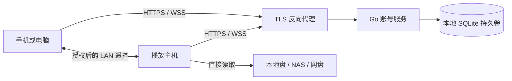

# 账号登录、多端同步与远程遥控架构计划

> 状态：评审修订稿，尚未实施。同步数据范围更新于 2026-11-12。
> 基线：[本地媒体库改造计划](fork-plan.md)。首版面向自托管，客户端范围沿用 Windows、macOS、Linux 和 Android（含 TV）。

## 1. 范围与评审结论

保留单机播放器。用户可以离线启动、浏览本地索引、播放可访问的片源。登录后可选择同步媒体来源、作品状态和授权遥控。自托管服务处理账号、设备、密文和短期控制消息，播放设备自行访问本地磁盘、NAS 或网盘。跨网投放指的是让目标设备播放它能访问的片源。

按最新需求，业务同步范围收敛为添加的媒体来源，以及来源内已刮削作品的观看进度、已看状态和片头片尾配置。电视剧按季集保存观看状态并统计已看集数。未刮削入库或缺少明确作品 ID 的条目完成匹配后才参与作品配置保存和同步。具体身份规则采用 [媒体 ID 与作品状态方案](media-identity-and-skip-settings-design.md)，默认本地库在账号范围内共用，Emby/Jellyfin 按服务器隔离。下文早期评审条目保留背景，实施范围以本段及第 3 节为准。

| 原计划的问题 | 修订决定与代码依据 |
| --- | --- |
| 把现有 Go 服务当作账号服务骨架 | 现有服务承担 Watch Together 房间中继、日志/海报和第三方 OAuth 代理，使用房间快照与独立文件存储。复用 Go、容器和网络工程经验，单独建立账号服务及存储。见 [路由](../server/main.go#L2644)、[OAuth 代理](../server/oauth.go#L171)、[部署](../server/docker-compose.yml)。 |
| 把设置导出白名单直接当成在线同步白名单 | 导出兼容性与实时同步分开管理。每个同步键指定类型、作用域、缺省值、版本和运行时效果。例如「始终保持侧边栏展开」具有桌面默认值，首版归设备本地。见 [设置定义](../lib/services/settings_service.dart#L884)、[导出服务](../lib/services/settings_export_service.dart)、[设置生效逻辑](../lib/services/settings_mutation_service.dart#L223)。 |
| 认为现有账号作用域能隔离整个本地库 | [MountRegistry](../lib/storage/mount_registry.dart#L26) 按数据库读取挂载，观看状态以本机 `itemId` 为主键。首版采用独立本地工作区，覆盖数据库、偏好、缓存、下载任务和播放/扫描后台任务。见 [观看状态表](../lib/database/library_tables.dart#L158)。 |
| 用客户端时间戳或整条记录覆盖解决冲突 | 采用实体版本校验和账号游标。凭据轮换单独控制并发。现有 [updateSecret](../lib/storage/mount_registry.dart#L57) 实际读取后重新 upsert 整条记录，接入同步前先修复这一竞争窗口。 |
| 复用夸克票据并承诺免扫码 | 首版夸克凭据和 PC 设备指纹留在本机。先验证不同终端能否独立授权、能否解析同一目录，再决定是否同步夸克挂载描述。见 [PC 设备存储](../lib/storage/drivers/quark_pc_device_store.dart)。 |
| 把登录密钥、同步密钥和遥控密钥绑在一起 | 分离账号登录、同步解密与遥控授权。服务端签发的种子无法支撑“服务端失陷仍无法伪造遥控”的承诺。现有 [遥控身份来源](../lib/providers/companion_remote_provider.dart#L298) 仍依赖旧后端。 |
| 把挂载删除等同于所有观看记录删除 | 外键明确级联删除挂载对应的文件和扫描状态。观看状态关联的是媒体条目，其存续还取决于孤立条目清理。凭据失效、设备停用与账号级删除分别处理。见 [库表](../lib/database/library_tables.dart#L97)。 |

## 2. 工作区、账号与设备

- 未登录进入游客工作区。每个服务地址与账号组合使用独立工作区目录和设置命名空间，分别保留 Drift 数据库、索引、凭据引用、同步队列和下载归属。切换时先暂停旧工作区写入、关闭驱动和遥控、隔离后台下载回调，再打开新工作区。服务地址改变视为切换账号命名空间。
- 首次登录展示可导入清单，确认后复制选中的媒体来源及已识别作品状态。默认保留双方记录，可由用户选择绑定到同一挂载。游客库、本地路径和下载可继续在游客工作区使用。远端已有数据时按正常版本协议合并。重复导入用持久化映射和操作 ID 保证幂等。
- 服务暂时不可用时使用已解锁的本机工作区。显式退出时立即停止同步与遥控并清除会话，默认锁住账号工作区，可另选清除本机副本并提示未上传修改。退出和切换均不提交账号删除操作。远程吊销在设备联网后执行，本机已解密数据无法保证远程抹除。
- 首版账号由管理员通过本地管理命令创建，关闭公开注册。密码经独立 Argon2id 校验。初始配置采用短效不透明访问令牌（建议 15 分钟）和按设备轮换的不透明刷新令牌（建议 30 天），数据库只存令牌摘要。客户端串行刷新。检测到旧刷新令牌重用时撤销该设备令牌族并重新授权，响应丢失也按此路径恢复。HTTP 每次鉴权检查设备和会话状态，WS 在撤销时断开并在授权到期前重新连接。
- 设备记录由服务端在授权成功时建立，包含账号、安装实例、名称、平台、公钥及能力。请求中的设备 ID 和能力声明仅供识别和展示，权限从认证会话与服务端授权记录判定。设备列表区分已注册、在线、已授权遥控和正在播放。
- TV 扫码按设备授权流程设计。高熵 `device_code` 只给发起端轮询，用户短码独立、短效、限尝试。手机展示设备名和核验码并显式确认，兑换原子化且一次性。采用可退避的短轮询，区分待授权、拒绝、过期和减速。扫码登录后进入待解锁状态，单独确认同步密钥和遥控授权。参照 [RFC 8628](https://www.rfc-editor.org/rfc/rfc8628.html) 和 [RFC 9700](https://www.rfc-editor.org/rfc/rfc9700.html)。

## 3. 数据归属与凭据

| 数据域 | 首版策略 |
| --- | --- |
| SMB / WebDAV | 显式开启后同步加密挂载描述（类型、名称、地址、根目录）。每端独立填凭据或关联已有挂载，先验证连接再启用扫描。自签证书信任、本机网络覆盖和扫描计划留在设备。 |
| 夸克 | 同步媒体源描述和所选目录身份。新端独立登录并确认访问相同账号下目录后启用。Cookie、PC Ticket、设备指纹与刷新留在各端。 |
| Emby / Jellyfin | 同步服务器来源描述，通过后端类型和服务器 machine ID 确认来源，各端完成所需登录。 |
| 本地盘、SAF | 可同步来源描述，路径及 SAF 授权在目标设备上重新关联。 |
| 应用设置与刮削设置 | 由各设备保存，包括全局跳过片尾延迟。 |
| 库与媒体 | 扫描索引、海报和下载各端维护。同步已识别电影或整剧的作品身份、片头片尾配置和观看状态。集级状态按整剧身份与季集编号保存，已看集数从各集汇总。目标设备尚未入库时保留收到的作品状态，入库后匹配。 |
| 跨端外部凭据 | 延后到安全存储、换钥、撤销和驱动兼容性通过验收。优先评估 SMB/WebDAV 的显式凭据共享，每个凭据为独立实体。 |

凭据过期时原地重登，保留挂载 ID 和根目录。驱动刷新携带打开连接时取得的本地凭据代号，只在代号仍一致时原子更新凭据列，避免旧连接覆盖重新登录后的值。未来共享凭据使用独立 CAS 版本，冲突后保留服务器接受的版本并提示重新验证，禁止用本机时间戳仲裁。用户主动删除同步挂载时先确认影响，其他设备收到墓碑后停止新扫描和新播放，按挂载禁用标记隐藏；正在进行的播放可结束，索引清理由独立操作和保留策略决定。

## 4. 同步加密与协议

### 4.1 密钥生命周期

- 可信客户端随机生成同步主密钥。首台设备初始化密钥和加密数据，新设备从已解锁的设备授权，或用独立高熵恢复码解锁已备份的密钥信封。账号密码重置只恢复登录，恢复码单独保管。全部可信设备和恢复码丢失时，仅允许在明确确认后新建同步代际，旧密文保留供用户恢复或清理。
- 设备间移交采用受支持的加密库和 [HPKE](https://www.rfc-editor.org/rfc/rfc9180.html)。批准端通过扫码或双方可核验的绑定信息确认接收端公钥指纹，避免只相信服务端返回的公钥。信封绑定服务身份、账号、接收设备、配对请求和密钥代际，并具备短有效期与一次性消费。仅输入用于登录的短码不会授予解密能力。
- 同步记录用经审核的 AEAD 实现封装，包含算法、协议版本、密钥代际、随机 nonce 和密文。附加认证数据绑定账号、命名空间、实体 ID、操作 ID、基准版本和操作类型。完整加密配置值、路径和显示名，服务端只可见账户、路由标识、版本、时间和大小等元数据。服务端可拒绝、遗漏或延迟数据，客户端记录已接受的代际和高水位，恢复流程处理回退；首版不提供跨设备一致性证明。
- 本机长期密钥和令牌放系统安全存储。当前 [CredentialVault](../lib/services/credential_vault.dart#L175) 的密钥保存在偏好里，只能说明现有凭据如何落盘。平台无可用安全存储时用恢复码或可信设备在需要时解锁，不自动降级到普通偏好。完成实际 Windows、Linux、macOS、Android TV 安全存储验证后再启用对应能力。
- 普通设备退出撤销会话与授权。怀疑密钥泄露时，用剩余可信设备建立新密钥代际，重新加密当前快照并换发恢复信封；旧代际写入被拒绝。旧设备持有的历史数据及第三方凭据需分别处置，第三方凭据必要时到源站撤销。

### 4.2 存储和写入语义

每个账号有独立变更序列。媒体来源使用已有挂载 UUID 或稳定服务器身份。作品数据的实体键由来源、媒体类型、外部 ID 及对应字段组确定，单集状态再包含季集编号，采用统一编码。记录实体版本、模式版本、最后提交游标、墓碑与密文。服务端维护当前实体、变更日志和已处理操作。每次写入由客户端提交稳定的 `opId` 和 `expectedVersion`，创建使用版本 0。服务器按账号串行提交同一批次中的操作，每项独立返回成功、冲突或验证失败。分配账号游标、写实体、追加日志和记录幂等结果在同一事务提交。相同操作 ID 与内容返回原结果，同 ID 不同内容拒绝。PostgreSQL 版本也须锁住账号序列行至提交，避免高游标先可见导致漏读。作品身份等敏感路由信息在加密实现中使用账号内稳定的不透明键，具体编码在传输实现时确定。

挂载描述和凭据是不同实体。设置按键更新。遇到版本冲突，先拉取并保存双方版本；能基于共同基线合并互不重叠字段时由客户端合并，否则保留待处理草稿并提示用户。已删除记录不能由旧更新复活。恢复需用户确认并使用新实体 ID，清理历史数据时保留已退役 ID 或通过代际重建切断旧写入。

### 4.3 离线、重试和恢复

1. 对同步字段，以 Drift 内的本地同步状态和 outbox 为权威，业务变更与入队同一事务。SharedPreferences 作为投影，启动时补做未完成投影。远端写入也走同一投影机制，带来源标记，避免重复上传。热生效失败保留可重试任务，允许需重启的设置延后生效。
2. 拉取使用 `GET /api/v1/sync/changes?cursor=…`，返回分页记录、页尾游标、固定本轮高水位和下一页标记。客户端将已应用记录或待解锁、待升级的密文连同游标一起持久化，禁止因版本未知而静默丢弃。完成本轮后提交 outbox，遇到冲突按上节处理。网络失败退避并重试同一操作 ID。冲突、待解锁和失败可在界面查看。
3. WSS 只发高水位通知，漏通知由启动、回前台、重连或低频定时补拉恢复。提交成功后才允许通知。无需为了通知本身引入持久消息队列。
4. 服务端压缩日志后，对过期游标返回 `resync_required`。全量快照必须对应固定高水位，分页使用短期快照令牌，落盘后再拉其后变更。本机重建云端镜像并保留 outbox，逐条重新校验或人工解决，禁止盲目重放过期删除或覆盖。变更日志、操作回执与墓碑回收窗口应与离线支持窗口一并配置，超窗设备必须先重建基线。
5. 服务端从旧备份恢复时生成全新的同步历史标识并要求重新拉取。游标、快照令牌与写入请求均绑定历史标识，旧历史的写入先拒绝，再由客户端重建基线。历史标识独立于加密密钥代际，恢复时仅按实际密钥状态解锁或换钥。若客户端曾观察到更高游标，显示可能回退并保留本机副本与未确认操作，用户可导出或确认恢复。

## 5. 服务器架构与运维

### 5.1 部署形态与选型

| 形态 | 取舍与决定 |
| --- | --- |
| 独立 Go 单体、SQLite、单实例 | 首版。建议在仓库中新建独立账号服务入口和容器，内部划分账号、同步、设备与 WSS。借鉴现有 HTTP 限流、可信代理和有界写队列，独立定义认证、路由及持久化。存储置于宿主机本地持久卷，SQLite 开启 WAL 和外键，配置写入等待时间并保持事务短。WAL 依赖同主机共享内存，NAS 可在其本地磁盘运行服务，数据库文件不挂在 SMB/NFS 上。 [SQLite WAL](https://www.sqlite.org/wal.html) |
| 在现有 Watch Together 进程直接加路由 | 初期少一个容器，但账号权限、备份生命周期和网络故障会与房间中继及第三方 OAuth 耦合。现有 WebSocket upgrader 允许任意 Origin，账号路由需独立策略。现有房间快照也不能承担账号事务。 [旧 WS 配置](../server/main.go#L93) |
| PostgreSQL 加多个 Go 实例 | 当实测写锁等待、恢复时间、并发连接或可用性超出单机预算时进入评估。先完成数据迁移、事务/游标一致性与备份演练，再引入跨实例设备路由、在线状态 TTL 和通知总线。迁移需验证账号、权限、密钥代际、幂等记录与游标，不能视为替换一个驱动。 |

### 5.2 数据与接口

| 服务边界 | 记录和接口 |
| --- | --- |
| 账号与设备 | `accounts`、`devices`、`sessions`、`device_grants`。提供 `/api/v1/auth/login`、`refresh`、`logout`、`device-code`、`device-confirm`、`device-token` 与设备列表/吊销。账号和设备从认证上下文解析，查询与唯一约束包含账号边界。 |
| 同步 | `sync_heads`、`sync_entities`、`sync_changes`、`sync_operations`、`key_envelopes`。提供 `/api/v1/sync/changes`、`snapshot`、`push` 与独立密钥信封操作。限制每页、单条、批次和账号总量。任何归属、版本或额度检查失败均有结构化错误。 |
| 实时连接 | `/api/v1/ws` 承载在线状态、同步通知和后续遥控密文。在线状态由当前连接和心跳维护，可异步记录粗粒度 last-seen。中继授权与连接绑定，使用短期会话、消息尺寸限制和有界队列；慢连接断开，通知可合并，控制请求失败返回可辨识状态。 |

### 5.3 上线配置与恢复

- TLS 由反向代理终止。应用端口只暴露给代理，可信转发头只接受指定代理网段。WS 在升级时鉴权，令牌使用请求头，浏览器来源使用明确允许列表，原生客户端走独立无 Origin 的认证路径。禁止在访问日志中记录令牌、请求密文、遥控帧和配对码。
- 登录、配对、同步和遥控分别设置每 IP、账号和设备额度。限制密码校验并发、请求体、连接数和输出队列。配置服务启动健康与数据库就绪探针，观测登录失败率、数据库写入等待、同步冲突与滞后、WS 队列压力、磁盘增长、备份年龄。旧 compose 的 128 MiB 限制不作为新服务容量结论。
- 使用 SQLite 在线备份机制将数据库和必要的部署配置备份到独立位置。不要在服务运行时只复制主数据库文件。升级前备份并检查迁移。恢复演练覆盖旧备份回档、会话全部吊销、同步代际更新和客户端重建。账号恢复码由用户保管。家庭部署初始目标可设每日备份（RPO ≤ 24 小时）、两小时内恢复（RTO ≤ 2 小时），实测后确认。 [SQLite 在线备份](https://www.sqlite.org/backup.html)
- 上线前按目标硬件测量批量同步、设备断线重连、同时登录、慢 WS、数据库故障、磁盘写满和备份恢复。记录写入 P95、内存峰值、文件增长和遥控往返时间，再决定容量与是否拆出中继。

## 6. 遥控与选片投放

1. 先交付 LAN 遥控，复用 [LAN 发现](../lib/services/companion_remote/lan_discovery_service.dart)、[连接和消息机制](../lib/services/companion_remote/companion_remote_peer_service.dart)、接收端命令映射与 UI。抽出身份和传输接口。现有 UDP 48633、首选 WS 48632 作为兼容入口。宿主主动启用，首次在主机确认控制器，后续使用已配对身份。LAN 已配对设备在账号服务不可达时可继续使用。
2. 遥控采用独立设备密钥和配对授权，认证需绑定双方设备公钥、角色、协议版本和会话，并使用经评审的认证密钥交换与 AEAD 实现。会话方向分别维护密钥/计数器，拒绝重放。局域网与 WAN 都验证同一配对身份。账号服务器可以撤销在线权限；离线 LAN 主机必须能本机取消配对，联网后同步撤销。远端吊销无法立即通知离线宿主。
3. WAN 后续发布且单独开关。先尝试 LAN，超时再申请服务端短效通道；服务端校验同账号、双方在线、宿主允许 WAN 及设备权限。端到端认证通过后才执行指令。一条通道建立成功后关闭另一候选。主机休眠、被系统暂停、离线或无法读源时返回明确状态。遥控请求过期后丢弃，禁止离线排队执行。
4. 选片投放优先用同步挂载 ID 与规范化相对路径，目标端按已有驱动和库权限解析并防止路径越界。外部 ID 仅用于本机索引候选，影视类型、季集与版本不唯一时请求用户确认。命令不接受任意 URL、绝对路径、原始凭据。用请求 ID 去重并返回已接收、播放成功或失败；断线后不可盲目重复起播。快照在状态变化时推送，播放进度低频采样，按会话发给当前控制器。

## 7. 分期与验收

| 阶段 | 交付 | 进入下一阶段前的验收 |
| --- | --- | --- |
| 0：本地基线及解耦 | 真机验证本地浏览与播放，梳理工作区、后台任务和旧后端依赖；为遥控抽出身份接口，修复挂载凭据刷新竞争。 | 单机启动、扫描、播放正常；切换工作区时旧回调无法写入新账号；旧刷新不能覆盖新凭据或配置。 |
| 1：账号、授权、备份 | Go 单实例、管理员建号、设备会话、电视设备码、密钥移交与恢复。 | 测试过期码、重复兑换、串号、换号、远程吊销、错配公钥、密钥丢失及数据库恢复。Android TV 与桌面各至少一台真机验证。 |
| 2：媒体源同步 | 挂载及服务器来源描述、各端授权、离线 outbox、增量与快照、冲突处理。 | 来源 ID 恢复一致，目标端完成授权后可访问。覆盖重试、长离线、删除后重连和旧客户端兼容。 |
| 3：遥控与选片 | 先 LAN 基本控制，再选片投放，最后可选 WAN 密文中继。 | 覆盖跨 VLAN、无网、挂起、撤销、错误来源和同命令重试。相同请求至多启动一次播放，宿主只读已有合法片源。 |
| 4：作品状态同步 | 按来源和作品外部 ID 同步片头片尾及观看状态，逐集保存进度与已看标记。 | 两端不同本地条目 ID 可匹配同一作品，已看集数正确。覆盖重扫、未刮削条目、重播、清除配置及同集进度冲突。 |

[fork-plan.md](fork-plan.md) 阶段 6 已与本计划对齐。按 2026-11-12 修订，先完成本地播放器真机验收，再提取并验证通用遥控、工作区和本地媒体导航；保留 Emby / Jellyfin 作为可选媒体来源，以及它们所需的 Profile 绑定和多服务器管理。连接配置归入「媒体来源」，侧栏每台服务器独立入口，首页最近添加仍按服务器、媒体库分别展示。Plex 暂时停用，保留已有配置和实现。刮削设置独立于媒体来源。Watch Together 与追踪器暂缓接入本地版，后续独立评估。
