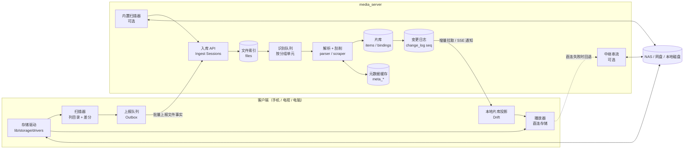
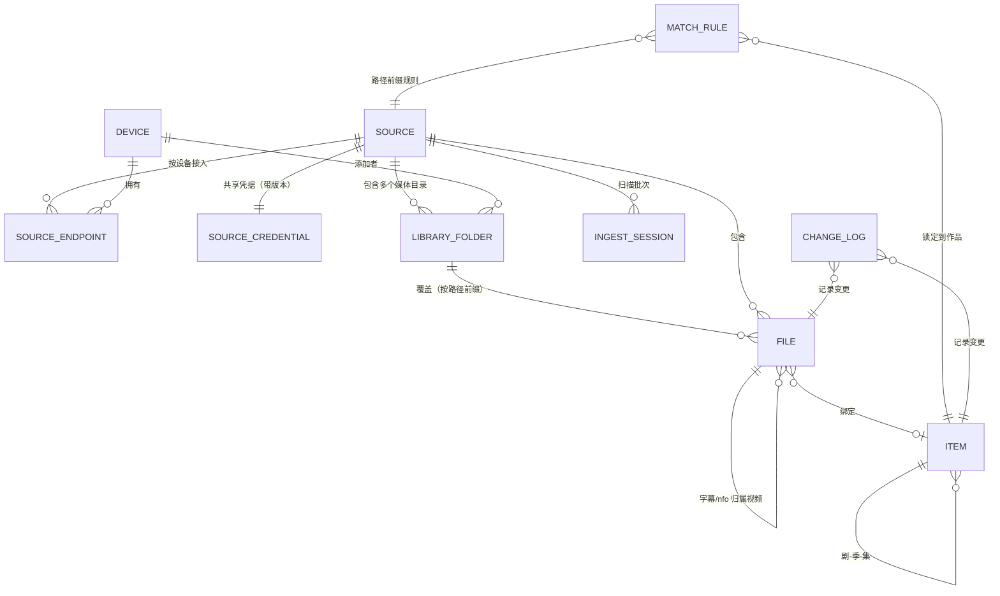
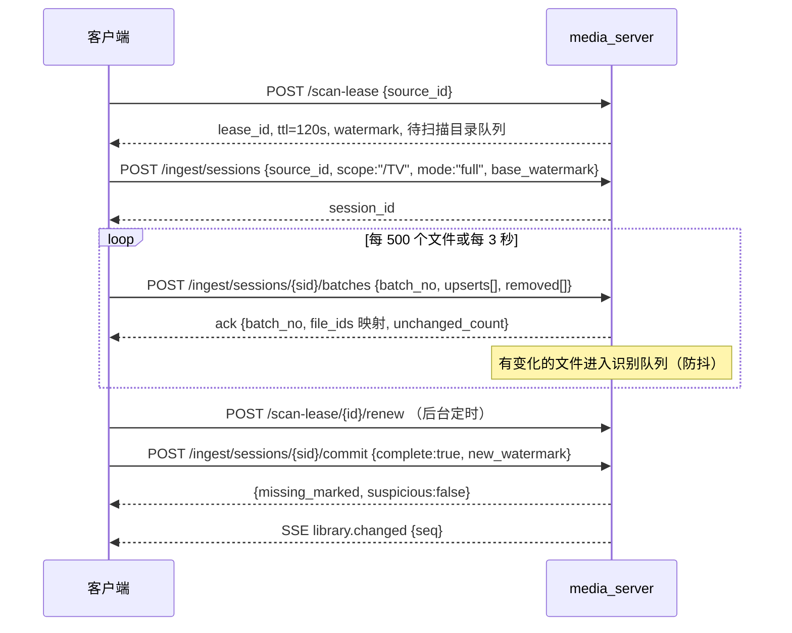
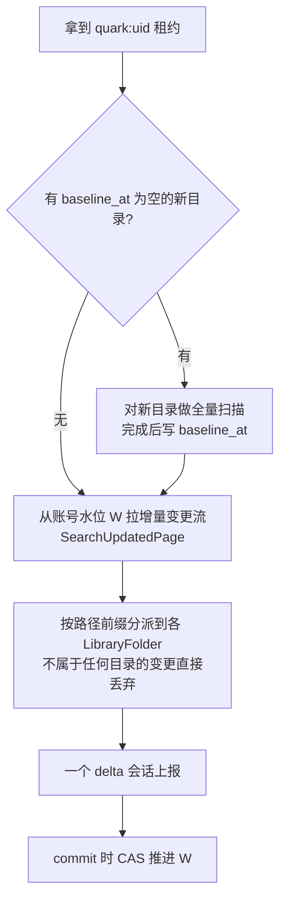
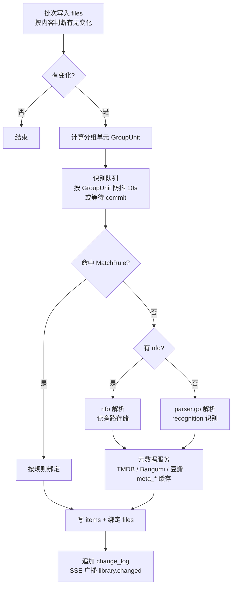
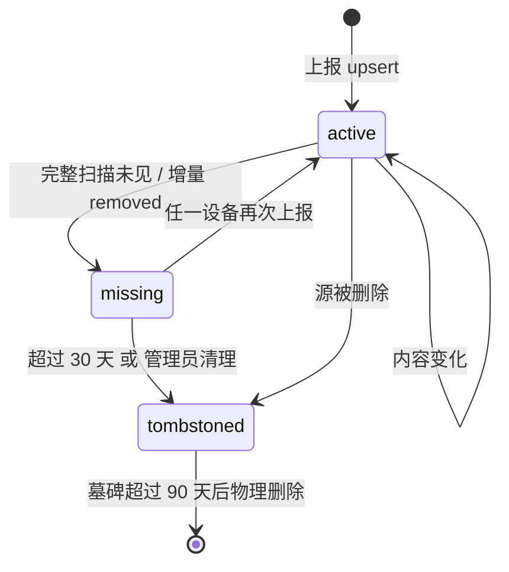
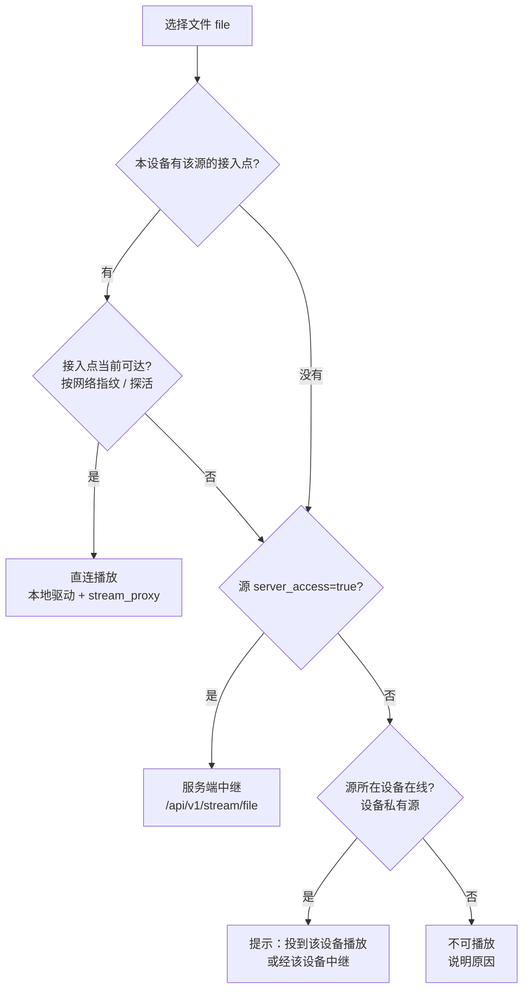
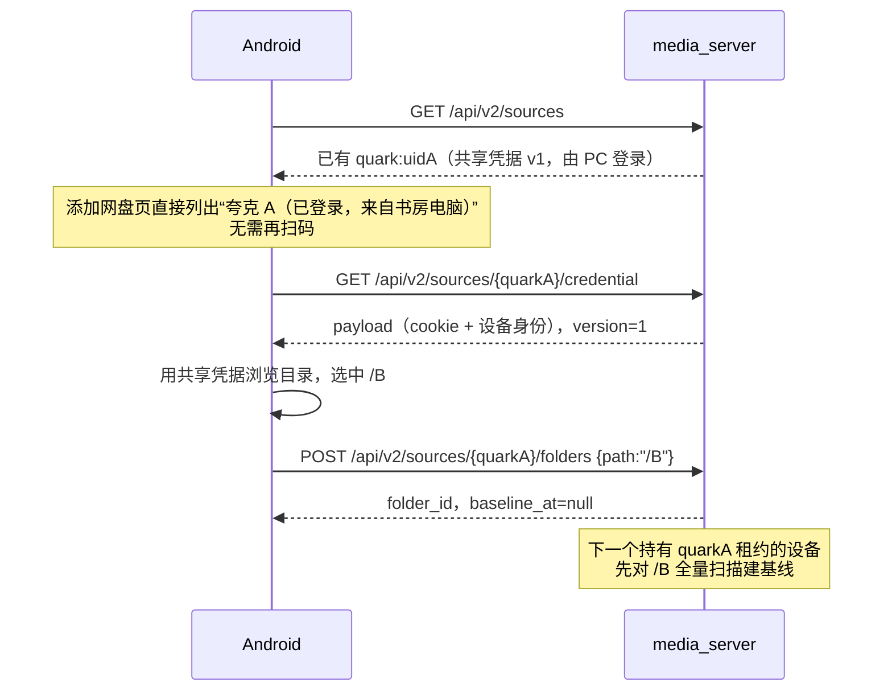

# 客户端扫描 + 服务端刮削入库：媒体库同步机制重构方案

> 状态：设计草案（待评审）　｜　日期：2026-11-20
> 涉及模块：`media_server/`（Go）、`lib/library/`、`lib/storage/`、`lib/ttplay/`（Flutter）
> 关联文档：[cross-platform-sync-whitepaper.md](./cross-platform-sync-whitepaper.md)、[server-sync-and-remote-control-design.md](./server-sync-and-remote-control-design.md)、[sync-and-cast-conflict-analysis.md](./sync-and-cast-conflict-analysis.md)、[media-identity-and-skip-settings-design.md](./media-identity-and-skip-settings-design.md)
>
> **V1 实施范围与取舍见 [v1-library-server-refactor-plan.md](./v1-library-server-refactor-plan.md)**：V1 移除了服务端扫描与中继播放，提前实现多用户，且不做设备接入点和设备私有源。两者冲突时以实施计划为准。

---

## 0. 一句话结论

**列文件交给客户端，认作品交给服务器。**

- **客户端**负责连接存储源、列目录、增量扫描、读取轻量旁路文件（nfo、字幕、本地海报），把**文件信息**分批上报，播放时**直接**读取存储源。
- **服务端**负责解析文件名、分组、刮削、手动匹配、元数据缓存和入库，只有服务端能**写作品身份**。它把整理好的片库以**增量变更流**下发给所有设备。
- 服务端**默认不碰视频内容**。服务端自己能访问的源（例如部署在 NAS 上），由**服务端内置扫描器**以「特殊客户端」身份接入同一条上报管道，所以现有能力不会丢。

---

## 1. 背景：我们走过的两条路

| 代 | 架构 | 主要问题 |
|---|---|---|
| G1（已删除） | 每个客户端各自扫描、各自刮削，通过 `sync_server` 同步 works/files（`sync_mapper.dart` 约 4.5k 行） | 多端都在写作品身份：刮削结果互相覆盖，需要“刮削状态单调升级”等大量冲突规则；弱网设备容易把数据写回旧状态；同一作品出现多个 `work_key`，整个映射层越来越复杂 |
| G2（当前） | `media_server` 全包：挂载凭据、扫描（`scanner.go`，夸克增量、fsnotify）、刮削（`scraper.go`）、串流代理（`/api/v1/stream/file`） | 服务器**必须能访问存储**。公网 VPS 访问不到家里的 SMB，也访问不到手机或电脑本地磁盘；夸克风控针对服务器 IP 和设备指纹；视频经服务器中转，带宽成本高、延迟大；NAS 部署门槛高 |
| **G3（本方案）** | 客户端扫描上报 + 服务端集中刮削 + 客户端直连播放 | 见下文 |

G3 吸收两代的教训：

- 来自 G1：**作品身份只能有一个写入方**（服务器），客户端只写自己能确认的**文件事实**。这样 G1 的大部分冲突规则不再需要。
- 来自 G2：刮削逻辑（`parser.go` / `scraper.go` / `recognition.go` / `metadata/*`）、元数据缓存和管理 UI 集中在服务端，**全部复用**。

---

## 2. 目标与非目标

### 2.1 目标

1. 用户在**任意客户端**添加媒体源（本地目录、SMB、WebDAV、夸克等），在该设备上扫描。扫描结果会上传到服务器，由服务器统一刮削入库。
2. 同一账号的所有设备看到**同一个片库**：海报、分组、匹配修正、观看进度保持一致。
3. 播放**优先直连**，不经过服务器。只有直连不可用时才走中继（服务器或其他设备）。
4. 支持**设备私有源**，例如电脑 D 盘、手机下载目录：元数据可以共享，播放地址只在源所在设备上有效。
5. 多端同时扫描、重复添加同一个源、重命名或移动目录、离线扫描后补传、客户端版本不一致，这些情况都要有确定的结果。
6. 服务端**仍然可以**作为扫描方，用于部署在 NAS 上、能直接访问存储的场景，并与客户端扫描共用同一条入库管道。

### 2.2 非目标（本期不做）

- 服务端转码。
- 跨账号共享片库（家庭多用户放在 §11 规划，不在首期）。
- 局域网 P2P 片库同步（G1 已移除，不恢复）。

---

## 3. 总体架构



### 3.1 职责边界（单写者原则）

| 数据 | 唯一写入方 | 其他方 |
|---|---|---|
| 媒体源定义（名称、类型、规范键） | 服务端（客户端发请求，服务端去重后落库） | 只读 |
| 源的设备接入点（凭据、内网地址、本机挂载路径） | 拥有该接入点的设备 | 其他设备按共享策略读取 |
| 文件事实（路径、大小、mtime、remote_id、旁路文件） | 当前持有扫描租约的设备，或服务端内置扫描器 | 只读 |
| 文件技术参数（编码、分辨率、音轨） | 扫描端轻探测；**实际播放端**上报权威值 | 只读 |
| 作品身份、文件到作品的绑定、元数据 | **仅服务端**（自动刮削或管理员手动匹配） | 只读 |
| 观看进度、收藏、片头片尾偏好 | 执行操作的设备 | 服务端合并，沿用现有 LWW 与单调规则 |

> [!IMPORTANT]
> 客户端**不再**向服务器写 `work_key`、标题、TMDB ID 等身份字段。客户端可以附带解析提示（`client_hints`），但服务器只把它当参考。这是 G3 与 G1 的根本区别。

---

## 4. 数据模型

### 4.1 概念关系

数据分三层：**存储源（Source，谁的盘 / 哪个账号）→ 媒体目录（LibraryFolder，盘里哪几个文件夹进片库）→ 文件（File）**。凭据挂在存储源上，扫描范围挂在媒体目录上，两者互不绑定。详见 §4.7。



### 4.2 Source（媒体源）：替代现有 `mounts`

一个 Source 是“一个存储源的逻辑身份”，与具体从哪个设备、用什么地址访问无关。

| 字段 | 说明 |
|---|---|
| `id` | 服务端生成的 UUID，永久不变 |
| `canonical_key` | 规范键，用于去重，沿用 `DeterministicKeys.canonicalSourceKey`：`smb://host/share`、`webdav://…`、`quark:<uid>`、`local:<device_id>:<root>`。**网盘的 uid 是强身份；局域网地址只是中等证据**（IP 会变，不同家庭的 IP 会重复），局域网源的最终判定以 §4.8 为准 |
| `identity_marker` | 标记文件中的 `source_id`（局域网源），或 SMB ServerGuid，可为空 |
| `kind` | `local` / `smb` / `webdav` / `quark` / … |
| `scope` | `shared`（账号内共享）或 `device_private`（只属于某台设备） |
| `owner_device_id` | `device_private` 时必填 |
| `incremental_watermark` | 夸克等支持增量的源的水位，**按存储源（账号）级别保存在服务端，所有设备和所有媒体目录共享**，见 §5.7 |
| `credential_mode` | `server_managed` / `e2ee` / `device_only`，见 §9 |
| `server_access` | 服务端能否直接访问（决定内置扫描和中继是否可用） |
| `created_at` / `updated_at` / `deleted_at` | 删除采用软删除 |

> [!NOTE]
> `local` 类型源的规范键**必须带 `device_id`**。两台电脑都有 `D:\Movies`，它们不是同一个源。
>
> 网盘类源的规范键**只到账号**（`quark:<uid>`），不带目录。同一个夸克账号下无论挂了几个目录、从几台设备挂，都只有**一个** Source。“挂哪些目录”由 §4.7 的 LibraryFolder 表达。这一点与 `DeterministicKeys` 现有注释“One account/origin maps to one mount (directories belong in includePaths)”一致。

### 4.3 SourceEndpoint（设备接入点）：解决“同一个 NAS，不同设备访问方式不同”

现实中同一份数据常有多种访问方式：

- 电脑把 NAS 挂成 `Z:\Media`，走本地文件系统。
- 手机用 `smb://192.168.1.10/media`。
- 户外设备用 WebDAV 公网地址 `https://nas.example.com:5006/media`。

这三者**应当是同一个 Source**，否则同一部电影会出现三份。

| 字段 | 说明 |
|---|---|
| `source_id`, `device_id` | 联合主键；`device_id = '*'` 表示所有设备通用的默认接入点 |
| `access_kind` | 实际使用的驱动，可以和 Source 的 `kind` 不同（例如 Source 是 smb，电脑用 local 驱动访问 `Z:\`） |
| `root_on_device` | 源根目录在该设备上的位置，例如 `Z:\Media` 或 `/media` |
| `config` / `secrets` | 地址、用户名、加密后的凭据 |
| `network_scope` | `lan` / `wan`；`lan` 时记录网络指纹（网关 MAC / SSID 哈希），用来判断当前是否可达 |
| `priority` | 同一设备有多个接入点时的顺序 |

**所有文件路径都是相对源根目录的规范化路径**（沿用 `normalizeMountPath`：POSIX 分隔符、NFC、去掉 `.` 和 `..`）。不同接入点上报的路径因此天然一致。

### 4.4 File（文件索引）：扩展现有 `media_files`

| 字段 | 说明 | 来源 |
|---|---|---|
| `id` | 服务端自增或雪花 ID，在上报回执中返回给客户端 | 服务端 |
| `source_id` + `path` | 唯一键 | 客户端 |
| `remote_id` | 夸克 fid 等，在源内唯一；有值时**优先用它做身份**，目录重命名后仍能保持绑定 | 客户端 |
| `role` | `video` / `subtitle` / `nfo` / `artwork` | 客户端初判，服务端复核 |
| `owner_file_id` | 字幕或 nfo 归属的视频 | 服务端计算 |
| `size`, `mtime_s`, `ctime_s` | **mtime 统一截断到秒**，避免 SMB 与本地文件系统精度不同导致反复变更 | 客户端 |
| `fingerprint` | 可选，`size + 首尾各 64KB 的 xxhash`，用于识别移动或重命名，以及跨源判断是否同一文件 | 客户端（仅局域网源、仅视频） |
| `media_spec` | 时长、编码、分辨率、HDR、音轨和字幕轨 JSON | 客户端探测或播放端上报 |
| `sidecar_ref` | nfo 正文哈希，以及服务端旁路存储中的位置 | 客户端上传 |
| `state` | `active` / `missing` / `tombstoned`，见 §6.5 | 服务端 |
| `match_state` | `pending` / `identifying` / `matched` / `unmatched` / `ignored` | 服务端 |
| `item_id` | 绑定的作品或单集 | 服务端 |
| `last_seen_session` / `last_seen_at` / `reported_by_device` | 用于删除推导和排查问题 | 服务端 |

### 4.5 MatchRule（匹配规则）：手动修正跟着目录走

G2 的手动匹配只作用于单个 item。用户修正“这个文件夹是《葬送的芙莉莲》第 1 季”后，新下载的第 29 集会被重新识别，可能识别错误。G3 新增规则表：

| 字段 | 说明 |
|---|---|
| `source_id` + `path_prefix` | 规则作用的目录 |
| `action` | `bind_work`（锁定到某作品，可指定季号偏移）/ `ignore`（不入库）/ `force_kind` |
| `target` | `provider:kind:id` + `season_offset` |
| `created_by` / `created_at` | 管理信息 |

识别流水线先查规则（**最长前缀优先**），再走自动刮削。

### 4.7 LibraryFolder（媒体目录）与 SourceCredential（共享凭据）

#### 为什么要把“目录”从“源”里拆出来

典型场景：

- PC：挂载本机 `E:\Videos`，同时挂载夸克账号 A 的 `/A`。
- Android：挂载本机 `/sdcard/Movies`，同时挂载**同一个夸克账号 A** 的 `/B`。
- 希望夸克 A 的凭据**只登录一次，多端共用**。

如果把“目录”作为 Source 的一部分（每挂一个目录就是一个源），会出现三个问题：

1. 同一个夸克账号变成两个源、两份凭据。一端刷新 cookie 后，另一端的副本失效。
2. 夸克的增量接口是**整个账号**的变更流（`SearchUpdatedPage`，参见 `scanner.go` 的 `scanQuarkIncremental`）。两个源各拉一遍等于重复请求，还各自维护一份水位。
3. 如果 `/B` 将来被移动到 `/A/B` 下面，或者两个目录有嵌套，同一个文件会以两个源的身份出现两次。

所以拆成：**Source = 账号命名空间 + 共享凭据；LibraryFolder = 该账号下进入片库的子目录**。文件路径一律**相对账号根目录**，与从哪个目录挂进来无关。

#### LibraryFolder 字段

| 字段 | 说明 |
|---|---|
| `id` | UUID |
| `source_id` | 所属存储源 |
| `path` | 相对存储源根目录的规范化路径，例如 `/A`、`/B` |
| `exclude_paths` | 该目录下要排除的子目录 |
| `library_hint` | `auto` / `movie` / `show` / `anime` |
| `added_by_device` | 是哪台设备添加的（只用于展示和管理，**不限制访问**） |
| `visibility` | `account`（默认，所有设备片库都显示）/ `device`（只在添加设备的片库中显示，其他设备不显示也不扫描） |
| `scan_policy` | `auto`（任何持有租约的设备都可以扫描）/ `owner_only`（只由添加设备扫描）/ `manual` |
| `baseline_at` | 首次全量扫描完成时间；为空表示该目录还没有基线，**不能参与增量**（见 §5.7） |

规则：

- **嵌套与重叠**：新增目录如果是已有目录的子目录，服务端直接提示“已包含在 `/A` 中”，不新建；如果是已有目录的父目录，提示合并，把子目录的规则（排除项、刮削提示）迁移过来后删除子目录。这样一个文件只属于一个媒体目录，`library_hint` 不会冲突。
- **删除目录**只把该目录前缀下的文件转为 `missing`，不影响同一账号下的其他目录，也不影响凭据。
- 本地类源（PC `E:\Videos`、Android `/sdcard/Movies`）同样用 Source + LibraryFolder 表达，只是 Source 的 `scope=device_private`，每台设备各有一个。

#### SourceCredential（共享凭据）

| 字段 | 说明 |
|---|---|
| `source_id` | 一对一 |
| `mode` | `server_managed` / `e2ee` / `device_only`，见 §9 |
| `payload` | 加密后的凭据。夸克 PC 会话需要**连同设备身份（`utdid` + `machine`）一起存**，见 §9.3 |
| `version` | 单调递增，每次写入加 1，用于 CAS |
| `updated_by_device` / `updated_at` | 最后更新者 |
| `status` | `valid` / `expired` / `kicked`；任一设备发现失效时上报，其他设备据此提示重新扫码，而不是各自盲目重试 |

### 4.8 源身份判定与添加冲突处理

#### 4.8.1 添加源一定经过服务端吗？

**在线时一定经过，离线时不一定。** 所以设计上不能假设“添加时就能挡住所有重复”，必须同时具备“事后合并”和“误合并后拆分”的能力：

| 时机 | 机制 |
|---|---|
| 在线添加 | 客户端先 `POST /api/v2/sources/resolve` 提交身份证据，服务端返回“已存在 / 疑似存在 / 新源”，用户确认后才创建。服务端在**同一事务**内检查并插入。强身份（网盘 uid、标记文件 ID、ServerGuid）建唯一约束，两台设备同时添加也只会成功一个，另一个收到 409 后自动转为“添加接入点”；局域网地址**不建唯一约束**，否则两个家庭里相同的 `192.168.1.10` 会被强制视为同一个源（见 L8） |
| 离线添加 | 客户端先建一个**临时源**（本地 UUID，标记 `provisional`），可以正常扫描和播放，扫描结果进入 Outbox。联网后先走同样的 resolve 流程：判定为已存在则**合并**（服务端把临时源的文件重新挂到已有源下，按路径去重，Outbox 中的临时 ID 由回执映射替换）；判定为新源则直接转正 |
| 事后发现重复 | 后续扫描拿到更强的身份证据（例如读到标记文件）时，服务端提示“这两个源看起来是同一个”，由用户确认合并 |
| 误合并 | 合并操作记录在 `source_merges` 表中，保留原接入点和路径映射，支持一键**拆分**还原 |

> [!IMPORTANT]
> 原则：**强证据自动合并，弱证据只提示，不确定时宁可分开。** 分开的最坏结果是片库里出现重复条目，可以随时合并；误合并的结果是两个不同的盘被当成一个，扫描时会把对方的文件判为缺失。因此误合并的风险更高，必须靠强证据。

#### 4.8.2 身份证据分级

| 级别 | 证据 | 适用 | 判定 |
|---|---|---|---|
| **强** | 网盘账号 ID（夸克 `uid`，从 cookie 或账号接口获取） | 网盘 | 相同即同一源，自动合并 |
| **强** | 标记文件 `/.ttplay/source.json`（首个添加设备在根目录写入 `source_id`，可写时才写，用户可以关闭） | SMB / WebDAV / 本地挂载的 NAS | 读到相同 `source_id` 即同一源，自动合并。**这是区分局域网设备唯一可靠的办法** |
| **强** | SMB 服务器 GUID + 共享名（SMB2 协商时返回 ServerGuid，前提是驱动能拿到） | SMB | 相同即同一源 |
| 中 | 规范化地址：主机（IP 或主机名，统一小写）+ 共享名或 WebDAV 路径 + 用户名 | SMB / WebDAV | 还要看网络：**同一网络指纹**（网关 MAC 哈希）下自动合并并通知用户；**不同网络**下只提示，因为两个家庭里都可能有 `192.168.1.10` |
| 弱 | 根目录列表指纹：抽样若干一级、二级目录名和视频文件大小，计算相似度 | 任意 | 相似度高时提示“可能是同一个存储”，必须用户确认 |
| 无 | 没有任何匹配 | — | 新源 |

本地目录（`local:<device_id>:<path>`）天然按设备区分，**永远不会与其他设备的本地目录合并**。唯一的例外是映射的网络驱动器，见下表 L7。

#### 4.8.3 场景清单

**网盘类**

| # | 场景 | 判定依据 | 处理 | 风险与兜底 |
|---|---|---|---|---|
| N1 | PC 已添加夸克 A，Android 再添加夸克 A（同一账号） | uid 相同（强） | 不新建源；如果 Android 扫码得到了新 cookie，以 CAS 写入凭据新版本；Android 选择的目录作为新 LibraryFolder | 无 |
| N2 | PC 和 Android **同时**首次添加夸克 A | uid 相同 + 唯一约束 | 一个创建成功，另一个收到 409，自动转为“使用已有源 + 添加目录” | 无 |
| N3 | Android 离线时添加夸克 A，PC 早已添加 | 联网后 resolve：uid 相同 | 临时源合并到已有源，文件按路径去重，播放进度按作品延续 | 合并前两端各有一份，属于短暂重复，不丢数据 |
| N4 | PC 添加夸克 A，Android 添加夸克 B（不同账号） | uid 不同 | 两个独立源，凭据各自管理 | 无 |
| N5 | 用户在已有的“夸克 A”源上重新扫码，却登录了账号 B | 新 cookie 的 uid ≠ 源的 uid | **拒绝覆盖**，提示“这是另一个夸克账号”，询问是否作为新源添加 | 防止用 B 的凭据覆盖 A，导致 A 的目录全部变成缺失 |
| N6 | 同一夸克账号，两端选的目录嵌套（PC `/影视`，Android `/影视/动漫`） | 同一源 + 路径前缀 | 提示“已包含在 `/影视` 中”，不新建目录 | 无 |
| N7 | 共享凭据已失效，Android 想添加新目录 | 凭据状态 `expired` | 引导扫码，扫出的 uid 必须与源一致（同 N5），然后刷新凭据并继续添加 | 无 |

**局域网类（SMB / WebDAV）**

| # | 场景 | 判定依据 | 处理 | 风险与兜底 |
|---|---|---|---|---|
| L1 | PC 添加 `smb://192.168.1.10/media`，Android 添加完全相同的地址 | 标记文件或 ServerGuid（强）；没有时看地址 + 同一网络（中） | 自动合并为一个源，Android 只新增接入点 | 无 |
| L2 | PC 用 IP `192.168.1.10`，Android 用主机名 `nas.local` 或 `DS920` | 地址字符串不同；标记文件或 ServerGuid 相同 | 自动合并 | 没有强证据时，弱证据（列表指纹）提示用户确认，不会自动合并 |
| L3 | 同一台 NAS 的**不同共享**（PC 加 `/media`，Android 加 `/movies`） | 标记文件不同，或共享名不同 | 两个独立源 | 无。它们本来就是两个存储 |
| L4 | 同一共享的**不同子目录**（PC 加 `/media/电影`，Android 加 `/media/剧集`） | 共享相同（强或中） | 一个源，两个媒体目录 | 无 |
| L5 | 同一台 NAS，PC 用 SMB，Android 用 WebDAV | 协议、地址都不同；标记文件相同（强） | 合并为一个源，两个接入点。WebDAV 的根目录可能与 SMB 共享根目录不同（例如 `/dav/media` 对应共享根目录），接入点记录**根目录偏移** | 没有标记文件时只能靠弱证据提示，需要用户确认，并由用户确认路径对应关系 |
| L6 | 户外用 WebDAV 公网地址添加家里的 NAS | 标记文件相同（强） | 合并，接入点标记 `network_scope=wan` | 同 L5 |
| L7 | PC 把 NAS 映射成 `Z:\`，然后以“本地目录”添加 | Windows 下可以把映射盘解析成 UNC 路径 `\\nas\media`，再读标记文件 | 自动识别为网络共享，归入对应的 SMB 源，接入点类型为 local | 解析不了时作为本地目录处理；之后读到标记文件再提示合并 |
| L8 | **两个不同家庭**（自己家和父母家）的 NAS 都是 `192.168.1.10/media`，同一账号 | 地址相同，但网络指纹不同，标记文件不同 | **不合并**，作为两个源 | 这是最需要防止的误合并。没有标记文件且网络指纹不同时，只提示，不自动处理 |
| L9 | NAS 的 IP 因 DHCP 变化（`.10` 变成 `.23`） | 标记文件或 ServerGuid 不变 | 同一源，只更新该设备接入点的地址 | 没有强证据时，用户在接入点里改地址即可，源和文件不变 |
| L10 | 换了一台新 NAS，把数据拷过去，地址不变 | 标记文件随数据一起拷贝时视为同一源；没拷时 ServerGuid 不同 | 拷贝了标记文件：同一源，文件按路径对上；没拷：提示“看起来是新存储”，询问是替换还是新增 | 替换时走源的“迁移”流程，按路径和指纹重新绑定 |
| L11 | 同一 WebDAV 服务，PC 用账号 admin，Android 用账号 guest | 用户名不同，看到的根目录可能不同 | 默认两个源；如果标记文件相同（两个账号看到同一个根目录），合并 | 权限不同的账号可能只看到部分目录，合并后用 guest 扫描可能把 admin 才能看到的文件判为缺失。所以**扫描时只对该接入点可见的范围推导删除**，见下方补充 |
| L12 | 共享是只读的，无法写入标记文件 | 只能用 ServerGuid、地址或列表指纹 | 按中、弱证据规则处理 | 宁可分开，之后由用户手动合并 |

**本地与混合**

| # | 场景 | 处理 |
|---|---|---|
| M1 | PC 加 `E:\Videos`，Android 加 `/sdcard/Movies` | 两个设备私有源，永不合并 |
| M2 | 同一个 U 盘先插 PC、再插 Android（OTG） | 默认两个本地源；如果 U 盘上有标记文件，提示“这是同一个移动硬盘”，用户确认后作为一个源（`scope=removable`），两台设备各有接入点 |
| M3 | 同一部电影，PC 本地有一份，NAS 上也有一份 | 不同源、不同文件，在**作品层**聚合为多版本，播放时按 §7.3 择优 |
| M4 | 用户删除了源，之后又重新添加 | 软删除期内按身份证据恢复原源，文件和绑定立即回来 |

#### 4.8.4 补充：多接入点下的删除推导

一个源有多个接入点，各接入点可能权限不同（L11）或根目录偏移不同（L5），所以 §5.1 的“缺失推导”要加一条限制：

- 会话记录本次扫描使用的接入点。推导删除的范围 = 会话范围 ∩ **该接入点的可见范围**。可见范围在接入点首次扫描时记录，例如 guest 账号无权访问的目录不在其中。
- 某个接入点扫描时遇到权限错误的目录，视为“未覆盖”，不推导该目录下的删除。

### 4.9 ChangeLog（变更日志）：下行同步的唯一依据

每次影响客户端视图的写操作（item、file、binding、用户状态）都追加一条：`seq`（账号内单调递增，**由服务端分配**）、`entity`、`entity_id`、`op`（upsert/delete）。客户端只需要记住 `last_seq`。

---

## 5. 客户端扫描与上报

### 5.1 扫描会话协议

扫描以**会话（Ingest Session）**为单位，借鉴数据库事务语义：**新增和修改随时生效，删除只在扫描完整覆盖范围后才推导**。



要点：

1. **批次幂等**：`(session_id, batch_no)` 重复提交时直接返回上次的回执。断网重传安全。
2. **按内容判断是否变化**：服务端比较 `(size, mtime_s, remote_id)`，没有变化则不写库、不增加 seq、不触发识别。全盘重扫因此几乎不产生下行流量。
3. **删除推导只在 commit 时进行**，并且必须满足 `complete=true` 且范围匹配：本会话范围内存在但没有被上报的文件，标记为 `missing`。中途取消、断网或权限失效时，提交 `complete=false`，不做任何删除推导。
4. **批量删除保护**：一次完整扫描若导致范围内超过 50% 且多于 100 个文件变成 missing（典型原因是 USB 硬盘没插、NAS 共享被卸载），服务端返回 `suspicious=true`，暂不应用这批删除，等管理员在 UI 中确认。
5. **增量模式**（夸克、fsnotify）：直接上报 `upserts` 和 `removed`，`mode="delta"`，不做缺失推导。commit 时携带新水位，服务端用 **CAS** 推进 `incremental_watermark`：只有 `base_watermark` 与当前值一致时才推进，否则返回冲突，客户端重新拉取水位后再处理。

### 5.2 上报内容与隐私过滤

客户端**只上报媒体相关文件**：

- 视频，沿用 `IsVideoFile` 与样片过滤 `IsSampleName`。
- 与视频同目录或在 `Subs/` 下的字幕。
- `*.nfo`：正文不超过 64KB 时一并上传。服务端按哈希去重保存，供刮削读取。
- 本地海报（`poster.jpg`、`fanart.jpg`、`<stem>-poster.jpg` 等）：只上报路径和大小。是否上传缩略图见 §5.4。

照片、文档、`@eaDir`、`.@__thumb`、回收站等，在客户端按 `exclude_paths` 和内置黑名单直接丢弃。**服务端也做同样的过滤**，因为老版本客户端不可信。

客户端可以附带解析提示 `client_hints`（快速解析出的标题、季、集），它只用于在服务端识别完成前给用户一个“未识别”的占位标题。**服务端以自己的 `parser.go` 结果为准**，避免客户端各版本解析器不一致造成分组漂移。

### 5.3 媒体探测（probe）的分工

| 时机 | 谁做 | 范围 |
|---|---|---|
| 扫描时 | 扫描端 | **仅局域网或本地源**，按 Range 读文件头（复用 `probe.go` 和 `media_probe.dart` 逻辑）；**网盘源跳过**，避免限流 |
| 首次播放 | 播放端 | 播放器拿到 mpv 实际轨道信息后上报 `POST /files/{id}/media-spec`，**这是权威值** |
| 管理员手动 | 能访问该源的设备或服务端 | 按需补全 |

### 5.4 本地海报与 nfo 中的图片

不能访问该源的设备看不到“源里自带的海报”。按源的属性分级处理：

- `server_access=true`：服务端直接读取源并缓存，沿用 `local_artwork_cache.go`。
- 共享源但服务端不可达：扫描端把海报压缩到 ≤ 300KB 的 WebP 后上传到服务端图片缓存。**默认开启**，可关闭。
- 设备私有源：同上上传缩略图，海报不涉及隐私，否则其他设备上的封面会是空白；用户可以关闭。

### 5.5 Outbox：离线扫描与补传

- 扫描结果先写入本地 `ingest_outbox`（Drift 表），再由后台任务上传。服务器离线、切换网络或进程被杀，都不会丢失已扫描的数据。
- Outbox **按账号隔离**。切换账号后不会把 A 账号的文件上报给 B 账号的服务器（沿用旧文档的验收要求）。
- 服务器离线期间，新文件以 `client_hints` 在本地投影中显示为“待识别”，可以直接播放。服务器上线并完成识别后，再替换成正式条目。

### 5.6 触发扫描的方式

| 触发方式 | 平台 | 说明 |
|---|---|---|
| 用户手动 | 全部 | 整个源或某个目录（详情页“刷新此目录”）；目录级扫描的 scope 就是该目录 |
| 文件系统监听 | 桌面端本地或已挂载目录 | 复用 G2 `coordinator.go` 的 fsnotify 和 5 秒防抖思路，移到客户端，以 delta 模式上报 |
| 定时 | 桌面端、电视（常开设备） | 需要拿到租约；移动端只在前台且连接 Wi-Fi 时执行 |
| 前台唤醒 | 移动端 | 节流，例如 30 分钟内最多一次轻量增量 |
| 服务端调度 | 服务端内置扫描器 | 用于 `server_access=true` 的源 |

### 5.7 同一网盘账号下多个目录、多台设备的扫描协调

以 §4.7 的场景为例：夸克账号 A 下有两个媒体目录 `/A`（PC 添加）和 `/B`（Android 添加），凭据共享。

**租约按存储源（账号）级别申请，不按目录。** 网盘的限流和风控是按账号计算的，两台设备同时扫同一账号的不同目录，对夸克来说仍然是并发请求。所以同一时刻只有一台设备持有 `quark:<uid>` 的扫描租约。

**拿到租约的设备负责该账号下的所有媒体目录，不只是自己添加的那个。** 凭据是共享的，PC 完全可以扫描 `/B`。Android 在后台或锁屏时不扫描，`/B` 的新剧集也会由常开的 PC 或电视发现。`scan_policy=owner_only` 的目录除外。

**增量水位按账号保存，一次增量拉取覆盖所有目录：**



- 增量变更流本来就是整个账号的，按目录前缀分派后，一次拉取就能覆盖 `/A` 和 `/B`。这比 G2 每个挂载各拉一遍、各存一份水位（`parseQuarkWatermark` 以 `rootID` 为前缀）更省请求。
- 新目录（例如 Android 刚加了 `/B`）先单独做一次全量扫描，建立基线，然后再加入增量集合。全量扫描期间，账号水位照常推进；即使增量流在这段时间内也包含 `/B` 的变更，按内容判断有无变化的幂等上报（§5.1 第 2 点）也会让重复数据变成空操作。
- 只要有一个目录的增量处理失败（例如父目录无法解析），本轮**不推进水位**，下次重拉，宁可重复也不丢变更。
- 增量变更流里如果出现文件从 `/A` 移动到 `/B`，`remote_id` 不变，只更新路径并重新归属目录，绑定和进度保留。
- 增量变更流超过 50 页时（沿用 G2 阈值），只对受影响的目录回退到全量扫描，而不是整个账号全量扫描。

**没有租约的设备怎么办：** 手动点击“扫描 `/B`”时，如果 PC 正持有租约，Android 显示“书房电脑正在扫描夸克 A（`/A` 已完成，`/B` 进行中）”，并提供“请求优先扫描 `/B`”。服务端把 `/B` 放到租约持有者的队列前部，持有者在下次续租时拿到这个指令。

---

## 6. 服务端入库与刮削

### 6.1 流水线



### 6.2 分组单元（GroupUnit）与防抖

剧集识别依赖兄弟文件，例如同一目录下有 `S01E01..E12`，单看一个文件无法判断，所以识别的最小单位是分组单元而不是单个文件：

- 剧集：剧目录（`parser.go` 推断出的 show 根目录）。
- 电影：单个视频文件（多版本按同目录、同标题聚合）。

同一分组单元在 10 秒内连续有文件进来时，合并为一次识别；收到 commit 时立即处理。这样全盘扫描 2 万个文件时，不会触发 2 万次 TMDB 查询。

### 6.3 复用与改造现有刮削器

`scraper.go` 当前通过两处直接读存储，需要抽象出来：

| 现有调用 | 改造 |
|---|---|
| `readMountText`（读 nfo） | 抽象 `SidecarReader` 接口：优先读旁路存储；`server_access=true` 时回退到直接读源 |
| `findLocalArtwork` / `filesInDir` | 改为查 files 索引（已经有完整的目录信息），图片 URL 指向服务端缓存或标记为“仅源设备可见” |
| `ProbePendingFiles` | 删除服务端主动探测，改为 §5.3 的上报模式；`server_access=true` 的源保留 |

其余逻辑，包括 `scrapeOne`、多源桥接、续集和季号解析、`IdentifyPublic`、元数据缓存，**原样保留**。

### 6.4 手动修正与锁定

- 管理员可以在 Web UI 或客户端管理页对 item 或目录执行“修正匹配”。修正会写入 `MatchRule`，并锁定相关 item（沿用 `locked` 字段）。
- 自动刮削**永远不会覆盖**锁定内容和规则。
- “重新刮削”完全在服务端完成，不需要任何客户端在线。这是 G3 相对 G1 的一大体验提升。

### 6.5 文件生命周期



- `missing` 状态的文件不在片库中展示，但**保留绑定关系**，重新出现时立即恢复，不需要重新刮削。
- 一个作品的所有文件都失效后，作品默认隐藏。**观看记录按 `work_key` 保留**，以后重新入库时进度仍在（沿用 `WorkWatchStates` 的设计）。

### 6.6 移动与重命名

| 源类型 | 识别方法 |
|---|---|
| 有 `remote_id`（夸克） | 同一 `remote_id` 出现新路径时，直接更新 path，绑定不变 |
| 有 `fingerprint` | commit 时，若本会话新增文件的指纹等于本会话变成 missing 的文件指纹，判定为移动，迁移绑定和 media_spec |
| 两者都没有 | 按新文件处理；同一分组单元中如果有 `MatchRule` 或同名作品，识别结果通常相同，进度按 `work_key` 延续，用户基本无感 |

---

## 7. 下行：客户端片库投影与播放

### 7.1 两种客户端形态

| 形态 | 适用设备 | 做法 |
|---|---|---|
| **完整投影**（推荐默认） | 手机、电脑、电视 | 本地 Drift 保存精简卡片（标题、年份、海报、外部 ID、分组、文件定位）。首次拉取快照，之后按 `seq` 增量更新；**离线也能浏览**；详情（演职员、分集简介）按需拉取并缓存 |
| 在线直查 | Web、低存储设备 | 沿用 G2 的 `/api/v1/library/*` 接口，不做本地投影 |

完整投影就是现有 `LocalLibraryClient` 的数据层，只是数据来源从“本机扫描和刮削”换成了“服务端变更流”。UI 层（`MediaServerClient` 接口）基本不用改。

### 7.2 增量拉取

```
GET /api/v2/library/changes?since=12345&limit=2000
→ { "changes": [...], "next_since": 14345, "has_more": true, "reset_required": false }
```

- 若 `since` 早于服务端日志压缩点，返回 `reset_required=true`，客户端改为拉取快照：`GET /api/v2/library/snapshot`，分页流式下载，2 万集约 2～4MB（gzip）。
- 收到 SSE 推送 `library.changed{seq}` 时立即拉取；应用回到前台时也拉取一次（沿用现有节流策略）。

### 7.3 播放地址解析（“这台设备能不能播”）

客户端本地完成解析，**不需要询问服务器**：



**多版本择优**：同一作品有多个文件时，按顺序选择：本机文件 > 可达的局域网源 > 公网接入点 > 网盘 > 服务端中继，然后再按分辨率等偏好排序。这沿用旧文档的规则，现在有了统一的数据基础。

UI 上，对“本机不可直接播放”的条目显示角标，例如“仅在书房电脑”“需在家中网络”。可以在设置中选择是否隐藏这类条目。详细交互见 §7.4。

### 7.4 媒体详情页：来源、版本与可用性

典型场景：手机在家添加了 WebDAV（内网地址）并完成扫描和刮削。PC 在公司，片库里能看到这部片，但当前网络无法访问该源。这是正常情况，界面要让用户**一眼看出“能不能播、从哪播、为什么不能播、还能怎么办”**。

#### 7.4.1 两个维度：版本与来源

一部电影或一集可能有多个文件，要分清两个概念：

- **版本**：内容不同，例如 4K REMUX 和 1080p 压制版、导演剪辑版。
- **来源**：同一份内容存放在哪里，例如家里 NAS 一份、夸克网盘一份。

判定方法：多个文件的指纹（§4.4 `fingerprint`）相同，或者大小和时长都一致时，视为**同一版本的多个来源**；否则是不同版本。界面按“版本 → 来源”两层展示。

#### 7.4.2 可用性状态（每台设备在本地计算，不同步）

| 状态 | 含义 | 图标与文案 |
|---|---|---|
| `direct` | 本机有接入点且当前可达 | 绿点“可播放” |
| `relay` | 本机不可直连，但服务端可以中继 | 黄点“经服务器播放”（可能较慢、消耗服务器流量） |
| `probing` | 接入点状态未知，正在探测 | 转圈“检测中” |
| `off_network` | 接入点只在局域网可用，当前不在该网络 | 灰点“需在家中网络” |
| `auth_failed` | 凭据失效 | 红点“需要重新登录”，附操作入口 |
| `device_only` | 设备私有源，源所在设备在线 / 离线 | “仅在书房电脑（在线）”/“（离线）” |
| `no_endpoint` | 本机没有该源的任何接入点 | 灰点“本设备未配置此片源” |
| `missing` | 文件最近一次扫描未找到 | 不展示该来源 |

**探测按接入点进行，不按文件。** 一个 WebDAV 源有一万个文件，也只需要探测一次源根目录（`PROPFIND` / SMB 连接，超时 1.5 秒）。结果在内存中缓存 5 分钟，网络切换（Wi-Fi 与蜂窝切换、SSID 变化）时立即失效。`network_scope=lan` 的接入点先比对网络指纹，指纹不匹配直接判定为 `off_network`，不发请求，也就不用等超时。

#### 7.4.3 详情页布局

```
┌──────────────────────────────────────────────────────┐
│  [海报]  沙丘2 (2024)  ★8.3                            │
│                                                       │
│  [▶ 播放 · 4K · 家里NAS]  [▾]       ← 自动选出的最佳来源 │
│                                                       │
│  版本与来源                                    全部 ▸ │
│  ┌ 4K HDR · HEVC · 58.2GB ─────────────────────────┐  │
│  │  ● 夸克网盘A          可播放                     │  │
│  │  ○ 家里NAS (WebDAV)   需在家中网络               │  │
│  └─────────────────────────────────────────────────┘  │
│  ┌ 1080p · H.264 · 8.1GB ──────────────────────────┐  │
│  │  ◐ 书房电脑 (本地)    仅在书房电脑 · 在线 [投放] │  │
│  └─────────────────────────────────────────────────┘  │
└──────────────────────────────────────────────────────┘
```

- **播放按钮**直接显示将要使用的版本和来源，例如“播放 · 4K · 夸克网盘A”，避免用户点了才发现走的是网盘。
- 只有**一个版本、一个来源且可播放**时，折叠“版本与来源”区域，只在按钮下方显示一行小字来源，保持页面简洁。
- 来源行默认只显示**源名称**，不显示完整路径；长按或展开后显示路径（复用 `MediaVersion.description` 现有的路径展示）。
- 用户手动选择的来源**按作品记住**（例如这部剧总是用 NAS 版），写入 `work_prefs`，各端同步。

#### 7.4.4 自动选择最佳来源

在 §7.3 择优顺序的基础上细化：

1. 过滤掉 `missing`、`auth_failed`、`no_endpoint`、`off_network`。
2. 如果用户对该作品设置过偏好来源，并且它可用 → 直接使用。
3. 按版本偏好排序：用户设置的画质上限（例如移动网络下最高 1080p）→ 设备解码能力（电视不支持某种 HDR 时降级）→ 分辨率从高到低。
4. 同一版本内按来源排序：本机文件 > 局域网 > 公网接入点 > 网盘 > 服务端中继。
5. 选中的来源如果还在 `probing`，最多等 1.5 秒；超时就用下一个已确认可用的来源起播，探测结果出来后不打断播放。

**起播失败自动换源**：起播或播放中断时（连接超时、401、网盘限流），自动尝试同一版本的下一个来源，并保留进度，提示“已切换到夸克网盘A”。没有可用来源时才停下来报错。

#### 7.4.5 一个来源都不能播放时

播放按钮变为“无法在此设备播放”，下方列出原因和可执行的操作，按可行性排序：

| 原因 | 提供的操作 |
|---|---|
| 源只在局域网可用（`off_network`） | ① 经服务器播放（`server_access=true` 时）② 投到在家的设备播放（如果有在线设备能播）③ 为此源添加公网地址（跳转到该源的接入点设置，例如 WebDAV 的外网域名） |
| 设备私有源 | ① 投到源所在设备播放 ② 经该设备中继（P3） |
| 凭据失效 | 重新登录（在不允许添加的设备上显示二维码，用手机完成，见 §14.2） |
| 本机未配置 | 为本设备添加接入点 |

“投到在家的设备播放”依赖现有遥控能力：手机或 PC 列出同账号在线、且对该文件可用性为 `direct` 的设备（例如客厅电视），一键让它播放。

#### 7.4.6 剧集、片库列表与继续观看

| 位置 | 展示 |
|---|---|
| 剧集详情的季列表 | 汇总可用性，例如“第 1 季 · 12 集中 8 集可在此设备播放” |
| 分集列表 | 每集一个小圆点（绿 / 黄 / 灰），不逐集展开来源；点进单集再看来源 |
| 片库海报墙 | 本机完全不能播放的作品，在海报角上显示小图标（例如断开的链路）；**不在列表层面探测**，只用已缓存的源状态计算 |
| 片库筛选 | 新增“仅显示可在此设备播放”。手机和 PC 默认关闭，电视默认开启（电视上点进去才发现不能播放，体验最差），可以在设置中修改 |
| 继续观看 | 进度按作品和集记录（`work_key`），与文件无关。上次在手机上用 NAS 版看到 32 分钟，PC 在外面也能从网盘版的 32 分钟继续，卡片上标注“将从夸克网盘A继续” |

#### 7.4.7 实现要点

- 投影数据里，每个文件带 `source_id`、版本分组键（指纹或大小加时长）。可用性是**纯本地计算**，由 `SourceReachabilityService`（接入点探测和缓存）和文件列表组合得出，不写服务器，也不进入同步。
- 扩展现有 `MediaVersion`：增加 `sources: List<MediaSourceRef>`，每项包含 `sourceId`、`sourceName`、`sourceKind`、`availability`、`fileId`。
- 现有 `action_buttons.dart` 的“分段播放按钮”逻辑在服务器不可达时会隐藏版本选择器（#1440）。G3 中改为**始终可以展开**，不可用的来源显示为灰色并附带原因，而不是隐藏。用户需要知道“这里有一个版本，只是现在用不了”。
- 片库海报墙的可用性角标与筛选，只读取源级别的缓存状态，每个作品计算一次“是否存在可用来源”，结果按源状态版本号缓存，避免滚动时重复计算。

---

## 8. 多端场景矩阵

| # | 场景 | 处理方式 | 结果 |
|---|---|---|---|
| 1 | 手机添加夸克，电视观看 | Source 为 shared，凭据按 §9 同步；电视用自己的驱动直连夸克 | 电视无需扫描即可看到片库并直接播放 |
| 2 | 夸克多设备同时登录被踢 | 接入点按设备区分；夸克可选“每设备单独扫码登录”，凭据为 `device_only`，或共享凭据并只允许一台设备扫描 | 不会因为共用 cookie 互相踢下线 |
| 3 | 电脑和电视同时扫描同一网盘 | 后台扫描必须拿到租约；手动扫描时如果已有租约，提示“书房电脑正在扫描（42%）” | 不会对同一网盘并发请求触发风控；即使并发，上报也是幂等的 |
| 4 | 两台设备分别添加同一台 NAS | 创建源时服务端按 `canonical_key` 去重，返回已有 `source_id`，客户端只新增本机接入点 | 片库中不会出现两份 |
| 5 | 电脑通过 `Z:\` 访问、手机通过 SMB 访问同一 NAS | 一个 Source，两个接入点，路径都相对源根 | 文件 ID 相同，进度互通 |
| 6 | 家里添加 SMB，户外用 5G 打开 | 接入点 `network_scope=lan`，网络指纹不匹配时判定为不可达，回退到 WebDAV 公网接入点或服务端中继 | 不会白屏卡住；可以明确提示原因 |
| 7 | 电脑本地 D 盘 | `device_private` 源，元数据上报，海报缩略图上传 | 手机能浏览和管理，播放时提示投到电脑或经电脑中继 |
| 8 | 扫描到一半拔掉 USB 硬盘 | 会话以 `complete=false` 结束，不推导删除；即使误提交完整扫描，也会触发批量删除保护 | 片库不会被清空 |
| 9 | 整理网盘目录（批量移动） | 夸克按 `remote_id`，局域网源按指纹，迁移绑定 | 海报、进度、手动修正都保留 |
| 10 | 扫描期间服务器离线 | 结果进入 Outbox，本地先显示“待识别” | 上线后自动补传和识别 |
| 11 | 新旧客户端混用 | 上报协议带 `protocol_version`；服务端对旧版本只接受文件事实，忽略身份字段 | 不会出现 G1 式的身份覆盖 |
| 12 | 弱网设备拿着旧数据 | 客户端不写身份，不存在“旧刮削结果覆盖新结果”的问题 | G1 的单调升级规则可以删除 |
| 13 | 管理员在 Web UI 修正匹配 | 服务端写 MatchRule，追加 change_log，SSE 推送 | 各端几秒内更新 |
| 14 | 删除一个源 | 软删除 Source，文件转为 tombstoned，作品无文件则隐藏，观看记录保留 | 重新添加后自动恢复 |
| 15 | 服务端部署在 NAS 上 | 源标记 `server_access=true`，服务端内置扫描器走同一条入库管道，客户端可以不扫描 | 与 G2 体验一致 |
| 16 | 设备时钟不准 | seq 和会话时间由服务端分配；进度合并沿用现有服务端时间规则 | 不受客户端时钟影响 |
| 17 | 首次登录面对 2 万集 | 分页快照 + 精简卡片，先显示海报墙，后台补齐详情 | 秒级可用 |
| 18 | 同一夸克账号，PC 挂 `/A`、Android 挂 `/B`，凭据共用 | 一个 Source + 两个 LibraryFolder + 一份带版本的共享凭据；账号级租约和水位 | 见 §8.1 |

### 8.1 完整推演：PC（本地目录 + 夸克 `/A`）与 Android（本地目录 + 夸克 `/B`）

**初始配置**

| 设备 | 添加的内容 | 落到服务端的结构 |
|---|---|---|
| PC | 本机 `E:\Videos` | Source `local:<pc>:/E:/Videos`（device_private，owner=PC）+ Folder `/` |
| PC | 夸克账号 A 的 `/A`（扫码登录） | Source `quark:<uidA>`（shared）+ Credential v1 + Folder `/A`（added_by=PC） |
| Android | 本机 `/sdcard/Movies` | Source `local:<android>:/sdcard/Movies`（device_private，owner=Android）+ Folder `/` |
| Android | 夸克 `/B` | 见下方流程 |

**Android 添加夸克 `/B` 的流程**



如果 Android 不知道账号已存在，自己又扫码登录了一次：服务端按 `canonical_key=quark:<uidA>` 识别为同一账号，**不新建 Source**。新凭据以 CAS 方式写入（version 1 → 2），PC 在下次请求时拿到新版本，见 §9.3。

**结果（各设备片库里看到什么）**

| 内容 | PC 片库 | Android 片库 | 谁能直连播放 |
|---|---|---|---|
| PC 本地 `E:\Videos` | 显示 | 显示，带“仅在书房电脑”角标（可在设置中隐藏） | 仅 PC；Android 可选择投到 PC 播放 |
| Android 本地 `/sdcard/Movies` | 显示，带“仅在手机”角标 | 显示 | 仅 Android |
| 夸克 `/A` | 显示 | 显示 | **两端都可以**（凭据共享） |
| 夸克 `/B` | 显示 | 显示 | **两端都可以** |

如果用户希望 `/B` 只出现在 Android 上，把该目录的 `visibility` 设为 `device` 即可。PC 不显示也不扫描它，但凭据仍然共享。

**扫描**

- 夸克：PC 和 Android 竞争 `quark:<uidA>` 一个租约。常开的 PC 通常拿到租约，一次增量拉取同时处理 `/A` 和 `/B`（§5.7）。PC 关机时，Android 在前台拿到租约，同样处理两个目录。
- 本地目录：各自只由所属设备扫描，不需要租约竞争。

**边界情况**

| 情况 | 处理 |
|---|---|
| 之后在 PC 上把 `/` 整个加为媒体目录 | 服务端提示 `/A`、`/B` 已存在，询问是否合并为 `/`；合并后文件 ID 不变（路径本来就相对账号根目录） |
| 在网盘里把 `/B` 移动到 `/A/B` | 增量变更流中 `remote_id` 不变，只更新路径；文件改归 `/A`；原 `/B` 目录下没有文件后提示用户清理 |
| PC 刷新 cookie 后，Android 用旧 cookie 请求失败 | Android 拉取新版本凭据后重试，不弹扫码框，见 §9.3 |
| 夸克提示账号在别处登录（被踢） | 发现方把凭据标记为 `kicked`，所有设备显示“夸克 A 需要重新扫码”；任一设备重新扫码后，其他设备自动恢复 |
| 有人用另一个夸克账号 B 添加了 `/B` | `uid` 不同，是另一个 Source，互不影响 |

---

## 9. 凭据与安全

### 9.1 三种凭据模式（按源选择）

| 模式 | 凭据存在哪 | 服务端能力 | 适用场景 |
|---|---|---|---|
| `server_managed`（自托管默认） | 服务端 vault 加密保存（沿用 `internal/vault`），下发给已授权设备 | 可以内置扫描、中继、读海报 | 自建 NAS 或家用服务器，用户信任自己的服务器 |
| `e2ee` | 用账号主密钥加密后存放在服务端，服务端无法解密 | 只能刮削，**不能**访问源 | 服务端部署在公网 VPS 或他人托管 |
| `device_only` | 只保存在该设备 | 只能刮削 | 夸克每设备独立登录、设备私有源 |

E2EE 的主密钥分发（扫码传递、密码派生备份）可以直接复用 [cross-platform-sync-whitepaper.md](./cross-platform-sync-whitepaper.md) 隐患 11 的方案和 G1 的 `sync_crypto` 实现（已删除，可以从 git 历史恢复）。

### 9.2 其他安全点

- 上报接口必须带设备 token，服务端校验该设备对该 Source 有写权限：只有接入点拥有者或 shared 源的已授权设备可以写。
- 文件路径属于隐私数据。对 `device_private` 源，可以提供“只上报文件名，路径做哈希”的严格模式，代价是无法按目录分组，默认关闭。
- “完全本地”模式（不登录）继续使用现有 `LocalLibraryClient`，本地扫描后通过 `/api/v1/public/metadata/identify` 匿名识别，不上传路径。这套能力已经存在，作为离线和隐私兜底保留。

---

### 9.3 网盘凭据多端共用（以夸克为例）

难点在于：夸克的会话不只是一段静态 cookie，还会**滚动刷新**（服务端驱动里的 `onSecretUpdate` 回调就是用来回写新 cookie 的），并且 PC 会话**绑定设备身份**（`utdid` + `machine`，见 `quark_pc_device_store.dart` 与 `quark/session.go`）。多端共用时要解决三件事：

1. **设备身份跟着凭据走，不跟着安装走。**
   - 现在 `QuarkPcDeviceStore` 是“每个安装一个设备身份”。共用凭据时，如果 PC 用 `utdid=X`、Android 用 `utdid=Y` 去带同一个 cookie，夸克会认为是两台设备在用同一会话，容易触发风控或互踢。
   - 改为：设备身份作为 `SourceCredential.payload` 的一部分保存，**所有设备使用同一个虚拟设备身份**访问该账号。`QuarkPcDeviceStore` 只在“本机首次扫码登录”时生成种子。
2. **刷新回写用 CAS，避免互相覆盖。**
   - 任一设备拿到刷新后的 cookie：`PUT /credential {base_version: n, payload}`。服务端只有在当前版本仍为 n 时才写入并升为 n+1；否则返回 409 和最新凭据，该设备丢弃自己的结果，改用最新版本。
   - 请求返回“未登录 / cookie 失效”时，**先拉取最新版本凭据重试一次**，仍然失败才标记 `expired` 并提示扫码。
   - 刷新最好也由**扫描租约持有者**负责，其他设备只读，从源头上减少并发刷新。
3. **失效状态全端共享。** 凭据被标记为 `expired` / `kicked` 后，所有设备停止对该账号的后台请求（避免继续触发风控），统一提示“夸克 A 需要重新扫码”。任一设备重新扫码成功即写入新版本，其他设备通过 SSE 收到 `credential.updated` 后自动恢复。

> [!WARNING]
> 多台设备**同时播放**同一夸克账号的视频时，即便设备身份一致，夸克仍可能有并发下载限制。这属于网盘自身限制，客户端应在播放失败时识别该错误码并提示“夸克 A 正在其他设备播放”，而不是笼统地报“网络错误”。

如果用户明确不想共享凭据（例如家里每个人用自己的夸克账号），把该源设为 `device_only`：各设备在本机分别扫码，Source 和 LibraryFolder 照常共享，只有凭据不同步。

## 10. API 草案（v2）

v1 接口保持不变，供 Web UI 和旧客户端使用；新增 `/api/v2` 前缀。

### 10.1 源与接入点

| 方法 | 路径 | 说明 |
|---|---|---|
| `POST` | `/api/v2/sources/resolve` | 提交身份证据（uid、标记文件 ID、ServerGuid、规范化地址、网络指纹、列表指纹），返回 `existing` / `suspected`（附候选源和理由）/ `new`；不产生写入 |
| `POST` | `/api/v2/sources` | 创建源；若 `canonical_key` 已存在，返回 `409 + existing_source_id`，客户端改为添加接入点 |
| `POST` | `/api/v2/sources/{id}/merge` · `/api/v2/merges/{merge_id}/split` | 合并两个源 / 拆分还原 |
| `GET` | `/api/v2/sources` | 列出当前设备可见的源及本设备接入点（凭据按 §9 下发） |
| `PATCH` | `/api/v2/sources/{id}` | 修改名称、范围、刮削提示 |
| `DELETE` | `/api/v2/sources/{id}` | 软删除 |
| `PUT` | `/api/v2/sources/{id}/endpoints/{device_id}` | 添加或更新本设备接入点 |
| `DELETE` | `/api/v2/sources/{id}/endpoints/{device_id}` | 移除接入点 |
| `GET` | `/api/v2/sources/{id}/credential` | 获取共享凭据（按 §9 的模式加密），带 `version` |
| `PUT` | `/api/v2/sources/{id}/credential` | CAS 更新 `{base_version, payload}`；版本冲突返回 409 和最新值 |
| `POST` | `/api/v2/sources/{id}/credential/status` | 上报 `expired` / `kicked` |
| `GET` | `/api/v2/sources/{id}/folders` | 列出媒体目录 |
| `POST` | `/api/v2/sources/{id}/folders` | 新增媒体目录 `{path, library_hint, visibility, scan_policy}`；与已有目录嵌套时返回 409 和合并建议 |
| `PATCH` / `DELETE` | `/api/v2/folders/{folder_id}` | 修改 / 删除媒体目录 |

### 10.2 扫描与上报

| 方法 | 路径 | 说明 |
|---|---|---|
| `POST` | `/api/v2/sources/{id}/scan-lease` | 申请租约（**存储源级别**，网盘按账号）`{ttl}`，返回 `lease_id`、待扫描目录队列，或当前持有者信息 |
| `POST` | `/api/v2/scan-lease/{lease_id}/renew` · `/release` | 续租 / 释放 |
| `POST` | `/api/v2/ingest/sessions` | 开始会话 `{source_id, scope, mode: full\|delta, base_watermark, lease_id, protocol_version}` |
| `POST` | `/api/v2/ingest/sessions/{sid}/batches` | 上报批次（gzip） |
| `POST` | `/api/v2/ingest/sessions/{sid}/commit` | 提交 `{complete, new_watermark}` |
| `POST` | `/api/v2/ingest/sessions/{sid}/abort` | 放弃 |
| `POST` | `/api/v2/sidecars` | 上传 nfo 或海报缩略图，按内容哈希去重（`HEAD /api/v2/sidecars/{hash}` 先检查是否已存在） |
| `POST` | `/api/v2/files/{id}/media-spec` | 播放端上报实际轨道信息 |

批次载荷示例：

```json
{
  "batch_no": 7,
  "upserts": [
    {
      "path": "/TV/Frieren/Season 01/Frieren - S01E29 [1080p].mkv",
      "remote_id": null,
      "role": "video",
      "size": 1503238553,
      "mtime_s": 1763600000,
      "ctime_s": 1763590000,
      "fingerprint": "xxh64:9f3c...:1503238553",
      "media_spec": { "duration_ms": 1440000, "video_codec": "hevc", "width": 1920, "height": 1080 },
      "client_hints": { "title": "Frieren", "season": 1, "episode": 29 }
    },
    {
      "path": "/TV/Frieren/tvshow.nfo",
      "role": "nfo",
      "size": 2311,
      "mtime_s": 1763000000,
      "sidecar_hash": "sha256:ab12..."
    }
  ],
  "removed": []
}
```

回执示例：

```json
{
  "batch_no": 7,
  "accepted": 2,
  "unchanged": 0,
  "file_ids": { "/TV/Frieren/Season 01/Frieren - S01E29 [1080p].mkv": 88213 },
  "missing_sidecars": ["sha256:ab12..."]
}
```

### 10.3 下行

| 方法 | 路径 | 说明 |
|---|---|---|
| `GET` | `/api/v2/library/snapshot?cursor=` | 分页快照 |
| `GET` | `/api/v2/library/changes?since=&limit=` | 增量变更 |
| `GET` | `/api/v1/events`（SSE，沿用） | 新增事件：`library.changed`、`ingest.progress`、`identify.progress`、`scan.lease` |

---

## 11. 多用户与家庭（规划，非首期）

G2 目前只有单个管理员（`admin_account id=1`）。G3 的数据模型预留以下扩展：

- **Library Space（片库空间）**：Source 属于某个空间，空间可以授权给多个用户。
- 作品、文件、元数据按空间共享；**观看进度、收藏、偏好按用户隔离**（沿用 `work_watch_states`，增加 `user_id`）。
- 角色：管理员可以管理源和修正匹配；成员只能浏览、播放，可选允许添加 `device_private` 源。

首期只需在表中预留 `space_id` 和 `user_id` 列，默认值为 1。

---

## 12. 代码改造清单

### 12.1 服务端（`media_server/`）

| 模块 | 改造 |
|---|---|
| `db/schema.go` | `mounts` 迁移为 `sources` + `source_endpoints` + `source_credentials` + `library_folders`；新增 `devices`、`ingest_sessions`、`ingest_batches`（幂等记录）、`scan_leases`、`match_rules`、`sidecars`、`change_log`；`media_files` 增加 `fingerprint`、`state`、`last_seen_session`、`reported_by_device`、`sidecar_ref`，`modified_at` 改为秒精度 |
| 新增 `internal/ingest/` | 会话管理、批次幂等、按内容判断变化、删除推导与批量删除保护、移动识别、水位 CAS |
| `library/scanner.go` | 拆成两部分：①“列目录 + 差分”部分改写为**服务端内置扫描器**，产出与客户端相同的批次，调用 `ingest` 内部接口；②落库逻辑（`recordDirectory`、`upsertFileTx`、`fileVideoTx`、占位 item 创建）迁移到 `ingest` 和识别队列 |
| `library/coordinator.go` | 刮削触发从“扫描完成后整体刮削”改为“识别队列按分组单元调度”；fsnotify 和定时器只服务于 `server_access=true` 的源 |
| `library/scraper.go` | 抽象 `SidecarReader` 和 `ArtworkLocator`；增加 MatchRule 前置判断；其余逻辑复用 |
| `api/` | 新增 v2 路由；`handlers_stream.go` 保留，作为中继通道 |
| `events/hub.go` | 新增事件类型；`library.changed` 带 seq |

### 12.2 客户端（Flutter）

| 模块 | 改造 |
|---|---|
| `lib/storage/*` | 基本不变（驱动已经齐全：local / smb / webdav / quark）；新增“接入点可达性判断”（网络指纹 + 探活缓存） |
| `lib/library/library_scanner.dart` | 保留列目录和差分逻辑，输出改为 Outbox 批次，不再直接写 `LibraryItems` |
| 新增 `lib/library/ingest/` | `IngestOutbox`（Drift 表）、`IngestUploader`（会话、批次、重试、租约续期）、`SidecarUploader` |
| 新增 `lib/library/projection/` | `LibraryProjectionSync`：快照、增量变更、SSE 驱动，写入现有 `LibraryItems` / `LibraryFiles`（`id` 采用服务端 ID 或增加映射列） |
| `lib/library/library_scraper.dart` 等 | 退出登录模式的主路径，仅在“完全本地”模式下使用（或改为调用 `public/metadata/identify`） |
| `lib/ttplay/ttplay_server_client.dart` | 播放信息改为本地解析（§7.3），只有在需要中继时才请求 `/playback/info` |
| `lib/screens/ttplay_admin/ttplay_mounts_screen.dart` | 拆为“源管理（服务端）”和“本机接入点（本地）”两部分；扫描按钮触发本机扫描 |

---

## 13. 分阶段落地


| 阶段 | 内容 | 验收标准 |
|---|---|---|
| **P0** | 新表与迁移；`internal/ingest`；把现有服务端扫描器改为通过 ingest 入库；change_log + SSE | 老用户升级后片库、进度、手动匹配不丢；服务端扫描行为与 G2 一致（现有 `library_test.go` 全部通过） |
| **P1** | 客户端扫描 local/SMB/WebDAV 并上报；Outbox；快照 + 增量投影；直连播放 | 手机扫描 SMB 后，电视在 10 秒内看到海报墙并能直连播放；断网扫描后联网自动补传；全盘重扫不产生多余的 seq |
| **P2** | 夸克增量（水位存服务端 + CAS）；扫描租约；指纹或 remote_id 移动识别；批量删除保护 | 两台设备同时开自动扫描时，同一时刻只有一台在请求夸克；网盘整理目录后进度保留；拔掉硬盘后片库不被清空 |
| **P3** | SourceEndpoint 多接入点；`device_private`；网络指纹可达性；中继回退与“投到源设备” | §8 场景 5、6、7 全部通过 |
| **P4** | E2EE 凭据模式；Library Space 与多用户 | 服务端数据库泄露后无法解密 e2ee 源的凭据；不同用户进度互相隔离 |

### 13.1 存量数据迁移

1. 现有每个 `mounts` 行转换为 `sources` + 一个 `device_id='server'` 的接入点，并设置 `server_access=true`。**多个 mount 指向同一个夸克账号（同一 uid）时，合并为一个 Source，原来的每个 rootFolder 变成一个 LibraryFolder**，文件路径改写为相对账号根目录，凭据保留最新的一份。
2. `media_files` 保留 ID，`state='active'`，`mtime` 截断到秒。
3. 已有的手动匹配（`match_locked=1` 或 item 的 `locked=1`）转换为 MatchRule，规则作用于所在剧目录或电影文件。
4. 迁移脚本可重复执行，中断后可以重试；迁移前自动备份 `media.db`。

---

## 14. 关键权衡与待决问题

| # | 问题 | 倾向 | 说明 |
|---|---|---|---|
| Q1 | 文件 ID 由服务端分配，还是客户端用 `hash(source_id + path)` 确定性生成？ | **服务端分配** | 确定性 ID 便于离线时引用，但路径规范化一旦有分歧就会产生重复；服务端分配并在回执中返回映射更稳。离线新文件在本地用临时 ID，回执后替换 |
| Q2 | 客户端投影是否保存演职员和分集简介？ | **不保存，按需拉取** | 控制首次同步体积，与旧文档“精简卡片”策略一致 |
| Q3 | 共享源默认用 `server_managed` 还是 `e2ee`？ | 自托管默认 `server_managed` | 自托管用户信任自己的服务器，并且能获得中继和内置扫描；公网托管形态默认 e2ee |
| Q4 | 服务端是否保留中继串流？ | **保留但不作为默认路径** | 户外访问内网 NAS 时的兜底方案；可以按源关闭以节省带宽 |
| Q5 | 指纹计算对 SMB 的开销 | 只对新文件计算一次，只读首尾 128KB | 网盘源不计算（有 `remote_id`）|
| Q6 | 设备私有源是否默认对其他设备可见？ | 可见，带角标 | 用户可以在设置中隐藏；电视上默认隐藏“不可播放”条目可能更合适，需要产品决定 |
| Q7 | 是否允许不登录服务器的“纯本地”模式长期存在？ | 保留 | 成本很低（现有代码），是隐私和离线兜底；需要保证从纯本地模式迁移到登录模式的导入路径（扫描结果直接作为首个会话上报）|
| Q8 | 是否像网易爆米花一样只允许手机端添加媒体源？ | **管理入口收敛，扫描不收敛**，见 §14.1 | |

### 14.1 产品策略：媒体源只在“管理端”添加

网易爆米花的做法是：网盘授权和片源添加在手机 App（或网页）完成，电视端只能扫码登录，登录后自动同步片源、海报墙和进度。电视上输入账号密码、浏览目录体验很差，这样做合理，我们应当借鉴。但有两点必须区分清楚：

1. **“谁能添加源”和“谁能扫描源”是两回事。** 爆米花对接的网盘大多有官方开放接口（OAuth），云端可以直接访问网盘；我们的夸克没有开放接口，SMB 也只在局域网内可达，**扫描必须由客户端完成**。手机恰恰是最差的扫描设备：iOS 和 Android 都限制后台任务，耗电，出门后访问不到 SMB。常开、插电、在局域网内的**电视和 PC 才是最好的扫描设备**。所以只能收敛“添加和编辑”，不能把扫描也收敛到手机。
2. **有些源只有设备本身能添加。** PC 的本地磁盘、电视盒子上插的 USB 硬盘，手机无法直接浏览。

#### 角色划分

| 能力 | 手机（管理端） | 服务端 Web 管理页 | 电视 / PC（播放端） |
|---|---|---|---|
| 添加、编辑、删除网盘和 SMB/WebDAV 源 | ✅ | ✅ 仅限服务端能访问的源，以及服务端托管凭据的网盘目录浏览 | ❌ 显示二维码“用手机添加片源” |
| 网盘扫码登录、刷新凭据 | ✅ | ✅ | ❌ 凭据失效时提示“请在手机上重新登录” |
| 添加本机目录（本地盘、USB） | 手机自己的目录 ✅ | ❌ | ✅ **例外**：只能添加本机目录，自动为 `device_private`；或者由手机远程浏览后添加（见下文） |
| 扫描（拿租约、上报） | ✅ 仅前台 | 内置扫描器 ✅ | ✅ **主力扫描设备** |
| 手动触发“刷新片库” | ✅ | ✅ | ✅ 只触发扫描，不改配置 |
| 修正匹配、编辑元数据 | ✅ | ✅ | 可选（遥控器操作不便，默认隐藏） |

#### 手机远程浏览其他设备的目录（可选增强）

PC、电视的本机目录也可以统一在手机上添加：手机通过已有的局域网配对通道（`lib/services/companion_remote/lan_pairing_service.dart`）向 PC 或电视发送“列出目录”请求，由对方列出本机目录并返回；用户在手机上选好后，以对方设备的身份创建 `device_private` 源。这样“所有源都在手机上管理”的体验是完整的，PC 和电视界面上可以完全不出现“添加”按钮。

#### 局域网源：手机添加，电视能不能用？

手机在家里 Wi-Fi 下添加 `smb://192.168.1.10/media`，这个地址会作为该源的**默认接入点**（`device_id='*'`）同步给所有设备。电视在同一网络下直接使用，不需要额外配置。只有个别设备需要不同地址时（例如 PC 用 `Z:\`），才在该设备上覆盖接入点，这一步可以放在“高级设置”里。

添加时手机必须能访问这个地址，才能浏览目录、写标记文件。如果手机不在家，可以让在家的电视或 PC 代为浏览（同上，经配对通道）。

#### 对 §4.8 冲突处理的影响

| 冲突来源 | 只允许管理端添加之后 |
|---|---|
| 电视、PC 各自添加同一个 NAS 或网盘（N2、L1、L2、L5、L7） | **基本消失**：播放端不能添加网络源 |
| 不同设备用不同地址访问同一源 | 大幅减少：默认所有设备共用一个接入点 |
| 离线添加产生临时源（N3） | 仍然可能：手机离线时添加。保留合并机制 |
| 同一账号有两部手机或平板，或家里多人都在管理 | 仍然可能：保留服务端判重、唯一约束和 409 |
| 换 NAS、IP 变化、两个家庭的 NAS 地址相同（L8–L10） | 不受影响，与在哪个设备添加无关：保留标记文件等身份判定 |
| 在已有的夸克源上扫码登录了另一个账号（N5） | 不受影响：保留 uid 校验 |

结论：**添加入口收敛后，大部分冲突会在产品层面消失，但 §4.8 的服务端判重和合并、拆分机制仍然要保留**。它们处理的是多管理端、离线添加和存储本身变化，这些与在哪台设备添加无关。

#### 实现方式

- 服务端设置项 `source_management_policy`：`managers_only`（默认，手机和 Web 管理页可以添加）/ `any_device`（所有设备都可以添加，给高级用户）。
- 设备注册时上报 `device_class`（`phone` / `tablet` / `tv` / `desktop`），服务端按策略校验 `POST /api/v2/sources` 和凭据写入接口；本机目录的添加接口单独放行。
- 电视端的“添加片源”页改为显示二维码，手机扫码后直接跳到添加流程，添加完成后电视自动刷新（SSE 推送 `library.changed`）。

### 14.2 按“身份强弱”决定添加入口（推荐方案）

§14.1 按设备类型收敛入口。更准确的做法是**按源的身份强弱收敛**：冲突的根源是“能不能确认两个源是同一个”，而不是“在哪台设备上添加”。

#### 规则

| 源类型 | 身份依据 | 身份强弱 | 允许添加的设备 |
|---|---|---|---|
| 夸克等网盘 | 网盘账号 uid | 强 | **所有设备**。网盘普遍支持扫码登录，在电视上添加反而最方便 |
| Emby / Jellyfin | 服务器 `ServerId`（`/System/Info/Public` 返回） | 强 | 所有设备（注意：它们走现有“外部服务器”通道，有自己的刮削，不进入本方案的扫描入库管道） |
| Plex | `machineIdentifier` | 强 | 同上 |
| SMB | ServerGuid + 共享名（驱动能拿到时）或标记文件 | 视情况：**拿到强证据就是强** | 强 → 所有设备；弱 → 仅管理端 |
| WebDAV（含 Alist 等） | 标记文件（可写时） | 视情况 | 同上 |
| 本机目录 | `device_id` + 路径 | 强（天然按设备区分） | 只能在该设备上添加，或由手机远程浏览后添加 |

**管理端**建议定义为“手机 + 桌面端 + 服务端 Web 管理页”，排除电视。桌面端有键盘，输入 WebDAV 地址和密码比手机还方便；限制它没有收益。

#### 添加流程（弱身份源在非管理端）

1. 用户在电视上选择添加 WebDAV，先连接并尝试获取强身份（读取或写入标记文件，SMB 尝试获取 ServerGuid）。
2. 拿到强身份 → 正常添加，与网盘相同。
3. 拿不到（只读共享、权限不足）→ 提示“该片源无法自动识别，请在手机或电脑上添加”，并显示二维码，扫码后在手机上继续。

这样“禁止添加”只出现在真正有风险的情况下，而不是按协议一刀切。

#### 仍然存在的风险

| 风险 | 是否被规则消除 | 兜底 |
|---|---|---|
| 多台播放端各自添加同一个 NAS | ✅ 消除（弱身份源不能在电视上添加；强身份源可以准确判重） | — |
| 两个管理端（两部手机 / 手机 + 电脑）都添加了同一个没有强身份的 NAS | ❌ 仍然可能 | §4.8 的地址 + 网络指纹判定和提示，事后合并 |
| 手机离线时添加 | ❌ 仍然可能 | 临时源 + 联网后 resolve 合并 |
| NAS 的 IP 变化、换 NAS、两个家庭地址相同 | ❌ 与添加入口无关 | 标记文件 / 网络指纹 / 拆分 |
| 强身份源被多端同时添加 | ✅ 唯一约束 + 409 | — |

结论：比“只允许手机添加”更合理，因为风险最高的情况（弱身份源被多端重复添加）被规则挡住，同时不牺牲网盘在电视上扫码添加的便利。服务端判重、合并、拆分机制仍需保留。

---

## 15. 验收用例（端到端）

测试环境：手机 A、电视 B、电脑 C、一台家用 NAS（SMB + WebDAV 公网）、一个夸克账号、一台可断网的 media_server。

| # | 操作 | 通过条件 |
|---|---|---|
| 1 | A 添加 NAS（SMB）并扫描 | 服务端出现 1 个源和 A 的接入点；B 和 C 无需扫描即可看到片库；B 在家可以直连播放，且服务端串流日志中没有该请求 |
| 2 | C 以 `Z:\Media` 本地路径添加同一 NAS | 服务端提示已有该源，只新增 C 的接入点；片库条目数不变；C 播放走本地文件系统 |
| 3 | A 切到 5G 网络 | SMB 接入点被判定为不可达，自动改用 WebDAV 公网接入点；没有 WebDAV 时提示原因或走服务端中继 |
| 4 | B 和 C 同时开启夸克定时扫描 | 服务端租约日志显示同一时刻只有一个持有者；水位只前进，不回退 |
| 5 | 在网盘中把 `/新番` 整个移动到 `/动漫/2026` | 条目不重复，海报、进度和手动修正保持不变 |
| 6 | C 扫描本地 D 盘 | A 上可以看到这些条目并带有“仅在 C”角标；在 A 上点击播放时提示投到 C |
| 7 | 拔掉 NAS 网线后在 C 上执行完整扫描 | 会话以 `complete=false` 结束，或触发批量删除保护；片库不变 |
| 8 | 管理员在 Web UI 把一个文件夹修正为某部剧 | 各端几秒内更新；之后该目录新增剧集自动归入同一部剧 |
| 9 | 关闭服务器后 A 扫描新增文件，再开启服务器 | A 本地先显示“待识别”并且可以播放；服务器恢复后自动补传、识别、替换条目，没有重复 |
| 10 | 用旧版本客户端上报带身份字段的数据 | 服务端忽略身份字段，结果与新版本一致 |
| 11 | 2 万集片库的新电视首次登录 | 10 秒内显示海报墙；后台完成同步后，浏览过程中不出现卡顿 |
| 12 | 升级前的 G2 服务器数据 | 升级后片库、进度、手动匹配完整保留；服务端内置扫描继续工作 |
| 13 | PC 扫码登录夸克 A 并添加 `/A`；Android 添加 `/B` | Android 不需要扫码；服务端只有 1 个 `quark:<uidA>` 源、2 个媒体目录；两端片库都有 `/A` 和 `/B`，且都能直连播放 |
| 14 | PC 和 Android 同时在线并开启自动扫描 | 同一时刻只有一个 `quark:<uidA>` 租约；一次增量拉取同时覆盖 `/A` 和 `/B`；新加的 `/B` 先完成基线全量扫描 |
| 15 | PC 刷新夸克 cookie 后，Android 立即播放 `/B` 中的视频 | Android 第一次请求失败后自动拉取新版本凭据并成功播放，不弹扫码框；服务端凭据版本单调递增，没有被旧值覆盖 |
| 16 | 在网盘里把 `/B` 移动到 `/A/B` | 文件不重复，进度保留，文件改归 `/A` 目录 |
| 17 | 夸克 A 在网页端被踢下线 | 所有设备停止后台请求并提示重新扫码；Android 扫码后 PC 自动恢复 |
| 18 | 手机在家添加内网 WebDAV 并扫描入库；PC 在公司打开该片详情 | 详情页显示该来源为“需在家中网络”，且不需要等待超时；播放按钮给出可执行的操作（经服务器播放 / 投到在家的电视 / 添加公网地址） |
| 19 | 同一部片同时在 NAS（4K）和夸克（4K 同一文件）、PC 本地（1080p） | 详情页显示 2 个版本，4K 版本下有 2 个来源；在公司时自动选择“4K · 夸克”，在家时自动选择“4K · NAS” |
| 20 | 播放 NAS 来源中途断网 | 自动切换到同一版本的夸克来源，进度保留，并提示已切换来源 |
| 21 | 电视打开片库 | “仅显示可在此设备播放”默认开启，看不到无法播放的作品；关闭筛选后这些作品带有不可播放角标 |
