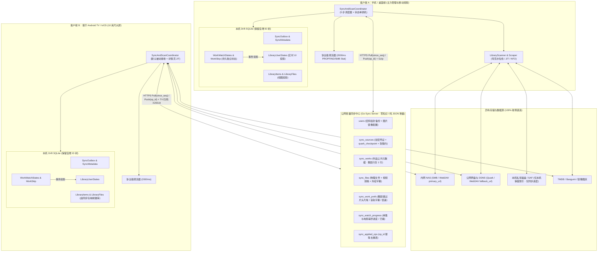
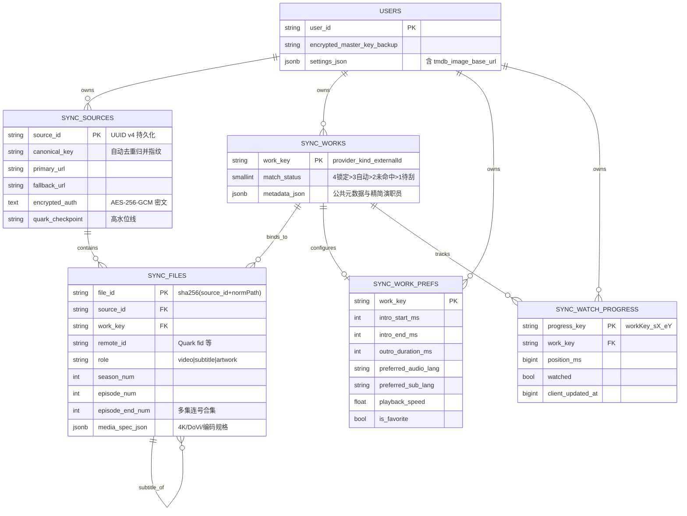
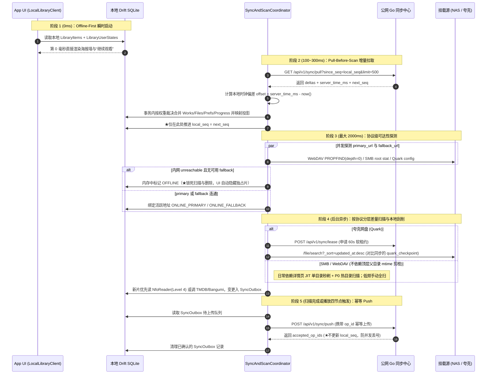
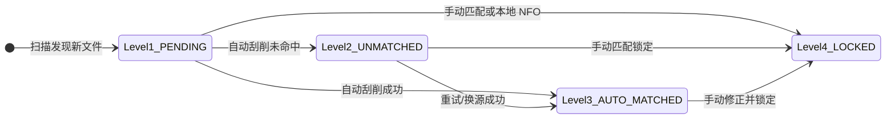

# 跨平台媒体库与播放器：全场景多端同步、扫描刮削与容错架构白皮书（V2.0 工程定稿版）

> **文档定位**：工程级架构设计与落地实施指南（Single Source of Truth）  
> **适用终端**：Android / iOS / Windows / macOS / Linux / Android TV & tvOS（10-Foot UI）  
> **技术栈基线**：基于 **Plezy** 现有代码架构——Flutter 全平台客户端、本地 `Drift (SQLite v32+)` 数据库（保留 `LibraryItems` / `LibraryFiles` 本机投影树与 `WorkWatchStates` / `WorkSkipSettingsStore` 独立持久层）、`QuarkStorageDriver` / `SmbStorageDriver` / `WebDavStorageDriver` / `LocalStorageDriver`、`cryptography`（`AesGcm` / `X25519` / `Argon2id`）、`unorm_dart`、`qr_flutter`，以及 `server/` 目录下的 Go 轻量同步服务。  
> **核心理念**：**「Offline-First 离线与多网容错底座 + 端侧自治刮削 + 轻量纯文本增量同步中心（外用确定性键同步，内保自增 ID 投影）」**

---

## 第一部分：基于真实用户习惯的全面可行性评估

在敲定最终实施代码前，必须从真实用户的日常行为出发，用挑剔的眼光审视**“客户端负责扫描刮削 + 外网服务器只存结构化文本元数据与进度”**的混合架构是否真正可行，以及它在技术、成本、体验与密钥安全上的边界。

### 1.1 七大典型用户画像与真实行为路径分析

| 场景编号 | 用户真实行为习惯 | 纯本地独立架构的痛点 | 服务端全包（中心化媒体服）的痛点 | V2.0 混合架构的表现与可行性结论 |
| :--- | :--- | :--- | :--- | :--- |
| **场景 1：首次开荒建库**<br>*(手机/电脑配置，客厅电视观看)* | 用户习惯在手机或电脑上粘贴 WebDAV 密码、扫码授权夸克网盘，并手动修正几部刮削错误的电影或整理 `.nfo`；随后走到客厅打开电视，期望**零输入、秒看片**。 | ❌ **不可行**：电视端拿遥控器输入密码极其痛苦；电视端重扫几千部电影耗时极长且手动修正结果全部丢失。 | ✅ 体验好，但服务器需保存明文网盘凭证并承担高昂爬虫与带宽成本。 | ✅ **完美可行**：手机端刮削修正后 Push 到云端（几百 KB～几 MB 文本）；电视扫码 1 秒登录并移交 `MasterKey`，Pull 下完整作品与文件映射直接渲染海报墙，**0 次网盘扫描、0 次 TMDB 请求**。 |
| **场景 2：日常追剧更新**<br>*(网页转存新片，直接开电视)* | 用户在电脑网页或手机微信随手转存了最新一集《仙逆》到夸克网盘，或 NAS 自动下载了新剧集。用户**不会先打开手机 App**，而是直接坐到沙发上打开电视。 | ⚠️ 电视能扫出来，但若每次开机全盘盲扫，电视低端芯片会卡顿且极易触发网盘 403/滑块风控。 | ❌ 若服务器定时轮询大量用户网盘，机房 IP 必被封杀；且无法穿透扫描内网 NAS。 | ✅ **完美可行**：电视开机秒开本地海报墙，随后点进剧集详情页触发 **JIT 单目录秒级刷新（200ms）**，或夸克通过同步下来的 `quark_checkpoint` 执行 **1 次请求 0.1 秒全局时间流增量**，当场刮削新集并 Push 回云端。 |
| **场景 3：内外网环境频繁切换**<br>*(在家连内网 NAS，通勤用 5G 流量)* | 用户在家里挂载了局域网 `smb://192.168.1.2` 与公网 `夸克网盘`；第二天坐地铁用 5G 流量打开手机 App 看剧。 | ⚠️ 室外打开 App 时内网源一直转圈超时报错，甚至触发清理逻辑把内网影片误删。 | ❌ 公网服务器无法连接用户家里的 `192.168.1.2`，内网源直接无法建库。 | ✅ **完美可行**：客户端启动执行 **2000ms 协议级并发探活**（非裸 TCP Ping，防同名局域网误判）。室外自动将纯内网源标记为 `OFFLINE` 并**上防误删锁**，UI 过滤隐藏内网独占片，优先切至 `fallback_url`（DDNS）或夸克网盘版本播放。 |
| **场景 4：跨设备高频接力播放**<br>*(客厅电视看一半，卧室平板接着看)* | 客厅电视看到第 23 分 15 秒按遥控器返回；5 分钟后在卧室打开手机或平板点击“继续观看”，且希望能记住刚调好的跳过片头片尾、国语音轨与简中字幕。 | ❌ 无法同步或受限于单一厂商生态（如 iCloud 无法跨 Android TV 与 Windows）。 | ✅ 体验好。 | ✅ **完美可行**：`sync_work_prefs`（整剧级偏好）与 `sync_watch_progress`（单集/电影进度）解耦存储，绑定在确定性 `work_key` 上。哪怕电视放 NAS 4K 原盘、手机放网盘 1080P，进度与片头片尾、音轨/字幕偏好跨集无缝继承。 |
| **场景 5：多设备同时在线 / 挂机**<br>*(PC 挂后台，同时打开电视)* | 用户书房电脑开着播放器没关，人走到客厅打开电视。此时两台设备同时在线。 | ❌ 两台设备同时发起网盘递归扫描，瞬间触发夸克等网盘风控限流。 | N/A | ✅ **完美可行**：TV 端默认设为**被动接收同步模式**；主动扫描端严格遵守 **`Pull-Before-Scan`** 与 **60 秒扫描软租约（Soft Lease）**，彻底避免多端并发冲击同一网盘账号。 |
| **场景 6：弱网或完全断网环境**<br>*(宽带外网故障，仅局域网存活)* | 家里外网断了，但路由器与 NAS 正常，用户想在电视上看本地 NAS 里的电影。 | ✅ 纯本地库可看。 | ❌ **彻底瘫痪**：强中心化架构连不上服务器就刷不出列表。 | ✅ **完美可行**：基于 **Offline-First** 架构，第 0 毫秒直接读取本地 `Drift` 数据库渲染海报墙；外网同步服超时则静默降级，本地新增进度与变更写入 `SyncOutbox`，恢复联网后自动补推且幂等合并。 |
| **场景 7：主力手机丢失/重装 & 本机私有磁盘隔离**<br>*(换新设备或挂载本机 `D:\Movies` / SAF)* | 用户换了新手机（旧手机已损坏），或首台设备是无摄像头的台式 PC；同时用户在 PC 上挂载了本机 `D:\Movies` 文件夹。 | ⚠️ 旧数据难找回；本机路径无法在电视播放。 | ✅ 服务器直接恢复。 | ✅ **完美可行**：E2EE 主密钥通过用户密码经 `Argon2id` 派生 `KEK` 加密生成 `encrypted_master_key_backup` 存云端，换机/重装输密码即可本地解封恢复（既无单点丢手机死锁，服务端也零知识）；`StorageKind.local` 本机目录绝不作为 `sync_sources` 上云（不给电视制造死链），但已刮削作品的进度与跳过规则正常同步。 |

### 1.2 技术、成本、隐私与体验可行性结论

1. **服务器成本极低（高性价比）**：
   * 服务端**不存任何一张图片二进制文件**，**不跑正则/刮削、不请求 TMDB/Bangumi、不代理视频流**。
   * 将公共元数据拆入整剧级 `sync_works` 后消除了长篇剧集的 JSON 写放大；一个拥有 2,000 部电影/剧集（约 20,000 个视频文件）的重度用户，全量数据压缩后约 **1~2 MB**。单台 2核4G 云服务器配合 SQLite WAL 或 PostgreSQL 即可轻松支撑日常个人及数万级日活同步。
2. **零机房 IP 封禁风险（高可用性）**：
   * 所有网盘 API 请求与 TMDB/Bangumi API 请求 100% 运行在用户客户端本地，使用用户自家宽带 IP，公网同步服务器无高频外呼风控风险。
3. **双轨制 E2EE 安全与不丢失保障**：
   * 用户的网盘 Cookie/Ticket、SMB/WebDAV 密码在客户端本地由 `MasterKey` 经 `AES-256-GCM` 加密后存入 `encrypted_auth`；`MasterKey` 本身同时通过 **TV 扫码 `X25519`（ECDH）1 秒免密直传** 与 **密码派生 `Argon2id` 备份信封** 双轨分发，兼顾极简体验、零知识安全与换机可恢复性。
4. **图片 CDN 与裂图兜底**：
   * 同步索引省掉的是**网盘列目录与 TMDB 元数据搜索请求**；各端首次渲染海报仍需加载海报图片。同步层需在账号配置 `users.settings_json` 中同步用户配置的 **`tmdb_image_base_url`（图片镜像域名）**，保证电视端与手机端使用同一可用图床，且始终以远程海报路径作为跨端保底。
5. **与现有代码极高复用度**：
   * 现有 `Drift` 本地数据库（`LibraryItems`、`LibraryFiles`、`WorkWatchStates`、`LibraryUserStates`、`Mounts`）、`WorkSkipSettingsStore`、`LibraryScanner`、`LibraryScraper` 与 `CredentialVault` 均完整保留；**不推翻本地自增 `LibraryItems.id` 树**，仅在同步进出口增加确定性键映射层与 `SyncOutbox` 队列即可平滑演进。

---

## 第二部分：全景系统架构图

本节用三张 Mermaid 架构图完整描述 V2.0 的**端云拓扑与本机双层投影模型**、**同步表与实体关系**，以及**客户端五步启动与同步时序**。

### 2.1 端云协同与本机双层投影拓扑图



### 2.2 同步数据实体关系图（ER Diagram）



### 2.3 客户端启动、探活与同步五步流水线时序图



---

## 第三部分：数据字典与确定性身份规范（外用确定性键同步，内保自增 ID 投影）

### 3.1 为什么不推翻现有本地 `LibraryItems.id` 自增主键？

在现有 Plezy 代码库中（见 [library_tables.dart](file:///e:/Code/plezy/lib/database/library_tables.dart#L19-L103) 与 [local_library_client.dart](file:///e:/Code/plezy/lib/library/local_library_client.dart#L222-L245)）：
* `LibraryItems.id` 是自增整数，通过 `parentId`、`showId` 高效维系 `show -> season -> episode` 三级级联树，并与 `LibraryItemGenres`、`LibraryCredits`、`LibraryListItems`、`LibraryUserStates` 绑定；
* 全局路由与下载模块依赖 `local-library:<id>` 格式的 `globalKey`；
* `WorkWatchStates` 和 `LibraryWorkBindings` 已经完美实现了**本地自增条目 ID 与跨端持久化作品身份（`WorkIdentity`）的解耦**。

**因此 V2.0 采用「内外分离、边界映射」策略**：
* **本机内部**：100% 保留现有的 `LibraryItems.id`、`LibraryFiles.id` 自增树结构与全部查询索引，零破坏现有 UI 与 300+ 测试用例。
* **同步边界**：所有上传至云端与从云端拉取合并的数据，一律使用**确定性字符串主键（Deterministic Keys）**。客户端 `SyncMapper` 在事务内将 `work_key` / `file_id` 映射到本机 `LibraryItems` / `LibraryFiles` 自增行，随后调用 `LibraryWatchStateStore.restoreItemAndChildren()` 自动重建 `LibraryUserStates` 投影。

### 3.2 路径归一化与确定性 ID 生成算法（Dart 规范）

所有端必须使用以下完全一致的归一化与 ID 生成器：

```dart
import 'dart:convert';
import 'package:crypto/crypto.dart';
import 'package:unorm_dart/unorm_dart.dart' as unorm;
import 'package:uuid/uuid.dart';

class DeterministicKeys {
  DeterministicKeys._();

  /// 1. 挂载相对路径标准化：
  /// 对齐现有 StoragePath.normalize，保留前导 '/'（如 '/国漫/仙逆/S01E65.mp4'），
  /// 并补齐 URL 解码与 Unicode NFC 统一（消除 macOS/iOS NFD 中文音调拆分差异）。
  static String normalizeMountPath(String rawPath) {
    var decoded = rawPath;
    try {
      decoded = Uri.decodeFull(rawPath);
    } catch (_) {
      // 保留含非标准百分号的原字符串，避免异常字符导致崩溃
    }

    final segments = <String>[];
    for (final segment in decoded.replaceAll('\\', '/').split('/')) {
      final trimmed = segment.trim();
      if (trimmed.isEmpty || trimmed == '.') continue;
      if (trimmed == '..') {
        if (segments.isNotEmpty) segments.removeLast();
        continue;
      }
      segments.add(unorm.nfc(trimmed));
    }
    return '/${segments.join('/')}';
  }

  /// 2. 挂载源持久化 ID：创建时生成稳定 UUID v4，修改 IP/端口/fallback_url 绝不改变！
  static String newSourceId() => const Uuid().v4();

  /// 3. 挂载源规范化指纹（仅用于多端独立添加同一源时的相遇归并，不作主键！）
  /// - quark:  quark:<uid>:<rootFolderId>
  /// - smb:    smb://<lower(host)>/<lower(share)><normalizedRootPath>
  /// - webdav: webdav://<lower(host)><port><normalizedBasePath>
  static String canonicalSourceKey({
    required String protocol,
    String? quarkUid,
    String? rootFolderId,
    String? host,
    String? share,
    String? rootPath,
    Uri? webdavBaseUrl,
  }) {
    final proto = protocol.trim().toLowerCase();
    if (proto == 'quark') {
      return 'quark:${(quarkUid ?? '').trim()}:${(rootFolderId ?? '0').trim()}';
    }
    if (proto == 'smb') {
      final h = (host ?? '').trim().toLowerCase();
      final s = (share ?? '').trim().toLowerCase();
      final r = normalizeMountPath(rootPath ?? '/');
      return 'smb://$h/$s$r';
    }
    if (proto == 'webdav' && webdavBaseUrl != null) {
      final portPart = webdavBaseUrl.hasPort ? ':${webdavBaseUrl.port}' : '';
      final pathPart = normalizeMountPath(webdavBaseUrl.path);
      return 'webdav://${webdavBaseUrl.host.toLowerCase()}$portPart$pathPart';
    }
    return '$proto://${(host ?? '').trim().toLowerCase()}${normalizeMountPath(rootPath ?? '/')}';
  }

  /// 4. 物理文件确定性 ID (file_id)
  static String generateFileId({
    required String sourceId,
    required String mountRelativePath,
  }) {
    final normPath = normalizeMountPath(mountRelativePath);
    return sha256.convert(utf8.encode('$sourceId:$normPath')).toString().substring(0, 32);
  }

  /// 5. 作品确定性键 (work_key)：对齐现有 WorkIdentity，支持 tmdb / imdb / bangumi
  /// - 已识别: "tmdb:movie:693134" / "tmdb:show:235412" / "bangumi:show:400602"
  /// - 未识别回退: "raw:<24位sha256>" (按标准化文件名 + 文件字节大小，防同片移动丢进度)
  static String generateWorkKey({
    required int matchStatus, // 1=pending, 2=unmatched, 3=matched, 4=matchLocked
    required String kind,     // 'movie' | 'show'
    String? provider,         // 'tmdb' | 'imdb' | 'bangumi'
    String? externalId,
    required String fileName,
    required int fileSize,
  }) {
    if (matchStatus >= 3 &&
        provider != null &&
        provider.isNotEmpty &&
        externalId != null &&
        externalId.isNotEmpty) {
      return '${provider.toLowerCase()}:$kind:${externalId.trim()}';
    }
    final cleanName = unorm.nfc(fileName.trim()).toLowerCase();
    final hash = sha256.convert(utf8.encode('$cleanName:$fileSize')).toString().substring(0, 24);
    return 'raw:$hash';
  }

  /// 6. 播放进度键 (progress_key)
  static String generateProgressKey({
    required String workKey,
    required String kind, // 'movie' | 'show'
    int seasonNum = -1,
    int episodeNum = -1,
  }) {
    if (kind == 'show' && seasonNum >= 0 && episodeNum >= 0) {
      return '$workKey:s$seasonNum:e$episodeNum';
    }
    return workKey;
  }
}
```

---

## 第四部分：公网同步服务器数据库表结构（DDL）与 JSON 载荷规范

服务端推荐采用 **Go + SQLite (WAL 模式) 或 PostgreSQL**（以下 DDL 以 PostgreSQL 标准类型给出，兼容 SQLite 对应转换）。核心改进是将作品元数据、物理文件规格、整剧偏好、单集进度拆分为 **7 张正交表**，彻底消除写放大与切集偏好丢失问题。

### 4.1 服务端核心 SQL 表结构（DDL）

```sql
-- 1. 账号与密码信封密钥表 (users)
CREATE TABLE users (
    user_id                     VARCHAR(64)  PRIMARY KEY,
    username                    VARCHAR(128) NOT NULL UNIQUE,
    password_hash               TEXT         NOT NULL, -- Argon2id 登录哈希
    kdf_salt                    VARCHAR(64)  NOT NULL, -- 用于端侧派生 KEK 的随机盐
    kdf_params_json             JSONB        NOT NULL, -- {"algo":"argon2id","m":65536,"t":3,"p":1}
    encrypted_master_key_backup TEXT         NOT NULL, -- KEK 用 AES-256-GCM 加密的 MasterKey 备份信封
    settings_json               JSONB        NOT NULL DEFAULT '{}', -- 含 tmdb_image_base_url 等账号级配置
    created_at                  BIGINT       NOT NULL,
    updated_at                  BIGINT       NOT NULL
);

-- 2. 共享网络挂载源配置表 (sync_sources)
-- 注意：StorageKind.local 本机私有目录/SAF 严禁写入此表！
CREATE TABLE sync_sources (
    user_id          VARCHAR(64)  NOT NULL,
    source_id        VARCHAR(64)  NOT NULL, -- 持久化 UUID v4（改 IP 不变）
    canonical_key    VARCHAR(512) NOT NULL, -- 归并指纹 (如 quark:uid:rootId)
    name             VARCHAR(128) NOT NULL,
    protocol         VARCHAR(32)  NOT NULL, -- 'smb' | 'webdav' | 'quark'
    is_lan_only      BOOLEAN      NOT NULL DEFAULT FALSE,
    primary_url      VARCHAR(512) NOT NULL, -- 主连接描述/地址
    fallback_url     VARCHAR(512) DEFAULT NULL, -- 备用外网 DDNS 地址
    include_paths    JSONB        NOT NULL DEFAULT '[]', -- 影视白名单目录
    exclude_paths    JSONB        NOT NULL DEFAULT '[]', -- 忽略目录 (相册/录屏等)
    encrypted_auth   TEXT         NOT NULL, -- 客户端 MasterKey 用 AES-256-GCM 加密的凭证密文
    auth_updated_at  BIGINT       NOT NULL DEFAULT 0, -- 凭证刷新时间戳 (CAS 乐观锁依据)
    quark_checkpoint VARCHAR(128) DEFAULT NULL, -- 夸克高水位线 "<rootFolderId>:<watermarkMs>"
    scan_lease_owner VARCHAR(64)  DEFAULT NULL, -- 当前持有扫描软租约的 device_id
    scan_lease_until BIGINT       NOT NULL DEFAULT 0,
    is_deleted       BOOLEAN      NOT NULL DEFAULT FALSE,
    server_seq       BIGINT       NOT NULL,
    PRIMARY KEY (user_id, source_id)
);
CREATE INDEX idx_sources_user_seq ON sync_sources (user_id, server_seq);

-- 3. 作品公共元数据表 (sync_works) —— 电影或整剧仅存 1 行，彻底消除番剧冗余写放大
CREATE TABLE sync_works (
    user_id           VARCHAR(64)  NOT NULL,
    work_key          VARCHAR(128) NOT NULL, -- 如 'tmdb:show:235412' / 'bangumi:show:400602'
    kind              VARCHAR(16)  NOT NULL, -- 'movie' | 'show'
    library_type      VARCHAR(32)  NOT NULL, -- 'movie' | 'show' | 'anime' | 'variety' | 'documentary'
    provider          VARCHAR(32)  DEFAULT NULL, -- 'tmdb' | 'imdb' | 'bangumi' | 'nfo'
    external_id       VARCHAR(64)  DEFAULT NULL,
    match_status      SMALLINT     NOT NULL DEFAULT 1, -- 1=pending, 2=unmatched, 3=matched, 4=matchLocked
    metadata_json     JSONB        NOT NULL DEFAULT '{}', -- 标题/简介/评分/流派/海报路径/精简演职员
    client_updated_at BIGINT       NOT NULL DEFAULT 0,
    is_deleted        BOOLEAN      NOT NULL DEFAULT FALSE,
    server_seq        BIGINT       NOT NULL,
    PRIMARY KEY (user_id, work_key)
);
CREATE INDEX idx_works_user_seq ON sync_works (user_id, server_seq);

-- 4. 物理文件映射与媒体编码规格表 (sync_files)
CREATE TABLE sync_files (
    user_id           VARCHAR(64)  NOT NULL,
    file_id           VARCHAR(32)  NOT NULL, -- sha256(source_id + normalized_relative_path)
    source_id         VARCHAR(64)  NOT NULL,
    relative_path     TEXT         NOT NULL, -- 统一以 '/' 开头，经 Unicode NFC 归一化
    remote_id         VARCHAR(128) DEFAULT NULL, -- 夸克 fid 等驱动自身稳定 ID
    role              VARCHAR(16)  NOT NULL DEFAULT 'video', -- 'video' | 'subtitle' | 'artwork'
    owner_file_id     VARCHAR(32)  DEFAULT NULL, -- 外挂字幕归属的视频 file_id
    language          VARCHAR(32)  DEFAULT NULL, -- 字幕语言标签
    file_name         VARCHAR(512) NOT NULL,
    file_size         BIGINT       NOT NULL DEFAULT 0,
    file_mtime        BIGINT       NOT NULL DEFAULT 0,
    work_key          VARCHAR(128) DEFAULT NULL, -- 关联到的作品键
    season_num        SMALLINT     NOT NULL DEFAULT -1,
    episode_num       SMALLINT     NOT NULL DEFAULT -1,
    episode_end_num   SMALLINT     DEFAULT NULL, -- 兼容单文件多集 (如 S01E01-E02.mkv)
    match_status      SMALLINT     NOT NULL DEFAULT 1, -- 文件级绑定权重 (4=matchLocked)
    version_label     VARCHAR(64)  DEFAULT NULL, -- 如 '4K DoVi', '1080P'
    media_spec_json   JSONB        NOT NULL DEFAULT '{}', -- 分辨率/编码/HDR/时长/单集分集标题缩略图
    client_updated_at BIGINT       NOT NULL DEFAULT 0,
    is_deleted        BOOLEAN      NOT NULL DEFAULT FALSE,
    server_seq        BIGINT       NOT NULL,
    PRIMARY KEY (user_id, file_id)
);
CREATE INDEX idx_files_user_seq ON sync_files (user_id, server_seq);
CREATE INDEX idx_files_work ON sync_files (user_id, work_key);

-- 5. 整剧/电影级播放偏好与跳过配置表 (sync_work_prefs) —— 切集自动继承不丢失
CREATE TABLE sync_work_prefs (
    user_id              VARCHAR(64)  NOT NULL,
    work_key             VARCHAR(128) NOT NULL,
    intro_enabled        BOOLEAN      NOT NULL DEFAULT FALSE,
    intro_start_ms       INTEGER      NOT NULL DEFAULT 0,
    intro_end_ms         INTEGER      NOT NULL DEFAULT 0,
    credits_enabled      BOOLEAN      NOT NULL DEFAULT FALSE,
    credits_from_end_ms  INTEGER      NOT NULL DEFAULT 0,
    keep_easter_egg_ms   INTEGER      NOT NULL DEFAULT 0,
    preferred_audio_lang VARCHAR(16)  DEFAULT NULL, -- 如 'chi', 'jpn', 'eng'
    preferred_sub_lang   VARCHAR(16)  DEFAULT NULL, -- 如 'zh-CN', 'off'
    playback_speed       REAL         NOT NULL DEFAULT 1.0,
    danmaku_offset_ms    INTEGER      NOT NULL DEFAULT 0, -- 预留整剧弹幕偏移
    is_favorite          BOOLEAN      NOT NULL DEFAULT FALSE,
    hidden_from_continue BOOLEAN      NOT NULL DEFAULT FALSE,
    client_updated_at    BIGINT       NOT NULL DEFAULT 0,
    server_seq           BIGINT       NOT NULL,
    PRIMARY KEY (user_id, work_key)
);
CREATE INDEX idx_work_prefs_user_seq ON sync_work_prefs (user_id, server_seq);

-- 6. 观看进度与已看状态表 (sync_watch_progress) —— 仅存单集或电影播放进度
CREATE TABLE sync_watch_progress (
    user_id           VARCHAR(64)  NOT NULL,
    progress_key      VARCHAR(160) NOT NULL, -- 'tmdb:show:235412:s1:e65' 或 'tmdb:movie:693134'
    work_key          VARCHAR(128) NOT NULL,
    season_num        SMALLINT     NOT NULL DEFAULT -1,
    episode_num       SMALLINT     NOT NULL DEFAULT -1,
    last_file_id      VARCHAR(32)  DEFAULT NULL,
    position_ms       BIGINT       NOT NULL DEFAULT 0,
    duration_ms       BIGINT       NOT NULL DEFAULT 0,
    watched           BOOLEAN      NOT NULL DEFAULT FALSE,
    play_count        INTEGER      NOT NULL DEFAULT 0,
    last_played_at    BIGINT       DEFAULT NULL,
    episode_ext_json  JSONB        NOT NULL DEFAULT '{}', -- 预留单集 dandan_episode_id 等扩展
    client_updated_at BIGINT       NOT NULL DEFAULT 0,
    server_seq        BIGINT       NOT NULL,
    PRIMARY KEY (user_id, progress_key)
);
CREATE INDEX idx_progress_user_seq ON sync_watch_progress (user_id, server_seq);

-- 7. 幂等操作去重表 (sync_applied_ops) —— 防止弱网重试重复应用
CREATE TABLE sync_applied_ops (
    user_id    VARCHAR(64) NOT NULL,
    op_id      VARCHAR(64) NOT NULL,
    server_seq BIGINT      NOT NULL,
    created_at BIGINT      NOT NULL,
    PRIMARY KEY (user_id, op_id)
);
```

### 4.2 精简 JSON 载荷字段规范

1. **`sync_works.metadata_json`（整剧/电影公共元数据，约 400~800 字节）**：

```json
{
  "title": "仙逆",
  "original_title": "仙逆",
  "aliases": ["Xian Ni", "Renegade Immortal"],
  "year": 2023,
  "release_date": "2023-09-25",
  "rating": 8.6,
  "genres": ["动画", "奇幻", "动作冒险"],
  "overview": "顺为凡，逆则仙，只在心中一念间……",
  "poster_path": "/xianni_poster.jpg",
  "backdrop_path": "/xianni_bg.jpg",
  "logo_path": "/xianni_logo.png",
  "tmdb_id": "235412",
  "imdb_id": null,
  "bangumi_id": "400602",
  "credits": [
    {"name": "石头熊", "job": "director", "character": null},
    {"name": "王林", "job": "actor", "character": "主役"}
  ]
}
```

2. **`sync_files.media_spec_json`（单文件技术规格与单集标题缩略图，约 200~350 字节）**：

```json
{
  "duration_ms": 1440000,
  "container": "matroska",
  "video_codec": "hevc",
  "width": 3840,
  "height": 2160,
  "hdr_format": "DoVi",
  "ep_title": "第 65 集：化神之战",
  "ep_overview": "王林凝结元婴后迎战强敌……",
  "ep_still_path": "/ep65_thumb.jpg"
}
```

3. **`users.settings_json`（账号级全局配置）**：

```json
{
  "tmdb_image_base_url": "https://image.tmdb.org/t/p",
  "preferred_scrape_lang": "zh-CN"
}
```

4. **`sync_watch_progress.episode_ext_json`（单集级扩展预留）**：

```json
{
  "dandan_episode_id": 184920
}
```

---

## 第五部分：多端冲突解决矩阵（Conflict Resolution Matrix）

### 5.1 四级媒体刮削状态单调升级法则（State Monotonicity Rule）

为防止客厅电视因未配代理产出 `unmatched` 而覆盖掉 PC/手机已经刮削或手动修正的成果，合并 `sync_works` 与 `sync_files` 时严格执行四级状态权重：

$$\text{Level 4 (MANUAL\_LOCKED / NFO)} > \text{Level 3 (AUTO\_MATCHED)} > \text{Level 2 (UNMATCHED)} > \text{Level 1 (PENDING)}$$



1. **高权重无条件胜出**：当 $R_{\text{new}}.\text{match\_status} > R_{\text{old}}.\text{match\_status}$ 时，无视时间戳直接覆盖。
2. **低权重严禁回退**：当 $R_{\text{new}}.\text{match\_status} < R_{\text{old}}.\text{match\_status}$ 时直接丢弃（除非收到显式 `explicit_unlock = true` 用户重置操作且时间更新）。
3. **同权重比校准时间戳**：若等级相同（例如两端先后在手机和 PC 上手动修正并锁定同一部片），取校准后的 `client_updated_at` 较大者。
4. **软删除与文件复活**：`is_deleted = true` 仅当 `client_updated_at > old.client_updated_at` 时生效；若此前标删的文件重新被扫描器在同路径扫出，置 `is_deleted = false` 并保留其 `work_key` 与 `match_status`。

### 5.2 挂载源凭证 CAS 乐观锁与水位合并

对于同一个 `source_id`：
* **凭证更新（`encrypted_auth`）**：Push 请求携带 `expected_auth_updated_at`；仅当服务端当前记录的 `auth_updated_at <= expected_auth_updated_at`（或客户端强制执行了扫码新授权 `force_auth_override = true`）时才允许覆盖，防止两台设备同时遇到 401 并发刷新互相踩踏。
* **夸克水位线（`quark_checkpoint`）**：在同一个 `rootFolderId` 下，服务端与客户端统一取水位线最大值：
  $$\text{MergedWatermark} = \max(\text{LocalWatermark}, \text{RemoteWatermark})$$
* **目录过滤规则（`include_paths` / `exclude_paths`）**：按 `client_updated_at` 取最新配置；若远端新增了 `exclude_paths`，接收端应用后立即清理对应被排除目录下的本地 `LibraryFiles` 并调用 `pruneEmptyTitles()`。

### 5.3 观看进度与整剧偏好合并（保护“标未看”与“重看”）

* **整剧偏好（`sync_work_prefs`）**与**单集进度（`sync_watch_progress`）**分表独立合并，修改跳过片头片尾时间**绝不会覆盖**单集播放进度。
* 同一 `progress_key` 采用**校准时钟下的 LWW（Last-Write-Wins）**：比较 `client_updated_at`，时间更晚的操作胜出。
* **为什么不盲目取 `max(position_ms)` 或锁死 `watched = true`？** 如果用户在设备 A 上手动将某集「标记为未看」或拖回 `00:00` 准备二刷，该主动操作拥有最新的 `client_updated_at`，LWW 能忠实同步“未看/重播”语义；同时在设备 B 断网延迟补发旧进度时，因为设备 B 的时间戳更小，服务端与设备 A 会自动拒绝旧包回退。

---

## 第六部分：十四大边缘场景与隐患的工程级防呆方案

### 隐患 1：家里添加内网 SMB/WebDAV，出门用 5G 流量无法访问
* **错误做法**：发裸 TCP Ping 探测端口，或超时报错后把影片标记为删除。
* **工程级解法**：
  1. **2000ms 轻量协议级探活（防同名网段假阳性）**：公司/酒店 Wi-Fi 也常是 `192.168.1.x`，裸 TCP Ping 会把别人的设备误判成家里 NAS。必须在 2000ms 超时内执行轻量协议校验：WebDAV 发 `PROPFIND depth=0`、SMB 调共享根 `stat`、Quark 调 `GET /config`（或校验近期成功缓存），确认身份可达才标为 `ONLINE`。
  2. **双地址故障转移（`primary_url` / `fallback_url`）**：并发探测内网主地址与外网 DDNS 备用地址；WebDAV 在切换使用 `fallback_url` 时，需同步更新 `HttpClient.authenticate` 允许提交凭证的 `uri.host` 校验（见 [webdav_storage_driver.dart](file:///e:/Code/plezy/lib/storage/drivers/webdav_storage_driver.dart#L34)）。两者共用同一个 `source_id`，无需重新刮削。
  3. **离线源防误删锁与 UI 智能隐藏**：所有不可达的挂载在内存中标为 `OFFLINE`。扫描器**直接跳过 `OFFLINE` 源且严禁删除其文件**；首页与海报墙默认隐藏“旗下所有视频均来自 `OFFLINE` 源且无本地离线下载”的条目，顶部展示状态胶囊提示：`已隐藏 1 个离线局域网源 [显示全部]`。

### 隐患 2：网盘只更新了 1 集新番，用户直接开电视，全盘扫描太慢怎么办？
* **错误做法**：依赖顶层文件夹 `mtime` 递归剪枝（SMB/NTFS/网盘在深层子目录加文件时，顶层父目录 `mtime` 不会更新，直接剪枝必漏新集）。
* **工程级解法（按驱动协议分层的三级极速追更）**：
  1. **详情页 JIT 单目录秒级刷新（全协议通用，200ms）**：电视点进剧集详情页瞬间，直接读取该剧关联的父目录路径单独执行一次 `driver.list(parentDir)`。发现新集立刻复用当前已知 `work_key` 刮削单集标题与简介，1 秒内新集直接亮出并 Push 回云端。
  2. **Quark 高水位线全局增量（0.1 秒，1~2 次请求）**：复用现有 `LibraryScanner.scanQuarkIncremental`（`/file/search?cat=video&_sort=updated_at:desc` + 60 秒安全重叠窗口），并在 `sync_sources.quark_checkpoint` 中跨端同步水位线。手机扫过之后，电视拉下最新 `quark_checkpoint`，直接站着接力增量。
  3. **SMB / WebDAV P0 热目录定向探测**：后台定期优先扫描“最近 14 天观看过的未完结剧集所在叶子目录”；完整递归扫盘仅在用户手动触发或低频兜底时运行。

### 隐患 3：多台设备同时在线，重复扫描同一网盘触发 429 / 滑块风控
* **工程级解法**：
  1. **设备角色默认分化**：Android TV / tvOS 默认开启**被动同步模式**（启动拉云端索引 + 进详情页按需 JIT 刷单目录，不跑后台定时全盘扫）。
  2. **`Pull-Before-Scan` + 60 秒 Soft Lease**：任何设备发起深度扫描前必须先完成 `Pull`；若准备扫描公网网盘，先请求 `POST /api/v1/sync/lease { source_id, device_id }`，已有设备在扫（且未超过 60 秒租约）则自动放弃重复扫盘。

### 隐患 4：夸克等非标准网盘凭证与设备指纹互踢失效
* **工程级解法**：
  1. **PC 模式设备指纹打包同步**：在 Plezy 中，夸克 PC 模式的 WSG 签名依赖 `ticket + uid + nickname + utdid + machine`（见 [quark_pc_session.dart](file:///e:/Code/plezy/lib/storage/drivers/quark_pc_session.dart#L59-L163)）。打包 `encrypted_auth` 时连同 `utdid + machine` 一起同步，让同一账号下的设备保持一致的虚拟客户端身份。
  2. **401 先 Pull 后 CAS 刷新**：当 Web 模式 `__puus` 轮换或凭证报 `401` 时，先触发一次 `Pull` 检查远端 `auth_updated_at` 是否已更新，有新密文则无缝替换重试；确实均已失效再提醒用户重新扫码（并允许在设置中为单台设备勾选“使用本机独立网盘登录态”）。

### 隐患 5：用户重命名或整理网盘目录（批量文件移动）
* **工程级解法**：
  1. **进度零丢失**：进度绑在 `work_key`，与路径和 `file_id` 完全解耦。
  2. **夸克按 `fid` 原地迁移**：利用现有的 `remoteId`（夸克 `fid`）匹配旧文件，直接原地更新 `path` 与新 `file_id`，保持原有 `work_key` 与 `match_status`，并将旧 `file_id` 标记 `is_deleted = true`。
  3. **SMB / WebDAV 同源指纹继承**：在同一 `source_id` 下同时出现新文件路径与旧路径消失时，若 `file_name + file_size` 完全一致，本地直接克隆其 `work_key` 与 `match_status` 而不重新请求 TMDB。

### 隐患 6：电视端首次登录面对 20,000 集存量数据的冷启动卡顿
* **工程级解法**：
  * `GET /api/v1/sync/pull?since_seq=0&limit=500` 游标分页（每页 500 条经 Gzip 压缩仅约 30~50KB）。
  * 客户端每收到 1 页立即在 Drift `transaction()` 中批量写入并映射首屏数据，第 1 页落盘后用户即可直接浏览，剩余分页后台异步循环拉取。

### 隐患 7：廉价电视盒子系统时钟不准导致 LWW 错乱
* **工程级解法**：
  * 增量游标 `server_seq` 100% 由服务端单调递增分配，完全不信任客户端时钟；
  * `client_updated_at` 一律在端侧通过 `server_time_ms` 响应头计算偏差校准：$T_{\text{calibrated}} = T_{\text{local}} + (T_{\text{server}} - T_{\text{local}})$。

### 隐患 8：本地 `.nfo` 文件与同目录本地海报的处理
* **工程级解法**：
  * 接通现有的 `NfoReader`（[nfo_reader.dart](file:///e:/Code/plezy/lib/library/scrapers/nfo_reader.dart)），扫描到同名 `.nfo` / `tvshow.nfo` 时优先解析入库，并直接赋予 **`Level 4 (matchLocked)`** 权重上云；
  * 同目录本地海报（`mount:<mountId>:<path>`）记录在 `sync_files (role='artwork')` 中，仅在对应挂载处于 `ONLINE` 时优先本地读图，否则统一回退到 `sync_works.metadata_json` 中的远程海报路径，彻底杜绝跨端裂图。

### 隐患 9：播放进度高频上报压垮服务器或导致数据库锁表
* **工程级解法（本地 5s 保底 + 云端黄金四节点）**：
  * 播放期间本地 Drift `WorkWatchStates` 按既有节流（每 5~10 秒）安全落盘防闪退；
  * 写入 `SyncOutbox` 触发云端 `Push` 仅发生在 **4 个节点**：① 暂停（`Pause`）、② 停止/退出播放（`Stop / Background`）、③ 拖动进度条（`Seek + 3 秒 Debounce 防抖`）、④ 连续播放每 **90 秒** 一次低频心跳。

### 隐患 10：软删除墓碑与幂等表无限膨胀
* **工程级解法**：
  * 服务端定时任务清理超过 **30 天**的 `is_deleted = true` 墓碑与超过 **7 天**的 `sync_applied_ops`；
  * 记录全局保留最低水位线 `min_retained_seq`；若某台积灰超 30 天未开机的设备带着 `since_seq < min_retained_seq` 来拉取，服务端返回 `"reset_required": true`，客户端清理本地同步缓存后从 `since_seq = 0` 重新全量重建。

### 隐患 11：E2EE 主密钥双轨安全分发（防丢手机死锁 + 电视免输密码）
* **工程级解法**：
  1. **防死锁底座（密码信封备份）**：首次注册/开启同步时，端侧随机生成 256 位 `MasterKey`，同时利用用户登录密码经 `Argon2id` 派生出 `KEK` 将 `MasterKey` 加密存为服务端 `users.encrypted_master_key_backup`。手机丢了或新买无摄像头 PC，输入账号密码即可在本地解封恢复 `MasterKey`，服务端全程零知识。
  2. **电视端 1 秒无感登录（扫码 + `X25519` 直传）**：TV 端生成临时 `X25519` 密钥对并展示二维码（`plezy://qr-auth?session_id=...&pub_key=...`）；已登录的手机扫码点“确认授权”后，用电视公钥加密 `MasterKey`（或同步传递一次性授权码）交由服务端中转给电视，电视 1 秒完成账号登录 + 拿到 `MasterKey` + 挂载全网盘。

### 隐患 12：同片多版本聚合与智能网络择优起播
* **工程级解法**：
  * 详情页查询某 `work_key` 下所有 `is_deleted = false` 的文件记录，按当前可达性自动排序选源：
    $$\text{本机离线下载 (DownloadedMedia)} > \text{内网直连 (onlinePrimary)} > \text{外网 DDNS (onlineFallback)} > \text{公网网盘 (Quark)}$$
  * 同等可达性下优先高分辨率/高码率版本，并在版本胶囊中标注清晰度（来自 `media_spec_json`）与当前在线状态。

### 隐患 13：国内宽带直连 `image.tmdb.org` 导致的电视端海报裂图
* **工程级解法**：
  * 在 `users.settings_json` 中同步用户在手机/PC 端验证可用的 `tmdb_image_base_url` 镜像地址，电视端拉取同步包后自动对齐该图片基址；本地图片缓存池按相对路径缓存，切换镜像域名不影响本地已缓存海报。

### 隐患 14：本机私有磁盘隔离与网盘杂项过滤
* **工程级解法**：
  * `StorageKind.local`（本机目录 / Android SAF）的挂载配置和文件路径**绝不进入 `sync_sources` / `sync_files`**，但挂载下已刮削作品的进度（`sync_watch_progress`）与跳过设置（`sync_work_prefs`）照常融入个人同步流；
  * 网络挂载源配置 `include_paths` / `exclude_paths` 并随 `sync_sources` 同步，彻底屏蔽网盘相册备份视频与工作录屏。

---

## 第七部分：RESTful 同步与扫码鉴权接口规范

### 7.1 TV 扫码授权与密钥直传接口

1. `POST /api/v1/auth/qr/create`（TV 端调用）：生成 `session_id`（TTL 180s）与状态，返回供 `qr_flutter` 渲染的 Payload（含端侧生成的临时 `tv_pub_key`）。
2. `POST /api/v1/auth/qr/confirm`（已登录手机端扫码后调用）：提交 `session_id` 与用 `tv_pub_key` 加密后的 `sealed_master_key`（经 `X25519 + AesGcm` 封装）。
3. `GET /api/v1/auth/qr/poll?session_id=...`（TV 端轮询）：授权完成后返回 `access_token`、`refresh_token` 与 `sealed_master_key`。

### 7.2 增量拉取接口：`GET /api/v1/sync/pull`

**Query 参数**：`since_seq`（必填 int64，首次传 `0`）、`limit`（默认 `500`）。  
**Response 示例（启用 Gzip 压缩）**：

```json
{
  "code": 0,
  "server_time_ms": 1763257260000,
  "current_max_seq": 1085,
  "next_seq": 1085,
  "has_more": false,
  "reset_required": false,
  "user_settings": {
    "tmdb_image_base_url": "https://image.tmdb.org/t/p"
  },
  "data": {
    "sources": [
      {
        "source_id": "7c9e6679-7425-40de-944b-e07fc1f90ae7",
        "canonical_key": "webdav://192.168.1.2:5244/dav/movies",
        "name": "家里 NAS",
        "protocol": "webdav",
        "is_lan_only": false,
        "primary_url": "http://192.168.1.2:5244/dav/movies",
        "fallback_url": "https://nas.example.com:5244/dav/movies",
        "include_paths": ["/国漫", "/电影"],
        "exclude_paths": ["/相册备份"],
        "encrypted_auth": "enc:e2ee:v1:...",
        "auth_updated_at": 1763250000000,
        "quark_checkpoint": null,
        "is_deleted": false,
        "server_seq": 1042
      }
    ],
    "works": [
      {
        "work_key": "tmdb:show:235412",
        "kind": "show",
        "library_type": "anime",
        "provider": "tmdb",
        "external_id": "235412",
        "match_status": 3,
        "metadata_json": {
          "title": "仙逆",
          "year": 2023,
          "rating": 8.6,
          "genres": ["动画", "奇幻"],
          "poster_path": "/xianni_poster.jpg",
          "backdrop_path": "/xianni_bg.jpg"
        },
        "client_updated_at": 1763255000000,
        "is_deleted": false,
        "server_seq": 1079
      }
    ],
    "files": [
      {
        "file_id": "f9e8d7c6b5a432109876543210fedcba",
        "source_id": "7c9e6679-7425-40de-944b-e07fc1f90ae7",
        "relative_path": "/国漫/仙逆/Season 1/S01E65.mp4",
        "remote_id": null,
        "role": "video",
        "owner_file_id": null,
        "file_name": "S01E65.mp4",
        "file_size": 854213900,
        "file_mtime": 1763251000,
        "work_key": "tmdb:show:235412",
        "season_num": 1,
        "episode_num": 65,
        "episode_end_num": null,
        "match_status": 3,
        "version_label": "4K",
        "media_spec_json": {
          "width": 3840,
          "height": 2160,
          "video_codec": "hevc",
          "hdr_format": "HDR10",
          "ep_title": "第 65 集：化神之战"
        },
        "client_updated_at": 1763255000000,
        "is_deleted": false,
        "server_seq": 1080
      }
    ],
    "work_prefs": [
      {
        "work_key": "tmdb:show:235412",
        "intro_enabled": true,
        "intro_start_ms": 0,
        "intro_end_ms": 95000,
        "credits_enabled": true,
        "credits_from_end_ms": 110000,
        "keep_easter_egg_ms": 0,
        "preferred_audio_lang": "chi",
        "preferred_sub_lang": "zh-CN",
        "playback_speed": 1.25,
        "danmaku_offset_ms": 0,
        "is_favorite": true,
        "hidden_from_continue": false,
        "client_updated_at": 1763256000000,
        "server_seq": 1082
      }
    ],
    "watch_progress": [
      {
        "progress_key": "tmdb:show:235412:s1:e65",
        "work_key": "tmdb:show:235412",
        "season_num": 1,
        "episode_num": 65,
        "last_file_id": "f9e8d7c6b5a432109876543210fedcba",
        "position_ms": 742000,
        "duration_ms": 1440000,
        "watched": false,
        "play_count": 0,
        "last_played_at": 1763257100000,
        "episode_ext_json": {},
        "client_updated_at": 1763257100000,
        "server_seq": 1085
      }
    ]
  }
}
```

### 7.3 增量推送接口：`POST /api/v1/sync/push`

> **关键防丢包铁律**：`Push` 响应只返回被幂等接收的 `accepted_op_ids` 与 `server_time_ms`；**客户端在 `Push` 成功后严禁直接将本机 `local_seq` 跳更为服务端当前最新序列号**（否则会永久跳过并发期间其他设备推送的中间版本）。本机 `local_seq` 仅允许由 `Pull` 顺序推进！

```json
// Request
{
  "device_id": "dev_mobile_01",
  "mutations": [
    {
      "op_id": "8b7c6d5e-4f3a-2b1c-9d0e-112233445566",
      "entity_type": "watch_progress",
      "payload": {
        "progress_key": "tmdb:show:235412:s1:e65",
        "work_key": "tmdb:show:235412",
        "season_num": 1,
        "episode_num": 65,
        "position_ms": 920000,
        "duration_ms": 1440000,
        "watched": false,
        "client_updated_at": 1763258000000
      }
    }
  ]
}

// Response
{
  "code": 0,
  "server_time_ms": 1763258000120,
  "accepted_op_ids": ["8b7c6d5e-4f3a-2b1c-9d0e-112233445566"]
}
```

### 7.4 扫描软租约接口：`POST /api/v1/sync/lease`

* 请求：`{ "source_id": "...", "device_id": "...", "ttl_sec": 60 }`
* 响应：`{ "acquired": true, "holder_device_id": "...", "expires_at_ms": 1763258060000 }`

---

## 第八部分：客户端同步协调器（对接 Plezy 现有架构代码骨架）

以下代码直接衔接现有的 `AppDatabase`、`MountManager`、`LibraryScanner`、`LibraryScraper` 与 `LibraryWatchStateStore`，在保留本地自增投影的同时实现完整的五步启动流水线与四节点入队：

```dart
import 'dart:async';

enum MountOnlineStatus { probing, onlinePrimary, onlineFallback, offline }

class SyncAndScanCoordinator {
  SyncAndScanCoordinator({
    required this.db,
    required this.syncStore,
    required this.apiClient,
    required this.mountManager,
    required this.scanner,
    required this.scraper,
    required this.watchStateStore,
    required this.deviceId,
    required this.isTvDevice,
  });

  final AppDatabase db;
  final SyncLocalStore syncStore; // 操作 SyncOutbox、SyncMetadata 与确定性映射
  final SyncApiClient apiClient;
  final MountManager mountManager;
  final LibraryScanner scanner;
  final LibraryScraper scraper;
  final LibraryWatchStateStore watchStateStore;
  final String deviceId;
  final bool isTvDevice;

  bool _isRunning = false;
  int _serverTimeOffsetMs = 0;

  /// 使用与服务端校验后的校准时间生成 client_updated_at
  int get calibratedNowMs => DateTime.now().millisecondsSinceEpoch + _serverTimeOffsetMs;

  /// ★ App 启动或恢复前台时的五步标准流水线
  Future<void> runStartupPipeline({bool allowBackgroundScan = true}) async {
    if (_isRunning) return;
    _isRunning = true;

    try {
      // [阶段 1] 0ms：UI 已通过 LocalLibraryClient 从 Drift 直接渲染，无需阻塞等待网络

      // [阶段 2] Pull-Before-Scan：分页拉取远端增量，合并并更新投影，仅在此处推进 local_seq
      if (apiClient.isSignedIn) {
        await _pullAndMergeAllDeltas();
      }

      // [阶段 3] 2000ms 并发协议级可达性探测，更新 MountOnlineStatus，保护离线源不被误删
      final onlineMounts = await _probeAllSharedMounts();

      // [阶段 4] 按协议分层差量扫描与刮削（TV 端默认被动享受同步成果，不自动扫全盘）
      if (allowBackgroundScan && !isTvDevice && onlineMounts.isNotEmpty) {
        await _scanAndScrapeOnlineMounts(onlineMounts);
      }

      // [阶段 5] Push SyncOutbox 到云端（仅清除 accepted_op_ids，绝不跳号改写 local_seq）
      if (apiClient.isSignedIn) {
        await pushOutboxToServer();
      }
    } catch (e) {
      // 外网断网或同步服不可达时静默降级为纯本地/局域网模式，变更继续留在 SyncOutbox 中
      appLogger.w('[SyncCoordinator] Degraded to offline mode', error: e);
    } finally {
      _isRunning = false;
    }
  }

  /// 阶段 2：分页拉取并将确定性实体映射写入本机 Drift 表
  Future<void> _pullAndMergeAllDeltas() async {
    var localSeq = await syncStore.getLastPullSeq();
    var hasMore = true;

    while (hasMore) {
      final resp = await apiClient.pullDelta(sinceSeq: localSeq, limit: 500);
      _serverTimeOffsetMs = resp.serverTimeMs - DateTime.now().millisecondsSinceEpoch;

      if (resp.resetRequired) {
        await syncStore.resetSyncCursorsForFullRebuild();
        localSeq = 0;
        continue;
      }

      await db.transaction(() async {
        // 1. 合并共享挂载（按 canonicalKey 自动归并双端独立添加的同源；合并 quark_checkpoint）
        await syncStore.mergeSources(resp.sources);

        // 2. 合并作品与文件映射（严格遵循 Level 4 > Level 3 > Level 2 > Level 1 权重）
        final touchedWorkKeys = await syncStore.mergeWorksAndFiles(resp.works, resp.files);

        // 3. 合并整剧偏好（跳过片头片尾/音轨字幕/收藏）与单集进度（校准时钟 LWW）
        await syncStore.mergeWorkPrefsAndProgress(resp.workPrefs, resp.watchProgress);

        // 4. 将新同步的作品状态投影到本机 LibraryUserStates
        for (final itemId in await syncStore.resolveLocalItemIds(touchedWorkKeys)) {
          await watchStateStore.restoreItemAndChildren(itemId);
        }

        // ★ 唯一允许推进 localSeq 的位置
        await syncStore.saveLastPullSeq(resp.nextSeq);
      });

      localSeq = resp.nextSeq;
      hasMore = resp.hasMore;
    }
  }

  /// 阶段 3：2000ms 超时协议级探活，并发测试 primaryUrl 与 fallbackUrl
  Future<List<StorageMount>> _probeAllSharedMounts() async {
    final mounts = await mountManager.registry.list();
    final online = <StorageMount>[];

    await Future.wait(mounts.map((mount) async {
      if (mount.kind == StorageKind.local) {
        mountManager.setOnlineStatus(mount.id, MountOnlineStatus.onlinePrimary);
        return; // 本机磁盘不参与远端共享同步扫描队列
      }

      final status = await mountManager.probeMountWithTimeout(
        mount,
        timeout: const Duration(milliseconds: 2000),
      );
      mountManager.setOnlineStatus(mount.id, status);
      if (status == MountOnlineStatus.onlinePrimary || status == MountOnlineStatus.onlineFallback) {
        online.add(mount);
      }
    }));

    return online;
  }

  /// 阶段 4：按协议分层的在线源扫描（Quark 增量水位线 / 其他源跳过离线与锁租约）
  Future<void> _scanAndScrapeOnlineMounts(List<StorageMount> mounts) async {
    for (final mount in mounts) {
      if (apiClient.isSignedIn) {
        final leaseOk = await apiClient.tryAcquireScanLease(mount.id, deviceId);
        if (!leaseOk) continue; // 其他设备正在扫描，坐享 Pull 结果
      }

      if (mount.kind == StorageKind.quark && await scanner.hasQuarkBaseline(mount)) {
        final driver = mountManager.driverFor(mount) as QuarkStorageDriver;
        await scanner.scanQuarkIncremental(mount, driver, cancel: ScanCancelToken());
      } else {
        // SMB/WebDAV 日常仅扫描 P0 热目录或等待详情页 JIT，避免冷启动阻塞
        await scanner.scanPriorityWatchFolders(mount, mountManager.driverFor(mount));
      }
    }

    await scraper.scrapePending();
    await syncStore.enqueueLocalChangesToOutbox(calibratedNowMs: calibratedNowMs);
  }

  /// ★ 详情页 JIT 单目录秒级刷新（解决“网盘刚存 1 集，TV 端直接看剧”）
  Future<void> refreshShowFolderOnEnterDetail(StorageMount mount, String showDirPath) async {
    if (!mountManager.isMountOnline(mount.id)) return;
    final entries = await mountManager.driverFor(mount).list(showDirPath);
    final changed = await scanner.recordSingleDirectory(mount, showDirPath, entries);
    if (changed > 0) {
      await scraper.scrapePending(mountIds: {mount.id});
      await syncStore.enqueueLocalChangesToOutbox(calibratedNowMs: calibratedNowMs);
      unawaited(pushOutboxToServer());
    }
  }

  /// 阶段 5：提交 SyncOutbox，仅清理服务端确认落盘的 op_id
  Future<void> pushOutboxToServer() async {
    final batch = await syncStore.readPendingOutbox(limit: 200);
    if (batch.isEmpty) return;

    final resp = await apiClient.pushMutations(deviceId: deviceId, mutations: batch);
    if (resp.acceptedOpIds.isNotEmpty) {
      await syncStore.deleteAcceptedOutbox(resp.acceptedOpIds);
    }
  }
}
```

---

## 第九部分：分阶段落地实施 Checklist

### Milestone 1（V1.0）：Offline-First 离线容错与同步就绪底座（约 3~4 天）

- [ ] **确定性键与规范化层**：新增 `lib/library/sync/deterministic_keys.dart`，实现 `normalizeMountPath`（含 NFC 标准化）、`canonicalSourceKey`、`generateFileId`、`generateWorkKey` 与 `generateProgressKey`。
- [ ] **补齐作品身份与 NFO 最高权重**：
  - [ ] 修改 `lib/media/work_identity.dart` 与 `lib/library/library_watch_state_store.dart`，使 `WorkIdentity` 正式支持 `bangumi` provider。
  - [ ] 在 `lib/library/library_scraper.dart` 接入 `NfoReader`（命中 `.nfo` 自动写入并锁定为最高权重）。
- [ ] **挂载配置扩展与协议级探活**：
  - [ ] 在 `lib/storage/storage_mount.dart` 增加 `fallbackUrl`、`isLanOnly`、`includePaths`、`excludePaths`；在 `mount_edit_screen.dart` 增加界面选填入口。
  - [ ] 在 `webdav_storage_driver.dart` / `smb_storage_driver.dart` 支持切换活跃备用地址（同步更新 WebDAV `authenticate` 允许的 `uri.host`）。
  - [ ] 在 `mount_manager.dart` 实现 2000ms 并发协议探活与 `MountOnlineStatus` 状态管理；修改 `library_scan_service.dart` 跳过离线源、`library_repository.dart` 隐藏离线源独占影片、`local_library_client.dart` 实现多版本择优排序。
- [ ] **JIT 刷新与黄金四节点 Outbox**：
  - [ ] 在 `library_scanner.dart` 抽出单目录刷新并在 `media_detail_screen.dart` 接入。
  - [ ] Drift 数据库新增 `SyncOutbox` 与 `SyncMetadata` 表；在 `PlaybackProgressTracker` / `LocalLibraryClient` 停止、暂停、Seek(3s 防抖)、90s 心跳节点入队变更。

### Milestone 2（V1.1）：Go 轻量公网同步服与 E2EE 双端闭环（约 3~4 天）

- [ ] **Go 同步服务端（`server/`）**：实现 `users`、`sync_sources`、`sync_works`、`sync_files`、`sync_work_prefs`、`sync_watch_progress`、`sync_applied_ops` 七张表（SQLite WAL / PostgreSQL），提供 `/auth/qr/*`、`/sync/pull`、`/sync/push`（含权重与 LWW 裁决）、`/sync/lease` 与 30 天墓碑 GC。
- [ ] **端侧 E2EE 加解密与 TV 扫码**：基于 `cryptography` 实现 `MasterKey` `AES-256-GCM` 加解密、`Argon2id` 密码备份信封，以及配合 `qr_flutter` 的 TV 扫码 `X25519` 1 秒登录移交密钥。
- [ ] **全链路联调**：接入 `SyncAndScanCoordinator` 五步启动流水线，完成手机建库刮削 -> 电视扫码秒出海报墙 -> 外出 5G 自动隐藏内网源并接力续播的端到端验收。

### Milestone 3（V2.0 进阶扩展）

- [ ] 接入弹弹Play（DandanPlay）弹幕 API 并将 `danmaku_offset_ms` / `dandan_episode_id` 接入预留字段。
- [ ] 若仍有无外网环境需求，在已有确定性键与幂等 `op_id` 基础上扩展局域网 UDP/WS P2P 同步通道与远程投播控制（`CompanionRemote` 改造）。
