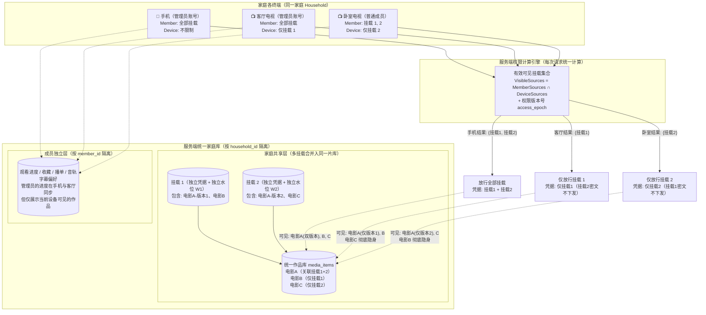
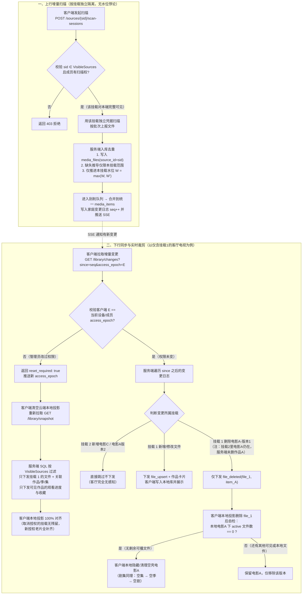

# 家庭多端挂载权限隔离与增量同步设计

> 关联设计：`docs/v1-library-server-refactor-plan.md`、`docs/client-scan-server-scrape-redesign.md`  
> 状态：**待定 / 后续开发计划（Backlog）**（2026-11-20；当前版本暂不处理家庭组与多成员逻辑，按单账号先落地，后续阶段再开启家庭组与设备级挂载隔离）

---

## 1. 背景与核心目标

在新的媒体库重构方案（客户端扫描 + 服务端刮削 + 家庭多租户）中，家庭（`Household`）内部的所有挂载都会归并扫描进**同一个统一家庭片库**，而观看记录、收藏、播单与个人播放偏好则按**成员（`Member`）**独立保存。

实际家庭使用中存在典型的**跨空间 / 跨设备片源差异需求**：
- **手机（管理员账号）**：拥有所有挂载的完整查看、管理与扫描权限。
- **客厅电视**：即使登录的是管理员账号（以保持与手机同步的个人观看进度），也只允许展示指定的挂载（例如仅放合家欢 NAS / 公用夸克）。
- **卧室电视**：只允许展示卧室指定的挂载。
- **儿童成员**：无论在哪个设备，仅允许看到被授权的挂载与分级范围内的内容。

本文明确如何在**不引入客户端增量扫描悖论**的前提下，实现严谨的挂载级权限隔离、数据下发裁剪与增量同步闭环。

---

## 2. 为什么必须以「挂载（`source_id`）」作为最小隔离单元？

如果尝试在同一个挂载（例如同一个夸克账号）下按“目录（`folder_id`）”做强权限隔离，会产生三个难以回避的架构悖论：

1. **账号级增量水位悖论**：夸克的增量水位（`incremental_watermark`）是账号级且单调递增的。如果只有部分目录权限的设备执行增量扫描并推进全局水位，无权目录内的新增文件会被永久跳过漏扫；如果不推进水位则会反复重扫；如果全扫再过滤又直接违背权限隔离。
2. **缺失推导误删悖论**：基于 `last_seen_at < started_at` 的缺失推导如果由受限视角发起，极易把不可见目录里的文件误判为 `missing`。
3. **直连凭据原子性悖论**：新架构取消服务端流媒体中继，采用客户端直连播放。同一夸克/WebDAV 账号共用一套 Cookie 或密码，下发了该源凭据后，客户端在技术上即可访问该账号下的全部目录。

**结论：权限隔离的最小粒度固定为「挂载（`source_id`）」。**
- 每个挂载独立持有 `source_credentials`（密文凭据）与 `source_scan_state`（扫描状态与水位）。
- 未授权的挂载连密文凭据都不会下发，实现**真隔离**，且每个挂载的增量水位与缺失推导天然闭环，彻底消除扫描悖论。
- 如需区分公私片源，采用不同网盘账号或 NAS 侧开设独立权限的 WebDAV / Emby 子账号分别挂载即可。

---

## 3. 双层权限模型（成员 × 设备）

为了让 **“人（进度与身份）”** 与 **“设备（空间场景限制）”** 解耦，引入对称的两张权限表：

| 表名 | 关键字段 | 语义 |
|---|---|---|
| `member_source_access` | `member_id`, `source_id` | 该成员允许访问的挂载集合（**为空 = 全部挂载**） |
| `device_source_access` | `device_id`, `source_id` | 该设备允许展示的挂载集合（**为空 = 不额外限制，跟随成员**） |

同时在 `members` 和 `devices` 上各维护一个单调递增的 **`access_epoch`**（权限版本号），每次修改对应权限时递增。

### 有效可见挂载计算公式

服务端所有业务接口（快照、增量变更、SSE、详情、搜索、凭据拉取、扫描会话）统一从会话上下文 `(household_id, member_id, device_id)` 计算有效可见挂载：

$$\text{VisibleSources} = \text{MemberSources}(member\_id) \cap \text{DeviceSources}(device\_id)$$

#### 典型场景示例
- **手机（管理员）**：`Member = ALL` ∩ `Device = ALL` → `{挂载 1, 挂载 2, ...}`（全量可见与管理）。
- **客厅电视（登录管理员）**：`Member = ALL` ∩ `Device = {挂载 1}` → 仅 `{挂载 1}`；观看进度依然归属管理员并与手机同步。
- **客厅电视（登录儿童）**：`Member = {挂载 1, 挂载 3}` ∩ `Device = {挂载 1}` → 仅 `{挂载 1}`（自动取交集）。
- **卧室电视（普通成员）**：`Member = {挂载 1, 挂载 2}` ∩ `Device = {挂载 2}` → 仅 `{挂载 2}`。

---

## 4. 全景架构流程图

### 图 1：家庭多端权限与数据隔离全景图



### 图 2：上行扫描 + 下行同步 + 边界兜底全流程图



---

## 5. 多挂载合并下的数据裁剪细则

核心原则：**“文件决定可见性”**。假设客户端 A 仅有**挂载 1** 权限、无**挂载 2** 权限：

### 5.1 电影场景

| 影片 | 服务端真实存储 | 下发给客户端 A | 客户端 A 展示效果 |
|---|---|---|---|
| **电影 A**（双挂载共有） | 作品 A + `[挂载1文件, 挂载2文件]` | 作品 A + **仅挂载 1 文件** | 正常展示并播放挂载 1 版本，感知不到挂载 2 的存在 |
| **电影 B**（仅挂载 1） | 作品 B + `[挂载1文件]` | 作品 B + 挂载 1 文件 | 完整展示与播放 |
| **电影 C**（仅挂载 2） | 作品 C + `[挂载2文件]` | **完全不下发** | 海报墙、搜索、分类计数、演职员页里彻底隐身 |

### 5.2 剧集跨挂载场景
假设某剧第 1 季在挂载 1，第 2 季在挂载 2：
- **剧集本体（Show）**：下发（挂载 1 下存在有效视频文件）。
- **季（Season）**：仅下发第 1 季；第 2 季在 `VisibleSources` 下无文件，不下发。
- **集（Episode）**：仅下发第 1 季的集与挂载 1 对应的 `media_files`；同一集若双挂载均有版本，仅下发挂载 1 的文件。

### 5.3 关联数据防穿透
- **继续观看 / 观看记录**：管理员在手机看过的电影 C（挂载 2）保留进度，但下发给客厅电视时仅下发可见作品对应的进度（同时客户端“继续观看” `INNER JOIN` 本地可见作品表），客厅不会出现电影 C 的死卡片或泄露隐私。
- **收藏 / 合集 / 播单**：只关联返回 `VisibleSources` 下存在的作品。
- **点查与搜索接口**（`/items/{id}`、`/search`、`/people/{id}`）：统一经 `VisibleSources` 守卫；直接拿电影 C 的 `item_id` 请求详情一律返回 **404**。

---

## 6. 关键边界兜底机制

### 6.1 单挂载删片导致“空壳作品”
- **场景**：电影 A 同时在挂载 1 和挂载 2。挂载 1 删除了电影 A，但挂载 2 仍在。此时服务端家庭库不会删除电影 A 的 `media_items`，只会把挂载 1 的 `file_1` 标记删除。
- **处理**：
  1. 服务端正常向客户端 A 下发 `file_deleted(file_1, item_A)`。
  2. 客户端本地投影在删除 `file_1` 后检查该 `item_A` 下是否还有任意 `active` 的云端或本地文件；若为 `0`，自动从本地展示视图隐藏/清理空壳作品（剧集按“空集 → 空季 → 空剧”逐级向上清理）。
  3. 当挂载 1 后续重新扫入电影 A 时，服务端下发 `file_upsert` 并附带作品卡片（或客户端按 `item_id` 补全），电影 A 立即恢复展示。

### 6.2 权限动态变更（`access_epoch` 重同步）
- **场景**：管理员在手机上给客厅电视取消挂载 1 或新开放挂载 2。由于旧变更日志的 `seq` 早已越过挂载 2 的历史影片，且挂载 1 的文件并未真正删除，普通增量流无法自动对齐。
- **处理**：
  1. 修改 `member_source_access` 或 `device_source_access` 时，服务端将对应 `access_epoch += 1`，并通过 SSE 推送 `access.changed` 事件。
  2. 客户端请求 `GET /api/v1/library/changes?since=seq&access_epoch=E` 时，服务端比对 `E != current_access_epoch`，立即返回 `reset_required: true`。
  3. 客户端清空云端工作区的本地投影，重新拉取 `/api/v1/library/snapshot`，保证收回的挂载零残留、新开放挂载的历史存量片库 100% 补齐。

---

## 7. 服务端 SQL 过滤与性能策略

- **全权限终端（如手机管理员）**：`VisibleSources == ALL` 时跳过 `source_id IN (...)` 条件，零额外性能开销。
- **受限终端（如客厅电视）**：通过 `(household_id, source_id, state, item_id)` 联合索引在 SQL 层直接裁剪：
  - **可见文件**：
    ```sql
    WHERE household_id = :hh
      AND state = 'active'
      AND source_id IN (:visible_sources)
    ```
  - **可见电影**：
    ```sql
    AND EXISTS (
      SELECT 1 FROM media_files mf
      WHERE mf.household_id = mi.household_id
        AND mf.item_id = mi.id
        AND mf.state = 'active'
        AND mf.source_id IN (:visible_sources)
    )
    ```
  - **可见剧集**：
    ```sql
    AND EXISTS (
      SELECT 1 FROM media_items ep
      JOIN media_files mf ON mf.item_id = ep.id
      WHERE ep.household_id = mi.household_id
        AND ep.show_id = mi.id
        AND mf.state = 'active'
        AND mf.source_id IN (:visible_sources)
    )
    ```

---

## 8. 管理端交互（手机 / PC App）

在 App 的「家庭管理」中提供两处挂载权限配置入口：
1. **家庭成员 → 成员详情 → 允许访问的挂载**：默认「全部挂载」，可切换为勾选指定挂载。
2. **设备管理 → 设备详情（如客厅电视）→ 允许访问的挂载**：默认「跟随当前登录成员」，可切换为「仅限以下挂载」并勾选。
3. **电视端**：只读展示当前设备可见挂载与登录成员，不可自行放开权限限制。
