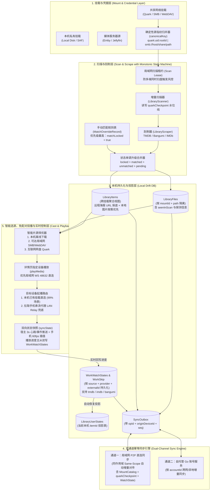
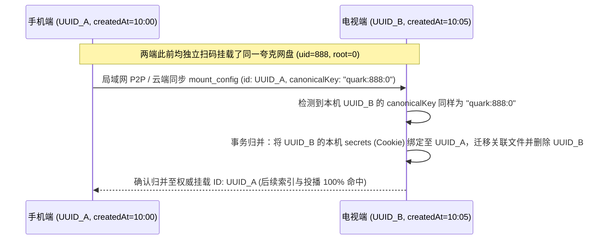
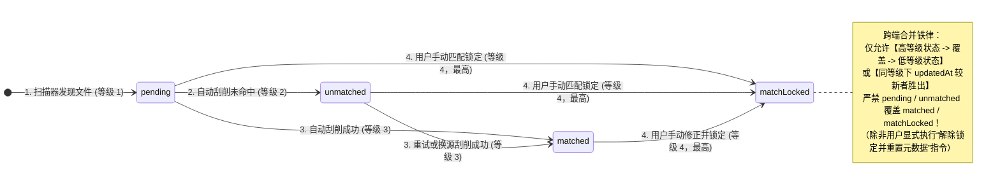
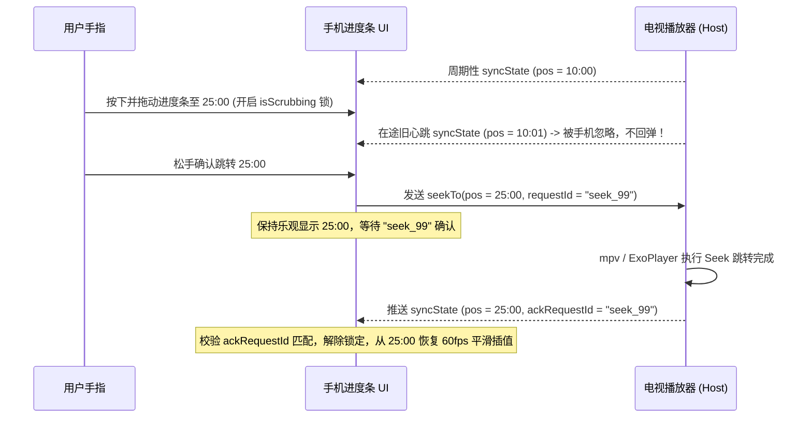

# 多端挂载、扫描刮削、同步与远程投播：冲突分析及消解架构文档

> 状态：评审定稿。
> 创建日期：2026-11-15
> 关联文档：[多端同步、离线协同与远程投播控制架构计划](account-sync-remote-plan.md)、[媒体 ID 说明与作品状态同步方案](media-identity-and-skip-settings-design.md)、[夸克网盘全盘扫描与增量更新方案](quark-incremental-scan-plan.md)。

---

## 1. 背景与参考案例对比（网易爆米花 / VidHub / Infuse）

在将 Plezy 打造为支持**「多端挂载、一次刮削多端复用、局域网免配对投播与进度控制、离线与自托管云同步」**的过程中，单纯叠加功能会在数据库外键、扫描水位线、状态合并及网络切换上产生诸多逻辑冲突。

参考目前主流轻量化直连海报墙播放器（**网易爆米花 Filmly**、**VidHub**、**Infuse**）的实践经验：

| 核心痛点场景 | 网易爆米花 (Filmly) 做法 | VidHub / Infuse 做法 | Plezy 架构取舍与增强 |
| --- | --- | --- | --- |
| **同一网盘/NAS 在多台设备添加** | 按网盘账号 UID + 目录路径识别为同一片源，跨全平台账号直接同步海报墙与播放记录 | 依托 iCloud / 账号同步挂载源配置与元数据索引，避免 Apple TV 重新扫盘 | 引入确定性源指纹 `canonicalKey`，即使离线独立添加同一网盘，相遇时自动归并 `mountId`，消除重复版本 |
| **网盘杂项视频干扰与风控** | 添加网盘时支持仅勾选指定影视文件夹，同步已聚合的剧集海报墙 | 支持文件夹白名单/忽略目录，支持批量重命名与手动修正锁定同步 | 同步 `includePaths` / `excludePaths`；同步包内嵌 `quarkCheckpoint` 水位线，多端无缝接力 0.1 秒级增量扫描 |
| **电视端弱网/无代理刮削失败** | 手机端刮削完成后，TV 端直接拉取现成海报墙元数据，无需 TV 独立刮削 | 主力设备（Mac/iPhone）刮削并同步元数据至 TV 端 | **状态单调升级法则**（严禁未配代理设备的 `unmatched/pending` 覆盖已匹配数据）+ **局域网扫描租约**防多端并发扫盘 |
| **跨设备投播与实时进度控制** | 各端独立播放通过云端同步进度，缺乏局域网无感投播与手机中继 | 依赖系统级 AirPlay（受限于苹果生态且占用手机前台） | **局域网免配对 UDP 发现 + WS 直连投播**：优先电视原生直连网盘/NAS，无凭据或本地离线视频自动回退手机串流代理中继，手机 60fps 实时同步电视进度 |

---

## 2. 消解冲突后的增量全局架构图

以下架构图展示了在引入**挂载指纹归一化、扫描租约与状态单调升级机、局域网 P2P + 云端双通道同步引擎、以及四层寻址投播与智能选源**后的完整数据流向：

---

## 3. 十二大核心冲突深度剖析与闭环解决方案

### 3.1 【挂载层冲突 1】多端独立添加同一网盘/NAS 导致 `mountId` 分裂与重复文件版本

* **冲突产生原因**：
  现有代码 [MountRegistry.newId()](../lib/storage/mount_registry.dart#L20) 每次新建挂载均生成随机 `UUID v4`。若用户在未同步前，先在手机上扫码挂载了夸克网盘（`mountId = UUID_A`），又在电视上独立扫码挂载了**同一夸克账号的同一目录**（`mountId = UUID_B`）。当两端在局域网或云端同步相遇时：
  1. 两端各自拥有 `UUID_A` 和 `UUID_B` 两条挂载记录，导致同一部电影下出现**两个完全相同的播放版本**；
  2. 手机投播 `UUID_A` 的影片给电视时，电视找不到 `UUID_A` 的凭据（凭据绑在 `UUID_B` 上），误判为无凭据而降级走手机串流中继；
  3. 手机导出的 `MountCatalog(UUID_A)` 无法与电视的 `UUID_B` 对齐。
* **解决方案（确定性源指纹 `canonicalKey` 自动归并）**：
  1. 为所有共享挂载计算规范化源指纹 `canonicalKey`：
     - **Quark**：`quark:<quark_uid>:<rootFolderId>`（登录时已获取 `uid`）
     - **SMB**：`smb://<lower(host)>/<lower(share)>/<normalizedRootPath>`
     - **WebDAV**：`webdav://<normalizedBaseUrl>`
  2. **相遇归并算法**：
     - 当收到远端同步的 `mount_config` 时，先按 `mountId` 查找；若未命中，再按 `canonicalKey` 查找本机已有挂载。
     - 若命中相同 `canonicalKey`：取 `createdAt` 较早（或字典序较小）的 `mountId` 作为保留主键，在事务中将本机 `LibraryFiles.mountId`、`LibraryScanStates.mountId` 迁移至保留主键，并**保留本机已有的有效 `secrets`（Cookie/密码）**，无缝消除分叉。

---

### 3.2 【挂载层冲突 2】夸克网盘全盘增量扫描混入非影视杂项（相册备份、网课、私人视频）

* **冲突产生原因**：
  [夸克增量扫描方案](quark-incremental-scan-plan.md#L101) 使用 `/file/search?cat=video` 检索视频。如果用户将挂载根目录设为网盘根目录（`rootFolderId = "0"`），网盘里的手机相册备份短片、工作录屏、网课视频都会被扫入库中并塞满「未匹配」列表。
* **解决方案（借鉴网易爆米花 / VidHub 的文件夹勾选与忽略列表）**：
  - 在挂载配置 `mount.config` 中增加 `includePaths`（仅扫描指定的子文件夹路径/fid 列表，空代表全部）与 `excludePaths`（忽略的文件夹路径/fid 列表，支持用户在界面上长按某文件夹一键「忽略此目录」）。
  - `includePaths` 与 `excludePaths` 随 `mount_config` 多端同步。增量扫描还原出父目录路径后，先校验是否命中白名单/黑名单，不匹配的目录直接跳过，且被新加入 `excludePaths` 的目录自动从 `LibraryFiles` 清理。

---

### 3.3 【扫描层冲突 3】夸克增量水位线（`quarkCheckpoint`）与本地扫描代际（`seenInScan`）跨端失步

* **冲突产生原因**：
  看现有代码 [LibraryScanner.scanQuarkIncremental](../lib/library/library_scanner.dart#L207-L209)：
  - 增量扫描必须读取 `library_scan_states.quarkCheckpoint`（`rootFolderId:watermark`）；若为空则直接抛出 `Quark: full scan required` 回退全盘遍历。
  - 全量扫描清理已删除文件依赖 `library_files.seen_in_scan != currentScanId`（见 [removeFilesNotSeen](../lib/library/library_scanner.dart#L180)）。
  - **矛盾点**：若手机完成了首次全盘扫描并把刮削索引同步给了电视，但没有同步 `quarkCheckpoint`，用户在电视上点“刷新”时，电视因为没有 `watermark` 会重新发起耗时数分钟的全盘递归扫描！此外，若同步导入的文件 `seenInScan` 未与接收端对齐，下次接收端扫描时会误删文件。
* **解决方案（索引包绑定水位线与扫描代际）**：
  1. `MountCatalogSnapshot` 与 `MountCatalogDelta` **强制携带 `quarkCheckpoint` 与源端 `catalogVersion`**。
  2. 接收端（如电视）在事务中导入索引包时：
     - 将本机 `library_scan_states` 的 `quarkCheckpoint` 更新为 `max(localWatermark, incomingWatermark)`，`status` 置为 `'idle'`；
     - 将导入的所有存活文件标记为本机当前 `scanId`。
  3. **效果**：手机扫完一次全盘后，电视收到同步包即天然具备增量基线；后续无论在手机还是电视上点“刷新”，都只需执行 **1 次请求（0.1 秒）** 的增量拉取。

---

### 3.4 【扫描层冲突 4】多端同时开启自动扫描导致的网盘风控踩踏（403 / 滑块限流）

* **冲突产生原因**：
  若手机、PC、电视同时在线且均开启“启动时/定时自动扫描”，三台设备同时用同一夸克账号调用接口，不仅产生冗余请求，还会触发夸克风控。
* **解决方案（主从默认策略 + 局域网扫描租约 Scan Lease）**：
  1. **设备角色默认分化**：
     - 手机 / 桌面端：作为主力管理端，可开启启动时增量扫描。
     - Android TV / tvOS 端：默认设为**「被动接收同步模式」**（启动时优先从局域网同伴或云端拉取最新 `MountCatalogDelta`，仅在用户主动点击“刷新”按钮且局域网无同伴刚扫过时才发起增量请求）。
  2. **局域网扫描互斥锁（Scan Lease）**：
     - 设备准备扫描共享挂载 `mountId` 前，先检查该挂载的 `lastFinishedAt`（含同步收到的时间戳）：若 **3 分钟内** 已有任何设备完成过扫描，自动跳过本次后台自动扫描。
     - 扫描进行中时，通过局域网 UDP/WS 广播 `scanningMounts: [mountId]`，同局域网其他设备看到后立即挂起对该挂载的重复扫描，直接等待接收扫描完成后的增量包。

---

### 3.5 【刮削层冲突 5】弱网/未配代理设备的 `unmatched/pending` 覆盖已刮削数据（数据倒退冲突）

* **冲突产生原因**：
  用户在 PC 端配置了 TMDB 代理或自定义域名，成功把 500 部影片刮削为 `matched`；而客厅电视没有配置代理，连不上 TMDB。如果电视对新文件或重扫文件执行刮削，产出了 `pending` 或 `unmatched` 状态，一旦同步合并逻辑简单按时间戳（`updatedAt`）覆盖，电视就会把 PC 端已经刮好的海报墙冲掉！
* **解决方案（状态单调升级状态机 State Monotonicity Rule）**：
  在跨端合并同一挂载文件（`mountId + path/remoteId`）的刮削状态时，不以单纯时间戳论胜负，而是严格执行**单向状态等级铁律**：

---

### 3.6 【数据模型冲突 6】`LibraryItems` 跨挂载聚合导致的海报裂图与移除挂载后的“幽灵空集”

* **冲突产生原因（代码级隐患）**：
  1. **海报裂图**：在 [LibraryScraper._apply](../lib/library/library_scraper.dart#L459-L460) 中，若挂载 S（如家里 SMB）的视频同目录有 `poster.jpg`，代码会将 `LibraryItems.posterSource` 写为 `'mount:<mount_S_id>:/...'`。若该剧同时合并了夸克挂载 Q 的集数，或者该元数据同步到了未挂载 S 的设备上，读取 `mount:<mount_S_id>:...` 会直接失败导致海报裂图！
  2. **幽灵空集**：当一部剧的第 1~10 集在挂载 Q，第 11~20 集在挂载 S。用户删除挂载 S 后，`LibraryFiles` 级联删除了 11~20 集的视频行，但 [pruneEmptyTitles()](../lib/library/library_scanner.dart#L181) 看到整部剧底下还有 1~10 集的视频，不会删除该剧，导致详情页里第 11~20 集依然显示在列表里，点击播放却报错“找不到文件”。
* **解决方案**：
  1. **远程海报保底 + 图片加载兜底 + 本地艺术图按需优先**：
     - `LibraryItems` 的 `posterSource` / `backdropSource` 存储 TMDB / Bangumi 的远程图片地址（**说明：同步索引省去的是 TMDB API 元数据刮削请求，接收端首次渲染海报时仍需请求图片地址下载并缓存**；若电视直连 `image.tmdb.org` 受限，可复用同步过来的 TMDB 图片镜像域名，或在同局域网内从手机/PC 缓存代理兜底拉取）。
     - 本地同目录图片作为 `role = 'artwork'` 记录在 `LibraryFiles` 中；UI 渲染或本地代理取图时，若当前设备存在该 `mountId` 且可达则优先使用本地图片，否则自动回退至 `LibraryItems` 上的远程 URL。
  2. **精细到单集与单季的 `pruneEmptyTitles()`**：
     - 修剪空条目时按自底向上顺序执行：
       1. 删除底下没有任何 `LibraryFiles (role='video')` 关联的 `episode` 行；
       2. 删除底下没有任何存活 `episode` 子行的 `season` 行；
       3. 删除底下没有任何视频或存活子行的 `movie` / `show` 行。
     - 由于观看进度和已看标记早已独立存储在 `WorkWatchStates`（以 `local-library:show:tmdb:12345:s1:e15` 为键）中，删掉空的 `episode` 索引行**完全不会丢失用户的已看记录**；日后重新挂回挂载 S 时，会自动通过 `restoreItemAndChildren` 恢复已看状态！

---

### 3.7 【身份模型冲突 7】Bangumi 刮削番剧在 `WorkWatchStates` 中的身份断层与季号错位

* **冲突产生原因**：
  - [LibraryScraper._providersFor](../lib/library/library_scraper.dart#L105-L110) 对动漫番剧优先使用 Bangumi 刮削，产出的 `LibraryItems` 仅有 `bangumiId`（无 `tmdbId` 和 `imdbId`）。
  - 若 `WorkWatchStates` 只认 `tmdb` 和 `imdb`，所有 Bangumi 刮削的番剧都会丢失进度持久化和片头片尾跳过能力。
  - 同时，Bangumi 将多季番剧拆分为不同 `subject_id`（每季均为 Season 1），而 TMDB 归为同一 `tmdbId` 下的 Season 1 / Season 2。若两端各自刮削且一端命中 Bangumi、一端命中 TMDB，季集号将严重冲突。
* **解决方案**：
  1. `WorkIdentity.provider` 正式支持 `tmdb`、`imdb`、`bangumi` 三种提供方（优先级：`tmdb` > `imdb` > `bangumi`）。
  2. 依托**「共享挂载一端刮削、多端同步索引」**，同一共享挂载内的番剧在所有设备上直接复用同一份刮削出的 `(provider, externalId, seasonNumber, episodeNumber)`，从根源上杜绝跨端刮削源不一致导致的季集错位。

---

### 3.8 【局域网免配对冲突 8】同局域网多用户（室友/家人不同账号）数据串流污染与误触打断

* **冲突产生原因**：
  采用“局域网免配对自动发现”后，若同一 Wi-Fi 下有两个不同用户（如合租室友或家里使用不同账号的成员），无条件自动 P2P 同步会把室友的片库和看片进度混入你的数据库；逛详情页时误点投播也会直接切走客厅正在播放的电视画面。
* **解决方案（同作用域免配对 `Same-Scope Zero-Pairing` + 播放中防误触保护）**：
  1. **后台 P2P 数据同步严格校验作用域（Scope Isolation）**：
     - 定义设备同步作用域 `syncScopeKey = accountKey ?? 'local-default'`。
     - 只有当局域网两台设备的 `syncScopeKey` 完全一致（例如双方均登录了同一账号，或双方均处于未登录的家庭默认模式且开启了局域网同步）时，才自动在后台通过 P2P 合并 `mount_catalog` 与 `work_watch`。不同账号之间绝对隔离。
  2. **投播防打断二次确认**：
     - UDP 信标实时广播宿主当前的 `nowPlaying` 状态。
     - 当目标设备处于 `playing` 状态且播放的是**另一部作品**时，手机端点击「在设备上播放」会弹出轻量确认框：“客厅电视正在播放《xxx》，是否切换播放《yyy》？”；若手机点开的是电视**正在播放的同一部作品**，详情页直接变形为实时进度控制条，不会重头起播打断。

---

### 3.9 【远程投播冲突 9】手机串流代理中继（`lanRelayFallback`）在手机锁屏/杀后台时断流 & 进度归属

* **冲突产生原因**：
  当电视未配网盘凭据或投播手机本地离线视频时，电视通过 `http://<phone-ip>:<port>/cast/<token>` 拉取手机串流代理。但用户点完投播后通常会把手机息屏放一边，几分钟后手机 OS 挂起后台网络，电视就会断流卡死！此外，若投播的是手机独有的离线视频，电视数据库里没有该条目，进度写给谁？
* **解决方案（源头凭据下发 + 中继保活 + 主从进度双写）**：
  1. **源头消除 99% 的中继需求——局域网一键下发挂载凭据**：
     - 手机向电视同步 `mount_config` 或首次投播时，支持将手机上已登录的夸克/SMB/WebDAV 凭据通过局域网直连一键加密同步至电视本机 `CredentialVault`。
     - 电视拥有凭据后，直接用电视本机驱动直连夸克/NAS 播放，**手机锁屏、关机、离家均不影响电视播放**。
  2. **1% 必须走手机中继场景（如投播手机已下载离线视频）的前台服务保活**：
     - 一旦テレビ实际连接了手机的 `/cast/<token>` 路由，手机立即启动与音乐播放同级的 **Foreground Service（持 `Partial WakeLock` + `Wi-Fi Lock`）**，并在手机通知栏与遥控页提示“正在由本机为客厅电视提供视频流”。
  3. **播放进度主从双写（Dual Write）**：
     - 电视播放期间，不仅在电视本机按 `WorkIdentity` 写入 `WorkWatchStates`，还通过 WebSocket `syncState` 将最新 `positionMs` / `watched` 实时回传给控制端手机，手机同步更新本机 `WorkWatchStates` 与 `LibraryUserStates`。

---

### 3.10 【多源选片冲突 10】多挂载同片源在「家庭局域网」与「户外 5G」切换时的死链报错

* **冲突产生原因**：
  同一部影片既有家里局域网 NAS（SMB 挂载）的 4K 版本，又有夸克网盘的 4K 版本，合并在同一个 `LibraryItems` 条目下。当用户拿着手机出门用 5G 流量点击「播放」时，若默认取第一个文件（内网 SMB `192.168.1.10`），会经历漫长的 TCP 连接超时然后报错。
* **解决方案（参考 VidHub / Infuse 的网络感知智能选源）**：
  点击「播放」未手动指定具体版本时，按当前网络环境与可达性自动排序选源：
  1. **第一优先**：本机已完成的离线下载文件（`DownloadedMedia`，零流量、秒开）；
  2. **第二优先**：当前网络快速可达的局域网挂载（SMB / 局域网 WebDAV，对 Host 做毫秒级连接探活或状态缓存，千兆内网高码率首选）；
  3. **第三优先**：公网可达的云盘/远程挂载（Quark 网盘 / 公网 WebDAV）。
  - 在户外 5G 下探测到内网 SMB 不可达时，自动静默跳过 SMB 版本并起播夸克网盘版本。

---

### 3.11 【双通道同步冲突 11】局域网 P2P 同步与云端服务器同步同时开启时的重复应用与乱序冲突

* **冲突产生原因**：
  手机和电视在家里同一 Wi-Fi 下，既连着局域网 P2P，又连着自托管 Go 服务器。手机看完第 1 集产生一条状态更新，通过局域网 WS 瞬间传给了电视（耗时 5ms），同时手机也把这条更新推给了云服务器，云服务器随后又通过 WSS 通知电视拉取（耗时 200ms）。如果两边游标独立，会不会导致重复写入、播放次数 `playCount` 被加两次，或者旧的云端快照覆盖掉刚刚局域网收到的新进度？
* **解决方案（全局幂等操作 ID + 绝对状态非增量写入）**：
  1. **状态幂等化（State-Based Idempotency）**：
     - `work_watch` 同步记录传输的是**操作后的最终状态快照**（如 `playCount: 1, positionMs: 0, watched: true, updatedAt: 1731600000`），而不是传 `playCount + 1` 的相对指令。因此同一条状态无论从局域网收到一次、再从云端收到一次，结果 100% 幂等！
  2. **操作流水号（`opId`）去重与时间戳守卫**：
     - 每次变更生成全局唯一 `opId`（UUID）与 `updatedAt`。
     - 接收端对每个实体仅当 `incoming.updatedAt > local.updatedAt`（或同时间戳下 `opId` 字典序更大）时才更新落盘，已处理过的 `opId` 直接 O(1) 忽略。

---

### 3.12 【远程控制冲突 12】手机拖动进度条（Seek）时的状态回跳（Rubber-banding 现象）

* **冲突产生原因**：
  电视正在播放第 `10:00`，用户在手机上把进度条拖到 `25:00` 松手发送 `seekTo(1500000)`。但在 `seekTo` 到达电视并完成解码跳转前的 200ms 内，电视刚好发出了一个定时心跳 `syncState(positionMs: 10:01)`。如果手机无脑接收 `syncState`，手机上的进度条会瞬间从 `25:00` **弹回** `10:01`，过一会儿再跳回 `25:00`，体验极差！
* **解决方案（乐观 UI 锁定 + `lastAckedSeekRequestId` 令牌校验）**：
  1. 手机端手指按下拖动进度条时，进入 `isScrubbing` 状态，暂停应用外部 `syncState` 的 `positionMs`。
  2. 松手发送 `seekTo(positionMs: 1500000, requestId: "req_seek_99")` 后，手机端保持显示 `25:00`（乐观更新），并开启 1.5 秒的 **Seek 挂起窗口（Pending Seek Guard）**。
  3. 在挂起窗口内，忽略任何未携带 `lastAckedRequestId == "req_seek_99"` 的旧周期性 `syncState` 位置更新；一旦收到电视完成跳转后回推的确认帧（或超时），立即解除锁定并恢复 60fps 平滑插值，做到丝滑跟手、绝不回弹。

---

## 4. 冲突消解清单汇总表

| 编号 | 冲突领域 | 核心矛盾 | 消解机制 |
| --- | --- | --- | --- |
| **1** | 多端独立挂载 | 随机 `UUID` 导致同网盘出现双份挂载与重复版本 | 计算确定性指纹 `canonicalKey`（如 `quark:uid:rootId`），相遇时自动归并 `mountId` 并保留本机有效凭据 |
| **2** | 网盘杂项视频 | 全盘搜索把相册视频、网课扫入未匹配 | 挂载支持 `includePaths` / `excludePaths` 目录勾选与忽略，配置随挂载多端同步 |
| **3** | 增量水位失步 | 同步索引未带水位线，导致电视刷新时全盘重扫 | `MountCatalog` 内嵌 `quarkCheckpoint` 与扫描代际，导入索引后任意端均可直接 0.1s 增量更新 |
| **4** | 多端并发扫盘 | 多设备同时启动自动扫描触发网盘 403 风控 | TV 端默认被动接收同步 + 局域网广播「扫描租约（Scan Lease）」互斥 |
| **5** | 刮削数据倒退 | 未配代理的设备用 `unmatched` 冲掉已匹配海报墙 | **状态单调升级法则**：`matchLocked > matched > unmatched > pending`，严禁低等级覆盖高等级 |
| **6** | 跨挂载聚合表 | 本地图片 `mount:` 路径跨端裂图；删挂载残留空集 | 远程海报 URL 保底、本地图片按可达性优先；`pruneEmptyTitles()` 级联清理无视频支撑的空 `episode/season` |
| **7** | 动漫番剧身份 | Bangumi 刮削无 TMDB ID 导致无法存进度；跨端季号错位 | `WorkIdentity` 正式支持 `bangumi`；共享挂载多端直接复用同一份刮削季集结果 |
| **8** | 免配对作用域 | 同局域网不同账号互串观看记录；误触切走电视画面 | `Same-Scope Zero-Pairing`（同作用域才自动同步数据）+ 电视播放其他影片时投播需轻量确认 |
| **9** | 手机中继断流 | 手机锁屏后代理断流；手机独有视频投播进度无归属 | 局域网一键下发凭据让电视 99% 原生直连；中继时启动 Foreground Service 保活；进度主从双写 |
| **10** | 多源异地死链 | 户外 5G 点播放默认命中内网不可达的 SMB 版本 | 网络感知智能选源：本机离线下载 > 当前可达局域网 SMB/WebDAV > 互联网网盘 Quark |
| **11** | 双通道重复写 | 局域网 P2P 与云端同时收到同一变更导致重复累加 | 传输最终状态快照而非相对增量 + 全局 `(opId, updatedAt)` 幂等去重 |
| **12** | 拖动进度回弹 | 手机 Seek 期间收到在途旧心跳导致进度条来回跳变 | 乐观 UI + `Pending Seek Guard`（校验 `ackRequestId` 后再恢复外部插值） |
