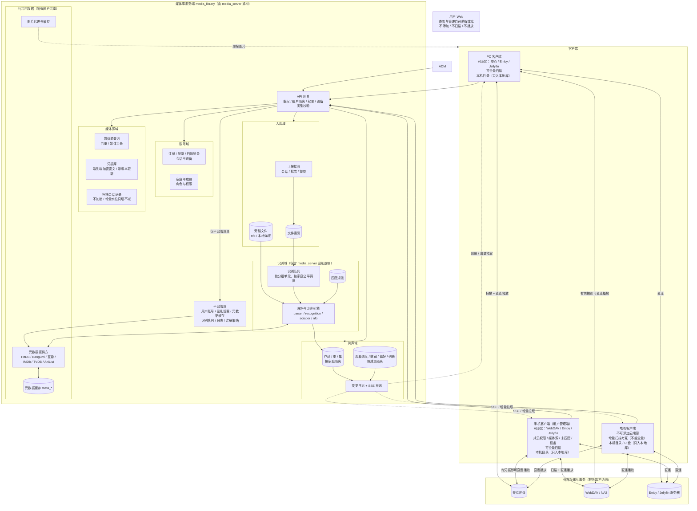
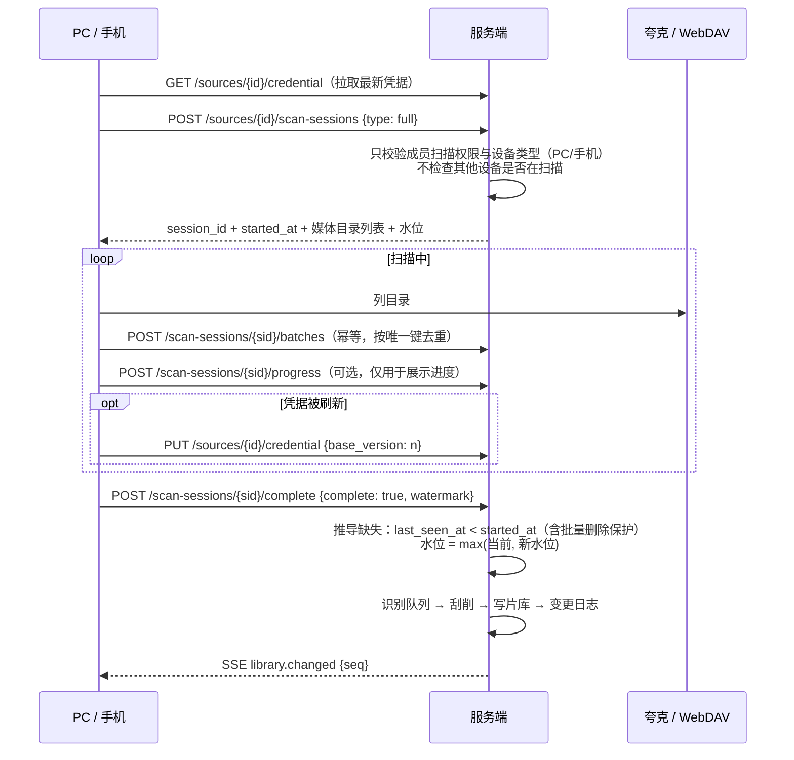
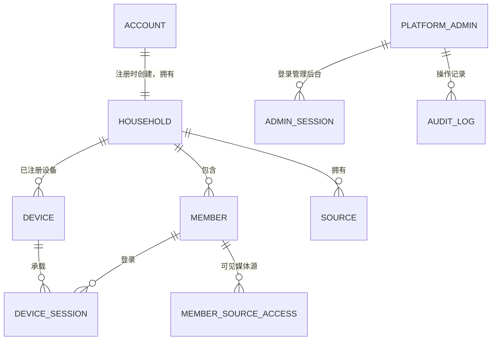
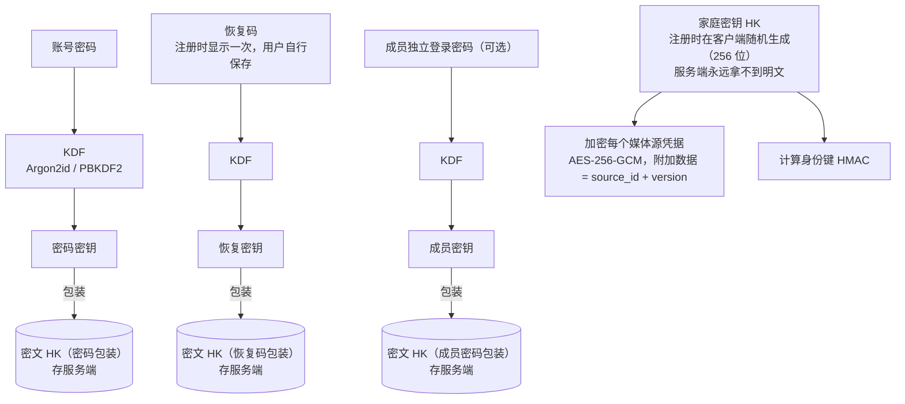
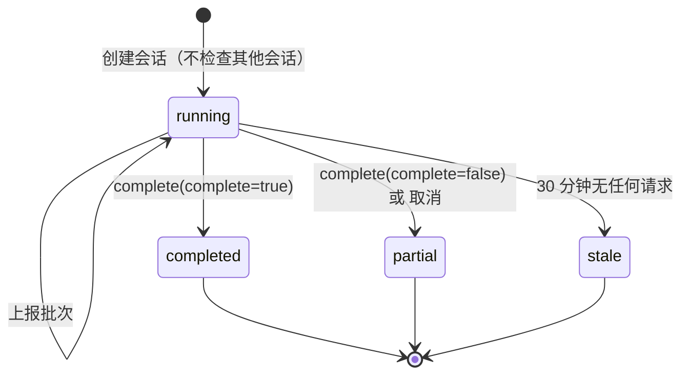
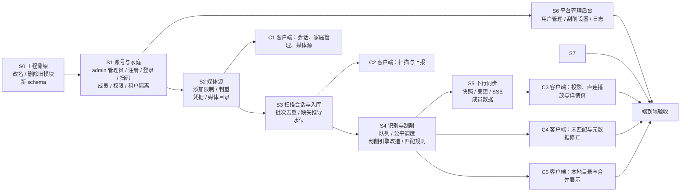
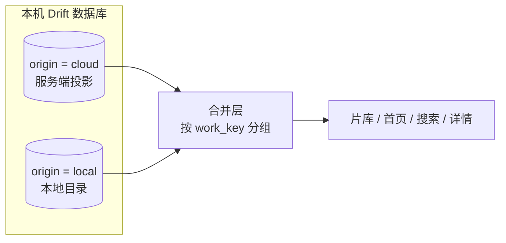

# V1 实施计划：媒体库服务端重构（客户端扫描 + 服务端刮削入库）

> 状态：计划草案（待确认）　｜　日期：2026-11-20
> 设计依据：[client-scan-server-scrape-redesign.md](./client-scan-server-scrape-redesign.md)（下称“设计文档”）。**本文的 V1 决策与设计文档冲突时，以本文为准。**
> 改造对象：`media_server/`（服务端，改名为“媒体库” `media_library/`）、`media_server/web/`（改为用户 Web + 平台管理后台）、Flutter 客户端相关模块；`sync_server/` 已从工作区删除，其账号、扫码登录、密钥传递逻辑从 Git 历史移植。

---

## 0. V1 已确认的决策

**服务端定位：官方服务端。** 普通用户自行注册、登录，在手机 App 上管理家庭成员、权限和媒体源；平台由内置管理员 `admin` 统一管理账号、刮削设置和日志。

| # | 决策 | 说明 |
|---|---|---|
| V1-1 | 服务端**只负责账号、媒体源登记、入库与刮削**，完全移除服务端扫描、存储驱动和串流代理 | 服务端不再访问任何存储，也不转发任何视频流 |
| V1-2 | 服务端自带的 Web 分为**用户 Web**（用户查看和管理自己的媒体库）和**平台管理后台**（仅管理员），都不提供播放 | 添加媒体源和扫描只在客户端完成，见 §9 |
| V1-3 | 服务端支持**公网部署、用户注册、多租户**；每个注册用户拥有一个家庭，可以管理家庭成员并配置权限 | 设计文档 §11 提前到 V1 |
| V1-4 | 添加入口按设备类型限制：**PC 只能添加夸克、Emby、Jellyfin；手机只能添加 WebDAV、Emby、Jellyfin**；电视和 Web 不能添加 | 与设计文档 §14.2“按身份强弱划分”一致：夸克有 uid、Emby/Jellyfin 有 ServerId，WebDAV 身份弱，只在手机上添加 |
| V1-5 | **Emby / Jellyfin 独立运行**：不扫描、不刮削、不入库；服务端只保存连接配置并同步给各设备，客户端用现有 Jellyfin/Emby 客户端直连 | 观看进度保存在 Emby/Jellyfin 自身 |
| V1-6 | 扫描规则：有凭据、有扫描权限的设备都可以扫描，**服务端不加扫描锁，多台设备可以同时扫描同一个源**；正确性靠唯一键去重、按时间推导缺失、水位只增不减来保证；扫描前先拉取最新凭据；**全量扫描只允许 PC 和手机** | 见 §5；如果后续出现网盘风控等问题再考虑加协调 |
| V1-7 | 不迁移旧的 `media.db`，V1 新建库 | 项目处于开发期 |
| V1-8 | **手机 App 是用户的管理端**：家庭成员与权限、媒体源（编辑、删除、媒体目录、扫描状态）、未匹配处理、元数据修正、设备管理都在手机上完成 | 添加媒体源仍遵守 V1-4；PC 也提供媒体源与扫描相关的管理 |
| V1-9 | 内置平台管理员，默认账号 **`admin` / `admin`**：管理所有用户账号、刮削设置、元数据缓存、识别队列和日志 | 平台管理员与普通用户是两类账号，见 §3.1；默认密码的安全措施见 §3.5 |
| V1-10 | **设备本地目录只入本地库**：任何客户端都可以挂载本机目录，本机扫描、调用服务端识别接口，结果只写本机；不上报、不入云端库；展示时与云端片库按作品身份合并 | 见 §14 |

---

## 1. 整体架构

### 1.1 架构总览



### 1.2 三条数据通路

| 通路 | 方向 | 内容 | 经过服务端吗 |
|---|---|---|---|
| 上行：文件事实 | 客户端 → 服务端 | 扫描得到的文件列表、nfo、本地海报缩略图、播放端上报的轨道信息 | ✅ |
| 下行：片库 | 服务端 → 客户端 | 作品、季、集、文件定位、匹配结果、成员的观看状态 | ✅（变更日志 + SSE） |
| 播放：视频字节 | 存储 → 客户端 | 视频、字幕 | ❌ 客户端直连存储；Emby/Jellyfin 直连其服务器 |

### 1.3 全量扫描时序



---

## 2. 服务端改名与工程结构

### 2.1 命名建议（待定）

已确定（D1）：服务端名称暂定为 **媒体库**。目录 `media_library/`，二进制 `media-library`，Web 标题“媒体库”。

### 2.2 目录结构

在原 `media_server/` 上重构后改名，保留 Git 历史：

```
media_library/
  cmd/media-library/main.go
  internal/
    api/               # 路由、中间件（鉴权、租户、权限、设备类型）
      v1/ ...          # 按领域拆分的 handler
    account/           # 注册、登录、扫码登录、会话、设备（移植自 sync_server）
    household/         # 家庭、成员、角色、权限
    source/            # 媒体源、媒体目录、判重、凭据（含带版本更新）
    scansession/       # 扫描会话记录、进度、缺失推导、水位（不加锁）
    ingest/            # 上报会话、批次幂等、变化判断、缺失推导、字幕归属
    identify/          # 识别队列、分组单元、公平调度
    library/           # 保留：parser / classifier / recognition / nfo / scraper（改造）
    metadata/          # 保留：各提供方与缓存
    feed/              # 变更日志、快照、SSE
    userdata/          # 观看进度、收藏、作品偏好、列表
    platform/          # 平台管理：管理员账号与会话、用户管理、注册策略、刮削设置、审计日志
    db/                # schema、migrations、按租户的存储层
    keyring/           # 端到端加密相关的服务端部分：保存家庭密钥的包装密文、KDF 参数、扫码传递密钥的临时通道（服务端不接触明文）
    applog/            # 保留
  web/                 # 平台管理后台（React，仅 admin 使用）
```

### 2.3 现有代码处理清单

| 现有模块 | 处理 | 说明 |
|---|---|---|
| `internal/metadata/*` | **保留** | 提供方与缓存不变；配置从“服务器设置”改为“平台设置 + 家庭偏好” |
| `library/parser.go` `classifier.go` `recognition.go` `nfo.go` | **保留** | 原样迁入 `internal/library` |
| `library/scraper.go` | **保留并改造** | 抽象 `SidecarReader`（读上传的 nfo）、`ArtworkLocator`（本地海报改用上传的缩略图）；所有查询加 `household_id`；入口从“整体扫完再刮削”改为“按分组单元识别”；前置匹配规则 |
| `library/identify_public.go` + `handlers_public_metadata.go` | **保留** | 继续服务未登录的“纯本地模式”客户端（设计文档 Q7） |
| `library/scanner.go` | **拆解** | 样片过滤、视频判定、字幕匹配（`matchSubtitles`）、占位条目创建等逻辑迁入 `ingest`；列目录部分删除 |
| `library/coordinator.go` | **删除** | 由 `scansession` + `identify` 取代；fsnotify、定时扫描全部删除 |
| `library/probe.go` | **删除** | 探测改由客户端完成并上报 |
| `internal/storage/*`（local / smb / webdav / quark） | **删除** | 服务端不再访问存储 |
| `internal/stream/*`、`handlers_stream.go` | **删除** | 不再提供串流代理和字幕抽取 |
| `internal/extserver/*`、`handlers_external.go` | **删除** | Emby/Jellyfin 由客户端直连；服务端只保存配置（`source` 中 kind = emby/jellyfin） |
| `handlers_mounts.go` | **删除** | 由 `source` 取代 |
| `api/local_artwork_cache.go` | **删除** | 本地海报改为客户端上传 |
| `api/handlers_artwork`（远程图片代理） | **保留** | 国内访问 TMDB 图片的兜底；这是元数据图片，不属于串流 |
| `internal/auth/*`（单管理员） | **拆分替换** | 原单管理员逻辑（密码哈希、种子管理员、会话）迁入 `platform`，作为平台管理员 `admin`；普通用户改为 `account` + `household`，并移植 `sync_server` 的注册、扫码登录、设备管理 |
| `home_cache.go`、`handlers_library.go` | **改造** | 只保留 App 管理页面需要的接口（未匹配列表、条目详情、搜索匹配），按家庭隔离；首页和浏览由客户端本地投影完成，删除首页缓存 |
| `events/hub.go` | **改造** | 按家庭分频道，事件类型重新定义 |
| `sync_server/` | **已删除，从 Git 历史移植** | 目录已从工作区删除；账号注册登录、扫码登录与密钥传递（`crypto.go`、`handleQr*`、KDF 参数与主密钥备份）、设备管理、平台管理页的逻辑从删除前的提交中取出，迁入 `account` / `keyring` / `platform` |

---

## 3. 账号、家庭与权限

### 3.1 两类账号

| | 平台管理员 | 普通用户 |
|---|---|---|
| 来源 | 服务端首次启动时自动创建，默认 `admin` / `admin` | 用户在 App 中自助注册（或由管理员创建） |
| 登录入口 | **只能登录平台管理后台 Web** | 手机、PC、电视 App 和用户 Web；**不能登录管理后台** |
| 家庭 | 没有家庭，不能添加媒体源、不能扫描、没有片库 | 注册时自动创建一个家庭，本人为所有者 |
| 能做什么 | 管理所有用户账号、刮削设置、元数据缓存、识别队列、注册策略、日志 | 管理自己的家庭成员、权限、媒体源、片库 |
| 能看到什么 | **只有账号信息和非隐私统计**（家庭成员数、设备数、媒体源数量、作品数、文件数、存储占用、最近活跃）；看不到片库内容、文件名、路径、媒体源名称、观看记录、凭据（D8） | 只能看到自己家庭的数据 |

管理员账号与用户账号存放在不同的表中（`platform_admins` 与 `accounts`），走不同的登录接口和会话类型，**互相不能登录对方的入口**。这样即使普通用户的用户名叫 `admin`，也不会与平台管理员混淆。

### 3.2 普通用户的家庭模型



| 实体 | 关键字段 |
|---|---|
| `platform_admins` | 用户名、密码哈希、`must_change_password`、最后登录时间与 IP |
| `admin_sessions` | 管理员、token 哈希、IP、过期时间（默认 12 小时） |
| `accounts` | 用户名、邮箱（可选）、密码哈希、状态（正常 / 禁用 / 待删除）、注册时间、注册 IP |
| `households` | 名称、所有者账号、配额（媒体源数、文件数）、家庭偏好（刮削语言等，见 §7.2） |
| `members` | 所属家庭、昵称、头像、角色、权限位、可选 PIN、可选独立登录名和密码、内容分级上限 |
| `devices` | 所属家庭、`device_class`（`desktop` / `phone` / `tablet` / `tv`）、平台、名称、最后在线时间 |
| `sessions` | 设备、成员、token 哈希、过期时间 |
| `member_source_access` | 成员可见的媒体源（为空表示全部可见） |
| `audit_logs` | 操作者（管理员或成员）、动作、对象、IP、时间；记录管理员的所有写操作，以及成员的凭据读取、媒体源删除、成员权限变更 |

### 3.3 家庭内的角色与权限

| 权限 | 所有者 | 管理员 | 成员 | 儿童 |
|---|---|---|---|---|
| 管理成员和权限 | ✅ | ✅（不能修改所有者） | ❌ | ❌ |
| 添加、编辑、删除媒体源 | ✅ | ✅ | 可单独授权 | ❌ |
| 触发扫描 | ✅ | ✅ | 可单独授权 | ❌ |
| 修正匹配、编辑元数据 | ✅ | ✅ | 可单独授权 | ❌ |
| 浏览和播放 | 全部 | 全部 | 按可见媒体源 | 按可见媒体源 + 内容分级上限 |
| 观看进度、收藏、列表 | 各自独立 | 各自独立 | 各自独立 | 各自独立 |
| 注销账号（删除整个家庭） | ✅ | ❌ | ❌ | ❌ |

权限以位标志保存在 `members.permissions`，角色只是预设模板，所有者可以对单个成员增减权限。这里的“管理员”是**家庭内的角色**，与平台管理员 `admin` 无关。

### 3.4 登录方式

**普通用户（App）**

1. **注册**：手机或 PC App 中填写用户名和密码（邮箱可选），服务端按注册策略校验（开放 / 邀请码 / 关闭，由平台管理员设置），成功后创建账号、家庭和所有者成员，直接登录。
2. **账号登录**：用户名 + 密码。家庭有多个成员时，登录后选择成员（有 PIN 时输入 PIN）。
3. **成员独立登录**（可选）：所有者为成员设置独立登录名后，成员可以直接登录，只能进入自己的身份。
4. **扫码登录**（电视、PC）：电视显示二维码，已登录的手机扫码确认，并选择登录到哪个成员。移植 `sync_server` 的 `qr/create`、`qr/confirm`、`qr/poll`。

设备注册时上报 `device_class`，服务端据此执行 §4 的添加限制和 §5 的扫描限制。`device_class` 由客户端上报，存在被伪造的可能。V1 接受这个风险：限制的目的是产品体验和防止误操作，不是安全边界；真正的安全边界是成员权限和租户隔离。

**平台管理员（管理后台 Web）**

- 独立登录接口 `POST /api/admin/auth/login`，独立会话，所有管理接口都在 `/api/admin/*` 下，中间件只接受管理员会话。
- 普通用户的 token 访问 `/api/admin/*` 一律返回 401；管理员 token 访问用户接口同样返回 401。

### 3.5 默认管理员账号的安全措施

默认账号 `admin` / `admin` 方便首次部署，但服务端会部署在公网上，必须配套以下措施：

| 措施 | 说明 |
|---|---|
| 首次登录强制改密码 | `must_change_password=true` 时，管理员登录后只能访问“修改密码”接口，其他管理接口返回 `403 password_change_required` |
| 可通过环境变量覆盖 | `LIBRARY_ADMIN_USER` / `LIBRARY_ADMIN_PASSWORD`：首次启动时用指定值创建管理员，并且不强制改密码（沿用现有 `-admin-user` / `-admin-password` 参数的思路） |
| 启动告警 | 只要管理员仍在使用默认密码，每次启动都在日志中输出醒目警告 |
| 登录限流 | 管理员登录按 IP 和账号限流（例如 5 分钟内失败 5 次锁定 15 分钟），记录审计日志 |
| 可选访问限制 | `LIBRARY_ADMIN_ALLOWED_CIDRS`：只允许指定网段访问管理后台；可选的独立监听端口 `LIBRARY_ADMIN_ADDR`，方便只在内网暴露 |
| 密码重置 | 管理员忘记密码时，用命令行 `media-library admin reset-password` 在服务器本机重置，不提供网页找回 |

### 3.6 租户隔离

- 所有业务表都带 `household_id`。存储层的每个方法都必须接收租户上下文，**不提供不带租户的查询方法**。
- 中间件从会话中解析 `household_id` 和 `member_id`，注入请求上下文。handler 不允许从请求参数里读取 `household_id`。
- 平台管理接口使用单独的存储方法，**只能读取账号信息和聚合统计**，没有任何返回片库明细、文件名、媒体源名称或凭据的接口（D8）。
- 元数据缓存（`meta_*`）和图片缓存是全局共享的，不含任何租户数据。
- 测试：每个接口都要有“用 A 家庭的 token 访问 B 家庭的资源返回 404”的用例；每个管理接口都要有“用户 token 访问返回 401”的用例。

---

## 4. 媒体源

### 4.1 添加限制

| 媒体源 | PC | 手机 | 电视 | 管理后台 | 身份（判重依据） | 是否扫描、刮削 |
|---|---|---|---|---|---|---|
| 夸克 | ✅ | ❌ | ❌ | ❌ | 夸克 uid | ✅ |
| WebDAV | ❌ | ✅ | ❌ | ❌ | 规范化地址 + 用户名（弱身份，见 §4.3） | ✅ |
| Emby | ✅ | ✅ | ❌ | ❌ | ServerId + 用户 ID | ❌ |
| Jellyfin | ✅ | ✅ | ❌ | ❌ | ServerId + 用户 ID | ❌ |

- 服务端在 `POST /sources` 中按 `device_class` 和 `kind` 校验；不允许时返回 `403 source_kind_not_allowed_on_device`，客户端据此显示“请在手机上添加”或“请在电脑上添加”。
- 允许的组合放在平台配置中（`source_add_policy`），平台管理员可以在管理后台调整，无需发版。
- 平台管理员没有家庭，不能添加或管理任何用户的媒体源。

### 4.1.1 媒体源的日常管理（在手机上完成）

| 操作 | 手机 | PC | 电视 | 说明 |
|---|---|---|---|---|
| 查看所有媒体源、凭据状态、扫描状态 | ✅ | ✅ | 只读 | |
| 改名、删除媒体源 | ✅ | ✅ | ❌ | 只看成员权限，不受添加限制约束：手机可以删除 PC 添加的夸克源 |
| 增删媒体目录（浏览目录后选择） | ✅ | ✅ | ❌ | 用共享凭据浏览目录。**手机可以给 PC 添加的夸克源增加目录**，因为凭据已共享，不涉及新的身份判定 |
| 修改凭据（重新扫码、改密码） | 遵守添加限制 | 遵守添加限制 | ❌ | 夸克在 PC 上重新扫码；WebDAV 在手机上修改密码 |
| 触发扫描 | ✅ | ✅ | ❌（V1） | 全量扫描只允许 PC 和手机，见 §5 |
| 确认批量删除（待删除列表） | ✅ | ✅ | ❌ | |
| 处理未匹配、修正匹配、编辑元数据 | ✅ | ✅ | ❌ | |

### 4.2 数据结构

| 表 | 关键字段 |
|---|---|
| `sources` | `id`、`household_id`、`kind`（quark / webdav / emby / jellyfin）、`name`、`identity_key`（判重键，HMAC(家庭密钥, 规范化值)，由客户端计算）、`created_by_member`、`created_by_device`、`status`、`deleted_at` |
| `source_folders` | `id`、`source_id`、`path`（相对源根目录）、`exclude_paths`、`library_hint`、`baseline_at`；**仅夸克和 WebDAV 有** |
| `source_credentials` | `source_id`、`ciphertext`（端到端加密，服务端无法解密）、`version`、`status`（valid / expired / kicked）、`updated_by_device`、`updated_at` |
| `source_scan_state` | `source_id`、`incremental_watermark`（夸克账号级水位）、`last_full_scan_at`、`last_scan_result` |

Emby/Jellyfin 的密文中保存服务器地址、用户 ID、访问令牌；没有媒体目录，也没有扫描状态。

### 4.3 判重（V1 简化版）

| 类型 | `identity_key` | V1 规则 |
|---|---|---|
| 夸克 | `quark:<uid>` | 家庭内唯一约束。重复添加时返回 `409 + existing_source_id`，客户端转为“刷新凭据 / 添加媒体目录”。如果在已有夸克源上扫码登录了另一个 uid，拒绝覆盖（设计文档 N5） |
| Emby / Jellyfin | `emby:<ServerId>:<UserId>` | 家庭内唯一约束；同一服务器的不同用户视为不同源 |
| WebDAV | `webdav:<scheme>://<user>@<host>:<port><path>`（小写、去默认端口、路径规范化） | **不建唯一约束**。相同时提示“可能已添加过”，由用户决定是合并还是新建（设计文档 §4.8）。V1 不做标记文件 |

> [!NOTE]
> 判重范围是**家庭内**。两个家庭添加同一个夸克账号是允许的，它们是两个租户的两个独立源。

### 4.4 凭据（端到端加密）

V1 直接采用**端到端加密**（D2）：夸克 cookie、WebDAV 密码、Emby / Jellyfin 令牌只在客户端以明文存在，服务端只保存无法解密的密文。V1 服务端本身从不使用这些凭据（不扫描、不串流），所以端到端加密不会限制任何服务端功能。

#### 4.4.1 加密范围

| 数据 | 是否端到端加密 | 原因 |
|---|---|---|
| 媒体源凭据（cookie、密码、令牌、夸克设备身份） | ✅ | 服务端不需要 |
| 媒体源的身份键（夸克 uid、WebDAV 地址、Emby ServerId） | 以 **HMAC(家庭密钥, 规范化值)** 形式保存 | 服务端只需要比较“是否相同”来判重，不需要知道原值 |
| 媒体源名称、媒体目录路径 | ❌ | 用户 Web 和 App 需要展示；目录路径是刮削的输入 |
| 文件路径、文件名、nfo、片库元数据 | ❌ | 服务端刮削必须读取 |
| 观看进度、收藏 | ❌ | 服务端需要合并和下发 |

#### 4.4.2 密钥体系



- **家庭密钥 HK**：注册时在客户端生成。服务端保存的只是用不同密钥“包装”后的 HK 密文，以及 KDF 参数和盐。
- **KDF**：首选 Argon2id。管理 Web 需要在浏览器中解包 HK（用户 Web 修改密码、给成员设置独立登录时需要），浏览器端使用 WebCrypto 原生支持的 PBKDF2-SHA256（≥ 600,000 次迭代），或者 Argon2id 的 WebAssembly 实现。**各端必须使用同一套参数**，KDF 算法和参数随包装密文一起保存，以后可以升级。
- **凭据加密**：AES-256-GCM，附加认证数据为 `source_id + version`，防止服务端把一个源的密文挪给另一个源使用。

#### 4.4.3 各端如何拿到 HK

| 场景 | 方式 |
|---|---|
| 注册 | 客户端生成 HK 和恢复码，上传密码包装、恢复码包装的密文；提示用户保存恢复码 |
| 新设备用账号密码登录 | 登录成功后下载“密码包装”的密文，本地用密码派生密钥解包，HK 保存到系统安全存储（Keychain / Keystore / DPAPI） |
| 电视扫码登录 | 电视生成临时密钥对，公钥放进二维码；手机确认登录时，用电视的公钥加密 HK 一起发送；服务端只转发密文。沿用 `sync_server` 原有的扫码传递密钥流程（代码已从工作区删除，从 Git 历史移植） |
| 成员独立登录 | 所有者为成员设置独立密码时，客户端用该密码包装一份 HK 上传 |
| 选择成员（家庭账号登录后） | 已经持有 HK，不需要额外操作 |
| 管理 Web（用户） | 登录时在浏览器中解包 HK，**只保存在内存**，关闭页面即丢弃 |
| 修改密码 | 客户端用新密码重新包装 HK 并上传；旧包装密文作废 |

#### 4.4.4 丢失密钥与密码重置

端到端加密意味着**服务端和平台管理员都无法恢复凭据**：

| 情况 | 结果 |
|---|---|
| 忘记密码，但有恢复码 | 用恢复码解包 HK，设置新密码并重新包装，凭据不受影响 |
| 忘记密码，但还有一台已登录的设备 | 在该设备上“重设密码”（已持有 HK，直接用新密码重新包装），凭据不受影响 |
| 忘记密码、没有恢复码、没有已登录设备 | 平台管理员只能重置账号密码（G7）。**片库、成员、观看进度都保留**（它们不是端到端加密的），但所有媒体源凭据无法解密：新登录时生成新的 HK，各媒体源显示“需要重新登录 / 输入密码”，用户在对应设备上重新扫码或输入密码即可，媒体源和片库不需要重建 |

管理后台的“重置密码”操作必须明确提示管理员：用户将需要重新输入所有媒体源凭据。

#### 4.4.5 下发、更新与状态

- 下发：只把密文下发给对该源可见、且已登录的设备会话；响应头禁止缓存；访问写入审计日志。
- 更新：`PUT /sources/{id}/credential {base_version, ciphertext}`，版本一致才写入，否则返回 409 和最新密文（设计文档 §9.3）。
- 状态上报：任一设备发现凭据失效时上报 `expired` / `kicked`，服务端通过 SSE 广播 `credential.status`，所有设备停止对该源的后台请求。
- 夸克 PC 会话的设备身份（`utdid` + `machine`）**随凭据一起加密保存**，各设备共用同一个设备身份（设计文档 §9.3）。

> [!NOTE]
> HK 是整个家庭共用的。成员只要拿到某个源的密文就能解密，所以“成员看不到哪些媒体源”这一限制靠服务端**不下发**对应密文来实现（§3.6），而不是靠密码学。V1 接受这一点；如果以后要做到“成员即使拿到密文也解不开”，再为每个源生成独立密钥并按成员包装。

---

## 5. 扫描会话（V1 不加锁）

### 5.1 原则：各扫各的，靠数据去重保证正确

V1 **不做服务端扫描锁**。任何有凭据、有扫描权限的设备都可以随时扫描，多台设备同时扫描同一个源也允许。正确性不依赖“同一时刻只有一个人在扫”，而是由下面三条规则保证：

| 规则 | 保证什么 |
|---|---|
| ① **文件按唯一键入库**：夸克按 `(source_id, remote_id)`，WebDAV 按 `(source_id, 规范化路径)`，数据库唯一索引 + `INSERT … ON CONFLICT DO UPDATE` | 两台设备上报同一个文件只会有一行；同时插入也不会产生重复 |
| ② **缺失推导按时间判断，不按“本次是否见过”判断** | 并发扫描时，一个设备的完成不会把另一个设备刚上报的文件判为缺失 |
| ③ **夸克增量水位只增不减** | 两台设备同时拉增量时，水位不会被改回旧值 |

`source_id` 本身是唯一的：夸克源在家庭内按网盘 uid 判重（§4.3），所有设备扫描同一个夸克账号时上报的是同一个 `source_id`；夸克文件的 `remote_id`（fid）在账号内唯一。因此不论几台设备扫描，最终都落到同一组记录上。

### 5.2 仍然保留的约束（都不阻塞）

| 约束 | 实现 |
|---|---|
| 成员必须有扫描权限、能看到该源 | 创建扫描会话和上报批次时校验，没有权限返回 403 |
| 全量扫描只允许 PC 和手机 | 创建 `full` 会话时校验 `device_class ∈ {desktop, phone}`（平板按手机处理）；电视可以做增量扫描和目录扫描，不能全量扫描（D5） |
| 扫描前使用最新凭据 | 客户端开始扫描前先拉取一次凭据（普通读取，**不是许可**）；凭据刷新仍走带版本的更新（§4.4），避免多端互相覆盖 |
| 可见性 | 正在扫描的会话通过 SSE 推送进度，各端可以看到“书房电脑正在扫描夸克 A（42%）”。**只是提示，不阻止**其他设备再扫 |

### 5.3 扫描会话

会话只用来记录“谁在什么时间扫了什么范围、是否扫完”，**不是锁**。

| 字段 | 说明 |
|---|---|
| `id` | 会话 ID |
| `source_id` / `folder_id` | 范围：整个源，或某个媒体目录 |
| `type` | `full` / `incremental` / `folder` |
| `device_id` / `member_id` | 扫描者 |
| `started_at` | **服务端时间**，创建会话时写入 |
| `status` | `running` / `completed` / `partial` / `stale` |
| `last_activity_at` | 最后一次收到该会话请求的时间，用于展示和清理 |
| `stats` | 上报数、新增数、变化数、缺失数 |



- `stale` 只是清理状态：后台任务把长时间没有动静的会话标记出来，不影响任何其他扫描。`stale` 会话之后再提交 `complete` 一律按 `complete=false` 处理，不推导缺失。
- 已上报的新增和修改，不管会话最终是什么状态，都保留。

### 5.4 缺失推导（并发安全的关键）

每个文件记录 `last_seen_at`（服务端时间，任何会话上报该文件时更新）。

会话 S 以 `complete=true` 结束时：

```sql
UPDATE files SET state = 'missing', missing_since = :now
WHERE household_id = :hh AND source_id = :sid
  AND path 在 S 的范围内
  AND state = 'active'
  AND last_seen_at < :S_started_at;   -- 只看“S 开始之后有没有任何设备见过它”
```

为什么并发安全：

| 情况 | 结果 |
|---|---|
| A、B 同时全量扫描，文件 X 被 B 上报，A 没扫到（A 扫那个目录时 X 还没出现） | X 的 `last_seen_at` 晚于 A 开始时间，A 完成时**不会**判 X 缺失 |
| 文件 Y 已从网盘删除 | A、B 都没上报 Y，`last_seen_at` 停在很久以前，任一方完成时判为缺失，结果正确 |
| A 开始得很早，几个小时后才提交完成（手机挂起后恢复） | 只会判“A 开始以来没有任何设备见过”的文件为缺失；而 A 已经完整遍历过范围，这些文件确实不在了 |
| 扫描中途 Y 从未扫目录移到已扫目录 | 本次没看到 Y，可能被判缺失；下一次任何扫描看到 Y 时自动恢复为 `active`，绑定和进度都在（夸克按 `remote_id` 识别，同一行记录）。与单设备扫描时的情况相同 |

**批量删除保护**照常生效：一次推导出的缺失超过范围内 50% 且多于 100 个文件时，不直接标记，写入 `pending_deletions` 等待用户在 App 中确认。确认前如果任何扫描又上报了这些文件，它们自动移出待删除列表。

### 5.5 夸克增量水位

- 客户端开始增量扫描时，从服务端读取当前账号级水位 `W`。
- 处理完成并 `complete=true` 时提交新水位 `W'`，服务端执行 `watermark = max(watermark, W')`。
- 正确性：提交 `W'` 的设备已经处理了从它自己的起点到 `W'` 的全部变更，所以水位推进到 `W'` 不会漏数据；两台设备重复处理同一段变更，上报的数据按规则 ① 去重，是空操作。
- `complete=false`（中途失败、父目录解析失败等）不提交水位。

### 5.6 并发扫描的代价（已知，V1 接受）

| 代价 | 影响 | 后续可选的缓解（V1 不做） |
|---|---|---|
| 同一个夸克账号被多台设备同时请求，可能触发限流或风控 | 扫描变慢或暂时失败；失败的会话以 `partial` 结束，不影响数据 | 客户端看到“其他设备正在扫描”时，自动扫描主动跳过（纯客户端行为，不需要服务端锁） |
| 重复上报浪费流量和服务端处理 | 重复文件按内容比对为“未变化”，只更新 `last_seen_at`，不写变更日志、不进识别队列，开销很小 | 同上 |
| 识别队列重复触发 | 识别按分组单元防抖合并（§6.2 第 6 步），不会重复刮削 | — |

### 5.7 接口

| 方法 | 路径 | 说明 |
|---|---|---|
| `POST` | `/api/v1/sources/{id}/scan-sessions` | 创建会话 `{type, folder_id?}`；只校验权限和设备类型，**从不因为其他会话而拒绝**；返回 `session_id`、`started_at`、媒体目录、当前水位 |
| `POST` | `/api/v1/scan-sessions/{sid}/batches` | 上报批次（幂等） |
| `POST` | `/api/v1/scan-sessions/{sid}/progress` | 可选，上报进度用于 SSE 展示 |
| `POST` | `/api/v1/scan-sessions/{sid}/complete` | `{complete, new_watermark?}` |
| `POST` | `/api/v1/scan-sessions/{sid}/cancel` | 取消，等同 `complete=false` |

---

## 6. 上报入库（ingest）

### 6.1 接口

| 方法 | 路径 | 说明 |
|---|---|---|
| — | 扫描会话相关接口 | 见 §5.7（创建会话、批次、进度、完成、取消） |
| `HEAD` / `PUT` | `/api/v1/sidecars/{sha256}` | 检查 / 上传 nfo 或海报缩略图（nfo ≤ 64KB，图片 ≤ 300KB） |
| `POST` | `/api/v1/files/{id}/media-spec` | 播放端上报实际轨道信息 |

批次字段沿用设计文档 §10.2，V1 去掉 `fingerprint`（移动识别只依赖夸克 `remote_id`）。

### 6.2 服务端处理逻辑

1. **校验**：会话属于当前设备，成员仍有扫描权限；`(session_id, batch_no)` 已处理过则直接返回上次回执。**不检查其他会话**。
2. **过滤**：服务端再次执行视频、字幕、nfo、图片白名单和样片过滤（复用 `scanner.go` 中的 `IsVideoFile`、`IsSampleName`）。不属于任何媒体目录的路径直接丢弃。
3. **变化判断**：按 `(source_id, path)` 查找，夸克优先按 `remote_id` 查找；`size`、`mtime_s`、`remote_id`、路径都没变则只更新 `last_seen_at`，不写变更日志，不进识别队列。所有上报（包括未变化的）都更新 `last_seen_at`。
4. **写入**：`INSERT … ON CONFLICT DO UPDATE`，唯一键为夸克 `(source_id, remote_id)`、WebDAV `(source_id, path)`，多台设备同时上报同一文件也只有一行；同一 `remote_id` 出现新路径时只更新路径，保留绑定；状态为 `missing` 的文件再次被上报时恢复为 `active`。
5. **字幕和 nfo 归属**：同目录内按文件名匹配，复用 `matchSubtitles` 逻辑，写入 `owner_file_id`。
6. **入队**：计算分组单元（剧目录 / 电影文件），送入识别队列，同一分组单元 10 秒防抖。
7. **完成**：`complete=true` 时，按 §5.4 把范围内 `last_seen_at < 会话 started_at` 的文件标记为 `missing`（先检查批量删除阈值），按 §5.5 推进水位，写入变更日志。

---

## 7. 识别与刮削

### 7.1 识别队列

- 持久化表 `identify_queue`：`household_id`、`group_key`、`reason`（new / changed / manual_refresh / rule_changed）、`not_before`（防抖时间）、`attempts`。
- **按家庭公平调度**：全局一个 worker 池（默认 4 个并发），每轮按家庭轮询取任务，防止某个家庭一次导入 5 万个文件把其他家庭饿死。
- **限流**：TMDB 等外部接口的速率限制是全局的，继续使用 `metadata` 包现有的限流和缓存；元数据缓存全局共享，所以不同家庭的同一部剧只请求一次。
- 失败重试：上游错误按指数退避，最多 5 次；之后标记为 `unmatched`，等待手动处理。

### 7.2 刮削引擎改造点

| 改造 | 内容 |
|---|---|
| 租户 | 所有 `media_items`、`media_files` 的读写加 `household_id` |
| nfo | `readMountText` → `SidecarReader.Read(file)`：按 `files.sidecar_sha256` 读取上传内容 |
| 本地海报 | `findLocalArtwork` → 查同目录 `role=artwork` 的文件，图片 URL 指向已上传的缩略图 |
| 分组入口 | 新增 `IdentifyGroup(ctx, household, groupKey)`，内部复用 `scrapeOne`、季集填充等原有逻辑 |
| 匹配规则 | 识别前查 `match_rules`（目录前缀最长匹配）：命中则直接绑定到目标作品 |
| 手动匹配 | `ApplyManualMatch` 在原有基础上同时写入匹配规则，使目录内新增剧集自动跟随 |
| 配置 | **刮削设置由平台管理员统一管理**（TMDB Key、代理、各数据源开关与优先级、默认刮削语言、动漫识别策略），从平台配置读取；家庭只能选择片库显示语言（影响刮削语言），不能修改数据源和 Key |

### 7.3 片库数据

沿用 `media_items`（作品 / 季 / 集）、`genres`、`people`、`item_credits`、`lists`，全部加 `household_id`（`people` 为全局表）。

用户数据按成员隔离：`watch_states` 和 `work_watch_states` 增加 `member_id`，`work_prefs` 按“家庭共享 + 成员覆盖”两层保存（片头片尾时间家庭共享，播放速度和音轨偏好成员独立）。

---

## 8. 下行同步

| 方法 | 路径 | 说明 |
|---|---|---|
| `GET` | `/api/v1/library/snapshot?cursor=` | 分页快照：媒体源（不含凭据）、媒体目录、作品精简卡片、文件定位、当前成员的观看状态 |
| `GET` | `/api/v1/library/changes?since=&limit=` | 增量变更；`since` 太旧时返回 `reset_required` |
| `GET` | `/api/v1/items/{id}` | 详情按需拉取（演职员、分集简介等） |
| `GET` | `/api/v1/events` | SSE，按家庭和成员过滤：`library.changed`、`scan.progress`、`identify.progress`、`credential.status`、`source.changed` |
| `POST` | `/api/v1/playback/progress` 等 | 观看进度、收藏、作品偏好写入（沿用现有接口，加成员维度） |

- 变更日志的 `seq` 在**家庭内**单调递增。
- 观看进度等成员数据的变更**只推送给该成员的设备**。
- 成员不可见的媒体源及其文件，不出现在该成员的快照和变更中。如果一个作品的所有文件都来自不可见的源，该作品对这个成员整体不可见。

---

## 9. 管理入口

管理分成三个入口：

| 入口 | 使用者 | 范围 |
|---|---|---|
| **手机 App（主）/ PC App** | 普通用户（家庭所有者、家庭管理员、被授权的成员） | 自己家庭的成员、权限、媒体源、片库；添加媒体源、扫描 |
| **用户 Web**（D7） | 普通用户，账号登录 | 查看和管理自己的媒体库信息；**不能添加媒体源、不能扫描、不能播放** |
| **平台管理后台 Web** | 平台管理员 `admin` | 整个平台的账号、刮削设置、日志等；**看不到任何用户隐私数据**（D8） |

用户 Web 和管理后台是同一个前端工程的两个入口：用户 Web 在 `/`，管理后台在 `/admin`，登录接口、会话类型、权限完全分开（§3.4）。

### 9.1 App 内的家庭管理（手机为主，PC 同样提供）

| 页面 | 功能 | 需要的权限 |
|---|---|---|
| 账号与安全 | 修改密码、查看恢复码（需验证密码）、注销账号、查看已登录设备并注销 | 本人 |
| 家庭成员 | 新增成员、昵称头像、角色、权限、可见媒体源、内容分级、PIN、独立登录 | 管理成员 |
| 媒体源 | 列表、凭据状态、扫描状态（哪台设备、进度）、改名、删除、增删媒体目录、触发扫描、确认批量删除；添加入口遵守 §4.1 | 管理媒体源 / 触发扫描 |
| 未匹配 | 未匹配列表、手动搜索匹配、忽略 | 修正匹配 |
| 元数据修正 | 在详情页中修改标题、海报，锁定，重新刮削，查看和删除目录匹配规则 | 修正匹配 |
| 本机目录 | 添加、私密开关、重新识别、移除（§14） | 本人 |
| 家庭设置 | 家庭名称、片库显示语言 | 所有者 |

电视端提供成员切换、本机目录 / U 盘管理、账号与设备信息的只读展示，以及“用手机管理”的二维码入口。

### 9.2 用户 Web（D7）

用户用 App 的账号登录（家庭账号登录后选择成员，或成员独立登录），登录时在浏览器内存中解包家庭密钥（§4.4.3）。

| 页面 | 功能 | 需要的权限 |
|---|---|---|
| 概览 | 媒体源数量、作品数、文件数、未匹配数、正在进行的扫描（哪台设备、进度）、最近添加 | 浏览 |
| 片库浏览 | 海报墙、筛选、搜索、作品详情（演职员、分集、文件位置和来源）；**没有播放按钮** | 浏览（按可见媒体源过滤） |
| 媒体源 | 列表、凭据状态、最近扫描结果、改名、删除、调整排除目录和刮削提示、确认批量删除；**不能添加、不能修改凭据、不能浏览网盘目录**（这些需要在客户端完成，页面显示“请在电脑 / 手机上操作”） | 管理媒体源 |
| 未匹配 | 未匹配列表、手动搜索匹配、忽略 | 修正匹配 |
| 元数据编辑 | 修改标题、简介、海报，锁定字段，重新刮削，片头片尾设置 | 修正匹配 |
| 匹配规则 | 查看和删除目录规则 | 修正匹配 |
| 观看记录与列表 | 当前成员的观看记录、收藏、播放列表 | 本人 |
| 家庭成员 | 新增成员、角色、权限、可见媒体源、PIN、独立登录 | 管理成员 |
| 设备 | 已登录设备、最后在线、注销 | 本人 / 管理成员 |
| 账号与安全 | 修改密码（浏览器内重新包装家庭密钥）、注销账号 | 本人 |

用户 Web **看不到本机目录的内容**，因为本机目录只存在于设备本地（§14）。

### 9.3 平台管理后台 Web（仅 `admin`）

管理员**只能看到账号信息和非隐私的统计数据**（D8），看不到任何片库内容、文件名、路径、媒体源名称、观看记录和凭据。

| 页面 | 功能 |
|---|---|
| 概览 | 用户数、家庭数、今日注册、活跃设备数、媒体源和文件总数、识别队列积压、外部数据源健康状态 |
| 用户管理 | 用户列表与搜索；账号信息（用户名、邮箱、注册时间和 IP、最后活跃、状态）；统计数字（家庭成员数、设备数、媒体源数（按类型）、作品数、文件数、旁路文件占用）；**创建用户、禁用 / 启用、重置密码（附端到端加密提示，§4.4.4）、强制下线、删除**；调整配额 |
| 注册策略 | 开放注册 / 邀请码注册（生成、作废邀请码）/ 关闭注册；用户名规则；注册频率限制 |
| 刮削设置 | TMDB Key 与 API 地址、图片地址、代理；Bangumi、豆瓣、IMDb、TVDB、AniList 开关与优先级；默认刮削语言；动漫识别策略；连通测试（沿用现有 `test-tmdb`、`test-provider`） |
| 元数据缓存 | 查看、搜索、按条目删除、清空（沿用现有 `metadata/tables`；这是公共元数据，不属于用户数据） |
| 识别队列 | 各家庭的排队数和失败数、失败原因分类（上游超时、未找到、限流等）、重试；暂停 / 恢复全局识别。**不显示文件名和作品名** |
| 媒体源策略 | `source_add_policy`（哪类设备可以添加哪类媒体源）、全量扫描允许的设备类型 |
| 日志 | 系统日志查看、筛选、下载、清理（日志脱敏规则见 §15.6） |
| 审计日志 | 管理员操作记录、敏感操作记录（凭据密文读取、批量删除确认、成员权限变更、账号删除） |
| 管理员账号 | 修改 `admin` 的用户名和密码；可选新增其他管理员 |

### 9.4 现有 Web 页面处理

| 现有页面 | 处理 |
|---|---|
| `PlayerPage` `utils/playerAdapter.ts` | 删除 |
| `MountsManagePage` `MountEditorModal` `QuarkQrModal` `DirectoryPickerModal` `FolderBrowserPage` | 删除；改为用户 Web 的“媒体源”页（只读 + 编辑） |
| `External*Page` `ExtMediaCard` `ExternalServerEditorModal` | 删除；Emby / Jellyfin 在“媒体源”页中只显示连接名称和状态 |
| `HomePage` `LibraryBrowsePage` `ItemDetailPage` `SearchPage` `PersonPage` `ListsPage` | **保留到用户 Web**：去掉播放入口，按家庭和成员过滤，详情中加入来源信息 |
| `UnmatchedPage` `ManualMatchModal` `MetadataEditModal` `WorkSkipModal` | **保留到用户 Web** |
| `MetadataManagePage` | 移到管理后台，作为“元数据缓存”页 |
| `SettingsPage` | 移到管理后台，作为“刮削设置”页 |
| `ServerLogsPage` | 移到管理后台 |
| `SetupPage` `LoginPage` | 拆为用户 Web 登录（含成员选择、浏览器内解包家庭密钥）和管理后台登录（含首次强制改密码） |
| 新增（用户 Web） | 概览、媒体源、匹配规则、观看记录、家庭成员、设备、账号与安全 |
| 新增（管理后台） | 概览、用户管理、注册策略、识别队列、媒体源策略、审计日志、管理员账号 |

---

## 10. 决策汇总

以下事项均已确定。

| # | 问题 | 结论 |
|---|---|---|
| D1 | 服务端名称 | **媒体库**（暂定）。目录 `media_library/`，二进制 `media-library`，Web 标题“媒体库”；以后改名只影响目录和品牌文案 |
| D2 | 凭据加密 | **端到端加密**：凭据只在客户端以明文存在，服务端只存密文；身份键以 HMAC 形式保存（§4.4） |
| D3 | 成员登录方式 | **两者都支持**（常见做法）：默认家庭账号登录后选择成员（可设 PIN，类似视频平台的多用户档案）；所有者可以给成员开独立登录，成员用自己的账号直接登录 |
| D4 | 数据库 | **V1 使用 SQLite**，存储层按接口实现；正式公网部署前补 PostgreSQL 实现 |
| D5 | 电视是否扫描 | **电视也扫描**：可以执行增量扫描和目录扫描（含自动扫描）；全量扫描仍只允许 PC 和手机（V1-6）。见 §15.2 |
| D6 | 未登录的纯本地模式 | **保留**；未登录时只能添加本机目录（G13） |
| D7 | 是否给普通用户提供网页端 | **提供用户 Web**：查看和管理自己的媒体库信息，不能添加媒体源、不能扫描、不能播放（§9.2） |
| D8 | 平台管理员能看到什么 | **只能看到账号信息和非隐私统计**（片库作品数、文件数、家庭成员数、设备数、媒体源数量等）；看不到片库内容、文件名、路径、媒体源名称、观看记录、凭据（§9.3、§15.6） |
| D9 | 本地目录中作品的观看进度是否上传服务端 | **上传**：只上传作品 ID 和进度，不含文件信息；保留“私密目录”开关作为可选项（§14.5） |
| G13 | 未登录的纯本地模式能否添加夸克 / WebDAV | **不能**，未登录只能添加本机目录（§15.3） |
| G14 | Emby / Jellyfin 内容是否与自建片库合并 | **V1 不合并**，作为独立的服务器标签页；全部功能跑通后再考虑（§15.3） |
| G15 | 媒体源被删除时正在扫描的设备 | 服务端拒绝后续上报，客户端停止扫描并删除本地对应数据（§15.3） |

其余补充规则（G1–G12）见 §15。

---

## 11. 客户端（Flutter）改造

| 模块 | 改造 |
|---|---|
| `lib/session/*` | 新的注册、登录、成员选择、扫码登录流程；会话里保存 `household_id`、`member_id`、`device_class`；注册策略为邀请码时显示邀请码输入框 |
| 新增 `lib/screens/household/*` | 手机和 PC 上的家庭管理：账号与安全、家庭成员与权限、设备、家庭设置（§9.1） |
| 新增 `lib/screens/sources/*` | 媒体源列表、详情（凭据状态、扫描状态、媒体目录）、增删目录、触发扫描、批量删除确认 |
| 新增 `lib/screens/library_admin/*` | 未匹配列表、手动匹配、元数据修正、匹配规则；交互参考原 Web 的 `UnmatchedPage`、`ManualMatchModal`、`MetadataEditModal` |
| 新增 `lib/library_cloud/source_repository.dart` | 拉取媒体源、媒体目录、凭据（含带版本更新与失效上报） |
| 添加媒体源页面 | PC：夸克（扫码）、Emby、Jellyfin；手机：WebDAV、Emby、Jellyfin；电视：显示二维码，引导到手机添加。不允许的类型不显示入口；同时兼容服务端返回的 403 |
| 新增 `lib/library_cloud/scan_session_runner.dart` | 拉取最新凭据 → 创建会话 → 用凭据构造驱动（复用 `lib/storage/drivers` 中的夸克、WebDAV 驱动）→ 复用 `library_scanner.dart` 的列目录逻辑 → 批次上报 → 完成；同一设备对同一个源不重复启动扫描（本机去重） |
| 新增 `lib/library_cloud/ingest_outbox.dart` | 上报队列（Drift 表），断网续传，按账号和家庭隔离 |
| 新增 `lib/library_cloud/projection_sync.dart` | 快照 + 增量变更 + SSE，写入本地 `LibraryItems` / `LibraryFiles`；UI 继续通过 `LocalLibraryClient` 读取 |
| `lib/ttplay/ttplay_server_client.dart` 等 | 片库读取改为本地投影；播放改为本地解析来源后直连（设计文档 §7.3、§7.4）；删除对 `/stream`、`/playback/info` 的依赖 |
| Emby / Jellyfin | 从服务端拉取连接配置后，交给现有 `jellyfin_client` / `media_browser_dialect` 建立连接；新增或删除时自动同步到其他设备 |
| `lib/screens/ttplay_admin/*` | 删除；功能由上面新增的家庭管理、媒体源、片库管理页面取代 |
| 详情页 | 版本与来源展示、可用性状态、自动选源与断线换源（设计文档 §7.4） |

---

## 12. 里程碑



| 里程碑 | 交付内容 | 完成标准 |
|---|---|---|
| **S0 工程骨架** | 目录改名与重组；删除 `storage`、`stream`、`extserver`、`coordinator`、`probe` 及对应 handler；新 schema 与迁移框架；`go build` 和保留模块的测试通过 | 保留的 `parser`、`recognition`、`metadata` 测试全部通过；二进制启动后只暴露健康检查和公共元数据接口 |
| **S1 账号与家庭** | 平台管理员（默认 `admin`/`admin`、强制改密码、登录限流、命令行重置）；用户注册（含注册策略）、登录、扫码登录（移植 `sync_server`）；家庭、成员、角色、权限；设备注册与 `device_class`；租户中间件；审计日志 | 首次用 `admin`/`admin` 登录后必须改密码才能操作；用户 token 访问管理接口返回 401，管理员 token 访问用户接口返回 401；跨家庭访问一律 404；成员权限不足返回 403 |
| **S2 媒体源** | `sources`、`source_folders`、`source_credentials`；添加限制（读取平台配置）；夸克与 Emby/Jellyfin 唯一判重，WebDAV 相似提示；凭据带版本更新与失效广播 | PC 添加 WebDAV 返回 403；手机可以给 PC 添加的夸克源增加目录；重复添加夸克返回 409 并指向已有源；两端同时更新凭据只有一个成功 |
| **S3 扫描会话与入库** | `scan_sessions`（仅记录，不加锁）；批次幂等；唯一键去重；变化判断；字幕归属；按时间的缺失推导与批量删除保护；夸克水位只增不减 | 两台设备同时全量扫描同一个夸克源，入库文件无重复，任一方完成都不会把对方刚上报的文件判为缺失；重复提交批次无副作用；未变化的文件不产生变更日志；中途掉线不删除任何文件；旧水位提交不会让水位回退 |
| **S4 识别与刮削** | 识别队列与公平调度；`scraper.go` 改造（租户、nfo、本地海报、分组入口、读取平台刮削设置）；匹配规则；手动匹配写规则 | 用现有 `library_test.go` 中的文件名样例做回归，识别结果与 G2 一致；修正目录匹配后新增剧集自动归入；管理员修改刮削设置后新任务立即生效 |
| **S5 下行同步** | 快照、增量变更、SSE；成员级观看数据；可见媒体源过滤 | 2 万集快照可以分页拉取；成员 A 的进度不推送给成员 B；不可见源的作品不下发 |
| **S6 平台管理后台** | §9.3 全部页面；日志脱敏（§15.6） | `admin` 能完成：创建、禁用、重置密码、删除用户；切换注册策略并生成邀请码；修改刮削设置并测试连通；查看和下载日志；查看审计日志。管理后台任何页面和接口都返回不了片库内容、文件名、媒体源名称 |
| **C1 客户端：会话、家庭管理、媒体源** | 注册、登录、成员选择、扫码登录；家庭成员与权限、设备管理；媒体源页面与添加限制；凭据同步 | 手机上注册后能添加成员并设置权限；PC 扫码添加夸克后，手机无需扫码即可看到并使用该源，并能为其增加目录 |
| **C2 客户端：扫描与上报** | 扫描任务执行器、上报队列、断网续传 | PC 全量扫描夸克、手机全量扫描 WebDAV，结果在服务端入库；扫描中断网后恢复，最终结果一致 |
| **C3 客户端：投影与播放** | 本地投影、直连播放、版本与来源展示、断线换源；Emby/Jellyfin 配置同步 | 设计文档验收用例 1、13–15、18–21 通过（服务端中继相关项除外） |
| **C4 客户端：未匹配与元数据修正** | 手机和 PC 上的未匹配列表、手动匹配、元数据修正、匹配规则管理 | 在手机上修正一个文件夹的匹配后，各端几秒内更新，之后新增剧集自动归入 |
| **C5 客户端：本地目录与合并展示** | 服务端登录态识别接口；本地目录管理；本地识别改用服务端接口；`origin` 分行存储；按 `work_key` 合并展示（§14） | §14.8 验收用例 L1–L8 通过 |

**建议顺序**：S0 → S1 → S2 → S3 → S4 → S5 为服务端主线；S6 平台管理后台依赖 S1，可以与 S2–S5 并行；S7 用户 Web 在 S5 完成后开始（复用原 Web 的片库和未匹配页面）；C1 在 S2 完成后开始，C2 在 S3 完成后开始，C4 在 S4 完成后开始，C3 在 S5 完成后开始。

---

## 13. 与设计文档的差异（V1 取舍）

| 设计文档中的能力 | V1 处理 |
|---|---|
| 服务端内置扫描器、`server_access`、服务端中继播放 | **移除**（V1-1）。设计文档 §7.3 / §7.4.5 中“经服务器播放”的选项在 V1 中不出现 |
| 设备接入点（SourceEndpoint）、多接入点、根目录偏移 | **V1 不做**。每个源只有一套连接配置，所有设备共用；网络不通时显示“当前网络无法访问” |
| 设备私有源（本机目录在云端登记、元数据共享给其他设备） | **改为“本地目录只入本地库”**（§14）：不在云端登记，其他设备看不到，展示时与云端片库合并 |
| 标记文件、ServerGuid、网络指纹 | **V1 不做**；WebDAV 只做地址相似提示 |
| 文件指纹与移动识别 | 只保留夸克 `remote_id` 的移动识别 |
| 端到端加密 | **V1 实现**（D2，§4.4） |
| 多用户（设计文档 §11 原为规划项） | **V1 提前实现** |
| 手机远程浏览 PC 目录 | 不需要（V1 没有本机目录） |
| 扫描租约、账号级扫描协调（设计文档 §5.1、§5.7） | **V1 不做**，各设备独立扫描；靠唯一键去重、按时间推导缺失、水位只增不减保证正确（§5） |

---

## 14. 设备本地目录（只入本地库，不入云端库）

### 14.1 定位

用户可以在**任意客户端**（PC、手机、电视）挂载**本设备上的目录**，例如 PC 的 `D:\Movies`、移动硬盘，手机的下载目录，电视盒子上插的 U 盘。这类目录：

- **在本机扫描**，**调用服务端的识别接口**得到元数据，结果**只写入本机的本地库**；
- **不上报文件信息，不进入云端片库**，其他设备看不到；
- 展示时与服务端下发的云端片库**合并成一个片库**，用户感受不到两套库。

这个设计是合理的：本地目录只有本机能播放，上报到云端对其他设备没有用处，还会暴露本机的文件路径；而刮削仍然走服务端的同一套识别逻辑，保证同一部作品在本地库和云端库中得到**相同的作品身份**，才能合并。

| 对比 | 云端媒体源（夸克 / WebDAV） | 本地目录 |
|---|---|---|
| 登记在哪 | 服务端 `sources` | 只在本机（`local_sources` 表） |
| 添加限制 | 按 §4.1（PC 夸克、手机 WebDAV） | **所有客户端都可以添加自己的本地目录**（Web 除外），不受 `source_add_policy` 约束 |
| 扫描 | 本机扫描，上报服务端 | 本机扫描，不上报 |
| 识别 | 服务端识别队列 | 本机调用服务端无状态识别接口 |
| 元数据存在哪 | 服务端，下发到各端投影 | 只在本机 |
| 手动修正匹配 | 服务端，写匹配规则，各端同步 | 只在本机，写本地匹配规则 |
| 其他设备能否看到 | 能 | 不能 |

### 14.2 识别接口（服务端，无状态）

现有 `identify_public.go` + `handlers_public_metadata.go` 已经提供“只识别、不写库”的能力（`IdentifyPublic`：TMDB 优先 + 辅助数据源桥接，纯内存执行），客户端的 `server_metadata_provider.dart` 也已经在调用。V1 在此基础上：

| 方法 | 路径 | 说明 |
|---|---|---|
| `POST` | `/api/v1/metadata/identify` | 单个分组单元识别：`{title, year?, kind, filename, folder_hint, nfo?, lang?}` → `{matched, work_key, work 精简信息, implied_season}` |
| `POST` | `/api/v1/metadata/identify/batch` | 批量识别（最多 50 个分组单元），用于首次扫描大目录 |
| `GET` | `/api/v1/metadata/work/{provider}/{kind}/{id}` | 作品详情 |
| `GET` | `/api/v1/metadata/season/{provider}/{id}/{season}` | 季与分集 |
| `GET` | `/api/v1/metadata/search` | 手动匹配时搜索 |
| `GET` | `/api/v1/metadata/artwork` | 图片代理 |

- 需要**登录**（普通用户会话），按账号限流（例如每分钟 120 次识别），防止公网服务被滥用。现有的匿名 `/api/v1/public/metadata/*` 保留给“未登录的纯本地模式”，由平台管理员在后台决定是否开放（D6）。
- 刮削设置（数据源、优先级、语言）使用**与云端识别相同的平台配置**，所以同一个文件在本地识别和云端识别得到的 `work_key` 一致。
- 本地 nfo 内容可以随请求一起提交（≤ 64KB），由服务端解析；服务端**不保存**请求内容，只使用全局元数据缓存。
- 服务端只记录请求计数用于限流，不记录文件名和路径。

### 14.3 客户端本地库

**复用现有实现。** 现有 `LocalLibraryClient` + `library_scanner.dart` + `library_scraper.dart` + `server_metadata_provider.dart` 本来就是“本地扫描 + 调服务端识别 + 写本地 Drift 库”的完整链路。V1 只需要：

1. 本地目录挂载限定为本机存储（`StorageKind.local`，以及 Android 的 SAF 目录、iOS 导入目录）。
2. 识别统一改为调用 §14.2 的服务端接口，**不再使用客户端内置的 TMDB / Bangumi 直连刮削**，保证与云端识别结果一致。
3. 本地库中的行增加 `origin='local'` 标记（见 §14.4）。

**作用范围**：本地目录属于“这台设备 + 当前登录账号”。切换账号时，上一个账号的本地目录和本地库隐藏但保留，切回后恢复；退出登录不删除。家庭成员切换时，本地目录对该设备上的所有成员可见，但儿童成员同样受内容分级限制（用本地元数据中的分级判断）。

### 14.4 合并展示

**合并依据：作品身份 `work_key`**（`provider:kind:id`，例如 `tmdb:movie:693134`）。



**存储方式**：云端投影和本地库存放在**同一组表**中，用 `origin` 区分，**各自独立成行，不互相覆盖**。

- 投影同步（§8）只增删改 `origin='cloud'` 的行；快照重置时只清空云端行，本地行不受影响。
- 本地扫描和识别只增删改 `origin='local'` 的行。
- 合并在查询层完成，而不是写入时合并。这样服务端修正了某部作品的匹配（`work_key` 变化）后，合并关系自动跟着变化，不需要回写本地数据。

**合并规则**：

| 对象 | 规则 |
|---|---|
| 作品卡片 | 同一 `work_key` 只显示一张卡片；元数据**优先使用云端**（服务端可能经过人工修正），云端没有该作品时用本地 |
| 季、集 | 按 `(work_key, 季号, 集号)` 合并。例如云端有第 1–10 集（夸克），本地有第 11–12 集（PC 硬盘），剧集详情中显示完整的 1–12 集 |
| 版本与来源 | 合并到同一个版本或来源列表中（设计文档 §7.4），本地文件显示为来源“本机 · D:\Movies”，可用性始终为 `direct` |
| 自动选源 | 本机文件优先级最高（设计文档 §7.3：本机文件 > 局域网 > 公网 > 网盘） |
| 未识别的本地文件 | 没有 `work_key`，不参与合并，单独显示在“未识别”中（本机），可以在本机手动匹配 |
| 首页“最近添加” | 按合并后作品的最近一次添加时间排序 |
| 搜索、筛选、计数 | 基于合并后的作品集合，同一作品不重复计数 |
| 片库分类 | 本地作品按识别出的类型（电影 / 剧集 / 动漫）归入相同分类，不单独开“本地”分类；可以加“来源：本机”筛选 |

### 14.5 观看进度与偏好

观看进度本来就是**按作品和集记录**（`work_key` + 季 + 集），与文件无关。所以：

- 用本地文件看到第 3 集 20 分钟，进度按 `work_key` 写入服务端（成员级），**只同步作品 ID 和进度，不同步文件信息**。手机上如果云端也有这部剧（例如网盘版），可以从 20 分钟继续。
- 本地独有的作品（云端没有），进度同样同步到服务端，但其他设备片库里没有这部作品，只会在“观看记录”中出现。
- 片头片尾等作品偏好同理。
- 提供“私密目录”开关：本地目录标记为私密后，其中作品的观看记录**不上传**，只保存在本机（D9）。

### 14.6 边界情况

| 情况 | 处理 |
|---|---|
| 同一个文件既在本地目录，又在云端源中（例如 PC 把 WebDAV 也挂成了本地盘） | 按 `work_key` 合并为同一作品；两个来源并列显示，自动选源优先本机 |
| 服务端修正了云端作品的匹配（`work_key` 变化） | 合并关系自动更新；本地行的 `work_key` 不受影响，可能从“合并”变成“分开显示”，这时详情页提示“本机文件的匹配与云端不同”，可以一键让本机采用云端的匹配 |
| 本地手动修正了匹配 | 只影响本机，写本地匹配规则；修正后的 `work_key` 如果与云端某作品相同，自动合并 |
| 服务端不可达或未登录 | 本地扫描照常进行；识别请求排队，联网后补识别；未识别前以文件名解析结果显示在“未识别”中，可以直接播放 |
| 平台调整了刮削设置 | 本地库不自动重刮（避免大量请求）；用户可以在本地目录设置中手动“重新识别” |
| 移除本地目录 | 删除该目录的本地行；观看进度保留在服务端（按作品），以后重新挂载会自动恢复 |
| 电视上插拔 U 盘 | U 盘拔出时，本地来源变为不可用（不删除记录），作品仍显示但标记不可播放；插回后恢复。U 盘长时间不插可以在设置中清理 |

### 14.7 改造清单

| 位置 | 改造 |
|---|---|
| 服务端 | 新增登录态的 `/api/v1/metadata/*` 识别接口（复用 `IdentifyPublic`），按账号限流；识别接口支持提交 nfo 内容；批量识别 |
| `lib/database/library_tables.dart` | `LibraryItems`、`LibraryFiles` 增加 `origin`（cloud / local）；新增 `local_sources`（本地目录，按设备 + 账号）、`local_match_rules` |
| `lib/library/library_scraper.dart`、`library_scrape_runner.dart` | 识别统一改用服务端接口；移除内置 TMDB / Bangumi 直连路径（`tmdb_provider.dart`、`bangumi_provider.dart` 仅保留给纯本地模式，或一并删除） |
| `lib/library/projection_sync.dart`（新增，见 §11） | 只处理 `origin='cloud'` 行 |
| 新增 `lib/library/merged_library_repository.dart` | 合并层：按 `work_key` 分组查询，供 `LocalLibraryClient` 的列表、首页、搜索、详情使用 |
| 本地目录管理页 | 所有客户端可用（Web 除外）：添加本机目录、私密开关、重新识别、移除 |

### 14.8 验收用例

| # | 操作 | 通过条件 |
|---|---|---|
| L1 | PC 挂载本地 `D:\Movies` 并扫描 | 本机片库出现这些作品；服务端没有任何该目录的文件记录；手机片库中看不到 |
| L2 | 云端（夸克）有某剧第 1–10 集，PC 本地有第 11–12 集 | PC 片库只有一张该剧卡片，详情显示 1–12 集，第 11–12 集来源为“本机” |
| L3 | 同一部电影云端和本地各有一份 | 一张卡片，两个来源；在 PC 上默认用本机文件播放 |
| L4 | 在 PC 上用本地文件看到 20 分钟 | 手机上该作品（云端版）显示从 20 分钟继续 |
| L5 | 把本地目录标记为私密后观看 | 服务端没有该作品的新观看记录 |
| L6 | 服务端修正云端作品匹配 | PC 合并结果随之更新，没有残留的重复卡片 |
| L7 | 断网时扫描本地目录 | 文件可以播放并显示在“未识别”；联网后自动识别并合并 |
| L8 | 投影快照重置（`reset_required`） | 本地行不受影响 |

---

## 15. 补充规则

### 15.1 作品身份与观看数据（G1–G4）

#### G1：作品身份以“外部 ID 集合”为准

同一部作品可能被不同数据源识别，例如本地识别为 `bangumi:123`，云端识别为 `tmdb:tv:456`（中途调整过刮削设置时可能发生）。只比较单一的 `work_key` 会导致合并失败、进度对不上。

- 每个作品（云端和本地）都保存**全部已知外部 ID**：`tmdb_id`、`imdb_id`、`tvdb_id`、`bangumi_id`、`douban_id`、`anilist_id`（现有 `media_items` 已有这些列，刮削时把桥接得到的 ID 都写入）。
- `work_key` 的生成规则固定：**有 TMDB ID 时一律用 `tmdb:<kind>:<id>`**，否则按 IMDb → TVDB → Bangumi → 豆瓣 → AniList 的顺序取第一个。
- **判定为同一作品**：`kind` 相同，且任意一个外部 ID 相同。用于：§14.4 本地与云端合并、观看进度匹配、列表和收藏匹配。
- 服务端维护一张全局的 `work_id_links`（外部 ID 之间的对应关系，来自刮削时的桥接结果，属于公共元数据，不含用户数据）。客户端查询进度时，可以把本地作品的任一外部 ID 换算成标准 `work_key`。
- 季号差异：Bangumi 常把每一季作为独立作品，TMDB 把多季放在同一部剧下。识别结果中已有 `implied_season`（`IdentifyPublic` 返回），桥接到 TMDB 时同时记录“Bangumi 作品 → TMDB 剧 + 季号”的对应关系，进度统一按 TMDB 的 `(work_key, 季, 集)` 记录。

#### G2：修正匹配时迁移观看数据

进度、收藏、作品偏好都按作品 ID 记录。把一个作品从 A 修正为 B 时：

- 服务端在**同一事务**内，把该家庭所有成员在 A 上的观看进度、收藏、作品偏好迁移到 B。B 上已有数据时：进度取较新的一条，收藏取并集，作品偏好保留 B 已有的设置。
- 迁移写入变更日志，各端同步更新。
- 本地手动修正（§14.6）只影响本机的匹配；如果本机已经把该作品的进度上传过，客户端同样调用迁移接口 `POST /api/v1/userdata/migrate-work {from, to}`，只迁移当前成员的数据。

#### G3：未识别文件的观看进度

| 文件 | 进度记录方式 |
|---|---|
| 云端未识别文件 | 按服务端文件 ID 记录（`progress_key = file:<file_id>`），随成员数据同步；识别成功后，服务端自动迁移到 `(work_key, 季, 集)` |
| 本地未识别文件 | 只记录在本机；识别成功后转为按作品记录并上传 |

#### G4：列表和收藏按作品 ID 引用

- 播放列表、合集、收藏统一以 `work_key`（单集为 `work_key + 季 + 集`）引用，不再使用条目自增 ID，所以云端作品和本地独有作品都能加入。
- 展示时按 G1 规则匹配到当前设备合并片库中的作品。没有可用文件的作品仍显示在列表中，标为“当前设备没有可播放的文件”。

### 15.2 自动扫描策略（G5）

服务端不协调扫描（§5），自动扫描完全由客户端按以下策略触发：

| 设备 | 云端源（夸克 / WebDAV） | 本机目录 |
|---|---|---|
| PC | App 运行期间，每 30 分钟对每个可访问的源做一次增量扫描（夸克用账号级增量；WebDAV 不支持增量，自动扫描跳过） | 文件系统监听，变化后防抖 5 秒触发目录扫描 |
| 手机 | 只在回到前台时触发增量扫描，同一个源 30 分钟内最多一次；不做后台扫描 | 回到前台时轻量检查 |
| 电视 | App 运行期间，每 30 分钟对每个可访问的夸克源做一次增量扫描（电视常开、插电，适合做自动扫描）；可以手动触发目录扫描；**不能全量扫描** | U 盘插入时、App 启动时扫描 |

- **全量扫描只能手动触发**，且只能在 PC 和手机上进行。电视可以执行增量扫描和目录扫描（D5）。
- 同一设备对同一个源不会同时运行两个扫描（本机去重）。
- 看到 SSE 中“其他设备正在扫描同一个源”时，**自动扫描跳过本轮**；手动扫描不受影响。这一条完全在客户端判断，不需要服务端锁，用来降低夸克风控的概率。
- 首次添加媒体源或新增媒体目录后，添加设备立即对该范围执行一次全量扫描。

### 15.3 产品边界（G13–G15）

#### G13：未登录的纯本地模式

- 未登录时**只能添加本机目录**，不能添加夸克、WebDAV、Emby、Jellyfin。
- 识别调用匿名的 `/api/v1/public/metadata/*`（平台管理员可以关闭；关闭后未登录用户只能按文件名展示，不刮削）。
- 登录后，本机目录及其本地库原样保留（它们本来就只在本机），观看进度按作品 ID 上传到当前成员。
- 现有客户端中“未登录添加的夸克或 WebDAV 挂载”在升级后不再可用，提示用户登录后重新添加。

#### G14：Emby / Jellyfin 暂不合并

- V1 中 Emby / Jellyfin 作为独立的服务器标签页展示，沿用客户端现有的多服务器界面，内容不与自建片库合并，观看进度保存在 Emby / Jellyfin 自身。
- 服务端只负责保存和同步连接配置（§4）。
- 全部功能跑通后，再评估是否按 TMDB ID 合并进统一片库。

#### G15：删除媒体源时的处理

1. 服务端软删除该源，写变更日志，通过 SSE 推送 `source.changed`。
2. 之后该源的所有上报、凭据读取请求返回 `410 source_deleted`，**不写入任何数据**。
3. 客户端收到 SSE 或 `410` 后：立即停止该源的扫描，丢弃上报队列中属于该源的批次，删除本地投影中该源的文件；作品没有其他可用文件时随之隐藏。
4. 观看进度、收藏按作品 ID 保留，以后重新添加同一个源（同一夸克 uid）时自动恢复。
5. 软删除 30 天后物理删除文件索引和旁路文件；凭据在软删除时立即清除。

### 15.4 公网部署要求（G6–G12）

| # | 要求 | 实现 |
|---|---|---|
| G6 | **强制 HTTPS** | 生产环境要求 HTTPS（可以由反向代理终止 TLS，服务端通过 `X-Forwarded-Proto` 判断）。请求不是 HTTPS 时，凭据下发接口返回 `403 https_required`；`127.0.0.1` / 局域网地址的调试环境可以通过启动参数 `--allow-insecure-credentials` 放开 |
| G7 | **用户忘记密码** | V1 不接入邮件服务。优先自助恢复：用恢复码，或在仍然登录的设备上重设密码，凭据不受影响。都不行时联系平台管理员，管理员在后台重置为临时密码，用户首次登录后必须修改；**此时家庭密钥丢失，所有媒体源需要重新输入凭据**，片库和进度不受影响（§4.4.4）。家庭内成员的密码和 PIN 由家庭所有者在 App 或用户 Web 中重置 |
| G8 | **注册与登录防滥用** | 注册按 IP 限流（例如每小时 5 次）；登录按账号和 IP 限流，连续失败 5 次锁定 15 分钟；注册策略支持开放 / 邀请码 / 关闭（§9.2） |
| G9 | **配额** | 每个家庭默认：媒体源 20 个、文件 20 万个、旁路文件（nfo + 海报缩略图）500MB、上报频率每分钟 60 个批次、识别接口（§14.2）每分钟 120 次。管理员可以按用户调整。超出时返回 `429 quota_exceeded` 并附带具体的配额项，客户端显示明确提示 |
| G10 | **图片带宽** | 下发的元数据中同时提供 TMDB 原始图片地址和服务端代理地址；客户端**先直连原始地址**，失败（超时或被屏蔽）后改用代理地址，并在本机记住该设备的选择。代理接口按账号限流，图片缓存设置容量上限；以后可以把代理地址替换为 CDN |
| G11 | **注销账号与数据清理** | 用户在 App 中注销，或管理员在后台删除用户：立即清除凭据、吊销所有会话；家庭数据（媒体源、文件索引、片库、成员、进度、旁路文件）进入 7 天待删除期，期间管理员可以恢复，到期后物理删除。全过程写审计日志 |
| G12 | **版本兼容** | 客户端每个请求携带 `X-TTPlay-Client: <平台>/<版本>/<协议版本>`；服务端配置最低协议版本，过低时返回 `426 upgrade_required`，客户端提示升级。服务端在 `/api/v1/public/bootstrap` 中返回当前协议版本和最低支持版本 |

### 15.5 对里程碑的影响

| 补充项 | 归入里程碑 |
|---|---|
| G1 外部 ID 集合与 `work_id_links`、G2 匹配修正迁移、G3 未识别文件进度 | S4（识别与刮削）、S5（下行同步） |
| G4 列表和收藏按作品 ID 引用 | S5、C3 |
| G5 自动扫描策略 | C2 |
| G6 HTTPS、G8 防滥用、G12 版本兼容 | S1 |
| G7 重置密码、G11 注销与清理 | S1、S6 |
| G9 配额 | S2、S3、S6 |
| G10 图片直连优先 | S5、C3 |
| G13 纯本地模式 | C5 |
| G14 Emby / Jellyfin 独立标签页 | C1 |
| G15 删除媒体源 | S2、C2 |
| D2 端到端加密（家庭密钥、恢复码、扫码传递密钥、浏览器内解包） | S1、S2、C1、S6 |
| D5 电视扫描 | C2 |
| D7 用户 Web | S7（新增） |
| D8 管理员可见范围、日志脱敏 | S1、S6 |

### 15.6 日志脱敏与管理员可见范围（D8）

平台管理员能查看系统日志，所以日志本身也不能包含用户隐私：

| 日志中允许出现 | 日志中不允许出现 |
|---|---|
| `household_id`、`member_id`、`device_id`、`source_id`、`file_id`、`item_id` | 文件名、路径、作品标题、媒体源名称、nfo 内容 |
| 媒体源类型（quark / webdav）、计数、耗时、错误分类、HTTP 状态码 | 凭据（任何形式）、身份键原值、IP 以外的设备信息 |
| 外部数据源的请求类型和结果（成功 / 未找到 / 限流） | 外部数据源的搜索关键词（来自文件名） |

- 现有 `scanner.go`、`scraper.go` 的日志大量输出路径和标题（例如“开始扫描挂载源 [名称]”）。迁移到新服务端时统一改为输出 ID，提供 `applog` 的脱敏辅助函数。
- 识别失败需要排查时，由**用户自己**在 App 或用户 Web 的“未匹配”页查看文件名；管理员只能看到失败数量和原因分类。
- 管理后台接口使用独立的统计查询方法，只返回聚合数字，不提供任何返回片库明细的接口。
